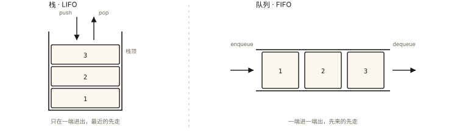

# 前端算法之栈与队列

## 从「浏览器的前进后退是道算法题」说起

```
浏览器历史 = 两个栈（XStack + FStack）：
  访问新页: push X，清空 F            ← 「前进」被新访问作废 ⭐
  后退:     X pop → F push
  前进:     F pop → X push
—— 你每天都在用的功能，就是栈的经典建模 ⭐
```

⭐⭐ 栈与队列是「受限的线性结构」——**限制产生秩序，秩序产生算法**。本篇：两结构的心智、单调栈这个大招、以及它们在前端的密集化身。

## 现象与直觉解释



*图 · 差别只有一个：开口在一边还是两边*

```
栈（LIFO 后进先出）: 只在一端进出 —— "撤销/嵌套/回溯"的世界
  push/pop/peek     O(1)
队列（FIFO 先进先出）: 两端各司其职 —— "排队/公平/层序"的世界
  enqueue/dequeue    O(1)
双端队列 Deque: 两端都能进出（滑动窗口最大值的引擎）
```

**一句话选型**：需要「最近的先处理」用栈；需要「先来先处理/逐层扩散」用队列。

## 深入原理

### 一、栈的三大招牌题型 ⭐⭐⭐

**① 括号匹配（LC 20）——栈的定义级应用**：

```js
function isValid(s) {
  const pairs = { ')': '(', ']': '[', '}': '[' };
  const stack = [];
  for (const c of s) {
    if (c === '(' || c === '[' || c === '{') stack.push(c);
    else if (stack.pop() !== pairs[c]) return false;  // 右括号必须配最近的左 ⭐
  }
  return stack.length === 0;   // 别漏：残留左括号也非法
}
```

**② 有效的括号进阶：去嵌套/最小删除（栈 + 计数）**；**函数调用栈本身就是栈**（js-deep-001 的执行上下文栈——递归=语言内置的栈 ⭐）。

**③ 单调栈：下一个更大元素（LC 739 每日温度）⭐⭐⭐**：

```js
// 每日温度: 之后哪天更暖 —— O(n²) 暴力 → 单调栈 O(n)
function dailyTemperatures(T) {
  const ans = Array(T.length).fill(0);
  const stack = [];                       // 存下标，温度单调递减 ⭐
  for (let i = 0; i < T.length; i++) {
    while (stack.length && T[i] > T[stack.at(-1)]) {
      const j = stack.pop();              // i 是 j 的"下一个更大"
      ans[j] = i - j;
    }
    stack.push(i);                        // 维持栈内单调递减
  }
  return ans;
}
// 单调栈心法: 「排队等答案的人，一旦遇到比它强的就结算」⭐
// 同族: 下一个更大元素 │ 柱状图最大矩形(LC84, 两端哨兵) │ 股票跨度
```

### 二、队列的两大应用 ⭐⭐

**① BFS 层序遍历（algorithm-006 树篇的主角，此处立框架）**：

```js
function bfs(root) {
  if (!root) return [];
  const queue = [root], result = [];
  while (queue.length) {
    const levelSize = queue.length;          // ⭐ 固定本层快照
    const level = [];
    for (let i = 0; i < levelSize; i++) {
      const node = queue.shift();            // 出队（JS 数组 shift 是 O(n)——
      level.push(node.val);                  //  大量数据用指针头模拟 ⚠️）
      node.left && queue.push(node.left);
      node.right && queue.push(node.right);
    }
    result.push(level);
  }
  return result;
}
```

**② JS 里没有真队列：数组模拟的三种姿势 ⭐**：

```js
// A. shift（简易）：O(n) 出队 —— 小数据无所谓
// B. 指针头（进阶）⭐: 出队只是 head++，均摊 O(1)
const q = []; let head = 0;
q.push(a); q.push(b);
const front = q[head++];              // "逻辑出队"
if (head === q.length) { q.length = 0; head = 0; }  // 偶尔回收
// C. 真结构: new Queue()（ES2025 TypedArray 之外可用链表手写）
```

### 三、栈与队列互相实现（考底层理解）⭐⭐

```js
// 两栈实现队列（LC 232）: inStack 收，outStack 出
// 倒水模型: outStack 空了才把 inStack 全倒过去 ⭐
class MyQueue {
  #in = []; #out = [];
  push(x) { this.#in.push(x); }
  pop() {
    if (!this.#out.length) {
      while (this.#in.length) this.#out.push(this.#in.pop()); // 倒水(逆序两次=正序)
    }
    return this.#out.pop();
  }
  peek() { this.pop(); return this.#out.at(-1); } // 简化示意
}
// 均摊 O(1): 每个元素一生只倒一次 ⭐（algorithm-001 均摊的教科书案例）
```

### 四、前端化身清单 ⭐⭐

```
栈: 浏览器历史 │ 撤销栈(编辑器) │ 递归调用栈 │
   JSX/HTML 解析的标签匹配 │ 表达式求值(计算器类题) │ DFS
队列: 事件循环的任务队列(js-async-005) ⭐ │ BFS │
   消息/弹幕排队 │ 背压限流(performance的pending队列)
双端: 滑动窗口最大值(LC239, 单调双端队列)
```

## 回看开篇

前进后退的两栈建模展示了「限制的力量」：栈只允许顶端进出，恰好匹配「后退到最近历史」的语义——**数据结构不是发明，是对问题语义的精准映射**；浏览器把它用在了你每天都摸的地方。

## 实战延伸

**1. 面试答题骨架**：「栈后进先出适合撤销、嵌套与回溯，队列先进先出适合排队公平与层序扩散。括号匹配是栈的定义级应用——右括号必须配最近的左括号；单调栈解决下一个更大元素类问题，栈内保持单调，新元素把可结算者依次弹出，均摊线性。BFS 用队列配合每层长度快照实现层序遍历，JS 中大量出队应用指针头模拟避免 shift 的线性开销；两栈实现队列利用倒水模型，输出栈空时才整体转移，每个元素一生倒一次均摊常数。前端世界中执行上下文栈、事件循环队列、浏览器历史、撤销栈都是这两种结构的化身。」

## 图解总结

```
栈(LIFO): 撤销 │ 嵌套(括号) │ 递归 │ DFS
  单调栈: 栈内单调(如下标温度递减) │ 新来者结算"等答案的人" ⭐
         每日温度/柱状图最大矩形 O(n)
队列(FIFO): 层序BFS │ 任务队列 │ 公平调度
  JS队列: head指针模拟(均摊O(1)) ⭐ │ shift的O(n)陷阱
互化: 双栈队列=倒水(out空才倒) 均摊O(1)
前端: 调用栈│事件循环│浏览器历史│撤销栈 —— 受限结构的秩序红利
```

## 总结

- 栈匹配「最近优先」语义：括号、撤销、递归、DFS；
- 单调栈：栈内保单调，新元素结算等待者——下一个更大类问题 O(n)；
- 队列匹配「先来优先」：BFS、任务队列；JS 用 head 指针模拟；
- 双栈队列的倒水模型均摊 O(1)；
- 执行栈、事件循环、历史栈——结构就在身边。

**面试一句话回答**：栈是后进先出的受限结构，天然匹配撤销、嵌套与回溯语义——括号匹配中右括号必须配最近的左括号正是栈的定义级应用；单调栈是其高阶形态，栈内维护单调性，每个新元素把栈中可结算的元素依次弹出并得到答案，以均摊线性解决下一个更大元素、柱状图最大矩形这类问题。队列先进先出，适合公平排队与层序扩散，BFS 以队列配合每层长度快照实现层序遍历；JavaScript 中大量出队场景用指针头模拟以避免 shift 的线性开销。两栈实现队列利用倒水模型，输出栈为空时才整体转移输入栈元素，每个元素一生只倒一次从而均摊常数。浏览器历史、递归调用栈、事件循环任务队列都是这两种结构的前端化身。

## 思考题

1. 用栈实现计算器（+−×÷ 与括号）：数字栈+运算符栈的优先级结算——写出骨架。
2. 滑动窗口最大值（LC 239）为什么必须用「双端」单调队列？（两端都要弹出：右端出小者、左端出过期者 ⭐）
3. 「合法出栈序列」判定题：给入栈顺序问某出栈顺序是否可能——模拟法怎么写？
4. 开放实战：实现带「优先级插队」的任务队列（正常排队 + 紧急置顶）——两个队列的组合设计。

（思考题解析将同步录入小程序题库，关联本文 id：algorithm-004）

## 参考文献：

- LeetCode 20/232/739/239（本篇题单）
- 《数据结构与算法分析》栈与队列章节
- 本课程《js-deep-001 执行上下文栈》《js-async-005 事件循环》（结构的真身）
