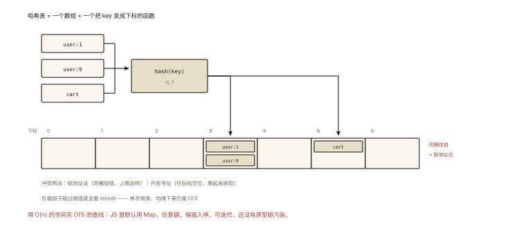

# 前端算法之哈希表

## 从「面试官的口头禅：能不能用哈希优化一下」说起

```
你写完 O(n²) → 面试官: "能优化吗?"
你沉默     → 面试官: "空间换时间了解一下?"
—— 90% 的场景，他心里想的就是哈希 ⭐
```

⭐⭐⭐ 哈希是「降维打击器」：把 O(n²) 的查找砍到 O(1)。它也是前端最熟悉的结构（对象/Map 天天用）——本篇把它从「会用」讲到「会考」。

## 现象与直觉解释



*图 · 两个 key 算到同一个下标，就是冲突的全部由来*

```
哈希表 = 数组 + 哈希函数
  key ──hash()──▶ 下标 ──▶ 桶里取值     平均 O(1)
  冲突: 链地址法(同桶挂链) │ 开放寻址(向后找位)
  扩容: 负载因子超阈值 → 全量 rehash（均摊 O(1)，algorithm-001）

JS 的两个哈希现成品:
  普通对象: 键限字符串/symbol（es6-007 的对照）
  Map:      键任意类型 │ 保持插入序 │ 直接可迭代 ⭐ 算法题默认用 Map
```

**一句话：哈希用 O(n) 空间买 O(1) 查找——「查过的存起来」**。

## 深入原理：四大题型

### 题型①：查找配对——两数之和（LC 1）⭐⭐⭐

```js
// 暴力: 双循环找 nums[i]+nums[j]===target → O(n²)
// 哈希: 一遍扫，「我需要谁」记下来
function twoSum(nums, target) {
  const seen = new Map();                    // 值 → 下标
  for (let i = 0; i < nums.length; i++) {
    const need = target - nums[i];           // 我的另一半是多少
    if (seen.has(need)) return [seen.get(need), i];  // 前面出现过 ⭐
    seen.set(nums[i], i);                    // 登记"我到过"
  }
}
// O(n): 每个"找配对"的查询 O(1) —— 哈希题的祖师爷
// 变体: 三数之和(排序+对撞, LC15 —— 哈希反而不优 ⚠️) │ 四数相加II(LC454, 分组哈希)
```

### 题型②：分组/计数——O(n log n) 排序的杀手 ⭐⭐⭐

```js
// 字母异位词分组（LC 49）: eat/tea/nate → 同组
function groupAnagrams(strs) {
  const groups = new Map();
  for (const s of strs) {
    const key = [...s].sort().join('');      // 排序后的形态作"指纹" ⭐
    (groups.get(key) ?? groups.set(key, []).get(key)).push(s);
  }
  return [...groups.values()];
}
// 更优指纹: 26 长度的计数串 "1,0,2,…" —— 免排序 O(n·L)
// 同族: 最多K个重复的最长子串 │ 出现频率最多的元素(桶排序思想)

// 计数模板: Map 拿"频次"
const freq = new Map();
for (const x of arr) freq.set(x, (freq.get(x) ?? 0) + 1);   // ⭐ 万用起手式
```

### 题型③：前缀和 + 哈希——子数组问题的降维 ⭐⭐⭐

```js
// 和为 K 的子数组个数（LC 560）: 暴力 O(n²) → 前缀和哈希 O(n)
function subarraySum(nums, k) {
  const count = new Map([[0, 1]]);     // 前缀和 0 出现 1 次(空前缀) ⭐ 易漏!
  let sum = 0, ans = 0;
  for (const x of nums) {
    sum += x;                          // prefix[i]
    ans += count.get(sum - k) ?? 0;    // 之前有几段前缀 = sum-k，就有几个解 ⭐
    count.set(sum, (count.get(sum) ?? 0) + 1);
  }
  return ans;
}
// 核心: 子数组和(i..j) = prefix[j] - prefix[i-1]
//      "找和为k的子数组" = "找两个前缀差为k" = "查表 sum-k 出现次数"
// 同族: 连续数组(LC525, 0/1 前缀差) │ 最长和谐子序列
```

### 题型④：设计题——哈希的组合拳 ⭐⭐

```
LRU 缓存(LC146, handwritten-012): 哈希定位 + 双向链表序 —— O(1) 四件套
O(1) 插入/删除/随机取(LC380): 数组(随机) + 哈希(定位) + 尾部交换删除 ⭐
  // 删除的O(1)技巧: 与末尾交换后 pop —— 哈希记"值→下标"
时间戳计数器 / 全O(1)结构: 双向链表分桶
「设计题 = 用哈希补齐另一个结构的"查找短板"」⭐
```

### 哈希的边界（什么时候别用）⭐⭐

```
✘ 需要有序遍历/范围查询 → 排序数组/树（哈希无序）
✘ 三数之和类"去重组合" → 排序+双指针更好写（哈希去重麻烦）
✘ 键不可哈希（对象引用键的 Map——序列化当键有正确性风险）
⚠️ 最坏情况 O(n)（全冲突）—— 面试提一句链地址与负载因子即加分
```

## 回看开篇

「空间换时间」的应答模板：哈希把「向后找配对/找同组/找差值」变成「查一次表」——两数之和存「值→下标」、异位词存「指纹→组」、子数组和存「前缀和→次数」。**识别信号：题目出现「找配对 / 分组 / 子数组计数」时，先问自己「查过的能不能存起来」**。

## 实战延伸

**1. 面试答题骨架**：「哈希表用数组加哈希函数实现 O(1) 平均查找，冲突用链地址或开放寻址解决，扩容按负载因子整体 rehash、均摊常数。算法上四大题型——查找配对如两数之和，边遍历边把值到下标存表，查 target 与当前值的差；分组与计数用键做指纹，排序串或计数串归组，频次 Map 是万能起手式；前缀和加哈希解决子数组和计数，利用前缀差等于 k 转化为查表，注意空前缀的计数初始化；设计题里哈希负责补齐其他结构的查找短板，如 LRU 的哈希定位加双向链表序、O(1) 随机结构的数组加哈希加尾部交换删除。边界是无序、范围查询与去重组合场景。」

## 图解总结

```
哈希 = 空间换时间: 查找 O(n)→O(1)（"查过的存起来"）
JS: Map(任意键/插入序/可迭代) 为默认 ⭐ │ 对象=字符串键的特例

四大题型:
 ①配对: 两数之和 —— 存"值→下标"，查 target-x
 ②分组/计数: 指纹键(排序串/计数串) │ freq Map 万用起手式
 ③前缀和+哈希: 子数组和 → 前缀差 → 查表次数([0,1]初始化⚠️)
 ④设计: LRU(哈希定位+链表序) │ O(1)随机(数组+哈希+尾交换删)
边界: 要有序/范围/组合去重 → 排序/双指针/树
```

## 总结

- 哈希=空间换时间；Map 是算法题默认容器；
- 配对问题：边扫边存，查「我需要的差」；
- 分组：指纹做键（排序串/计数串）；频次 Map 是起手式；
- 前缀和+哈希：子数组计数转查表，空前缀初始化别漏；
- 设计题：哈希补查找短板；有序/范围/组合去重慎用哈希。

**面试一句话回答**：哈希表通过哈希函数把键映射到数组下标，实现平均常数时间的查找，冲突以链地址法或开放寻址处理，扩容在负载因子超限时整体重哈希、代价均摊。典型应用四大类：查找配对如两数之和，遍历时把已见值存入哈希、查询目标差值；分组与计数以指纹为键——异位词用排序串或计数串归组，频率统计用 Map 累加；前缀和配合哈希解决子数组和的计数，利用区间和等于两前缀之差，把问题转为查询前缀和出现次数，并以空前缀初始化；设计题中哈希负责补齐结构的查找短板，如 LRU 用哈希定位加双向链表维护序、常数随机结构用数组加哈希配合尾部交换删除。需要有序遍历、范围查询或组合去重时哈希不是最优选择。

## 思考题

1. 两数之和的「有序数组版」（LC167）为什么官方解是双指针而不是哈希？（有序性提供了对撞的单调性——比哈希更省空间，两类解的选型辨析 ⭐）
2. 手写 `RandomizedSet`：insert/remove/getRandom 全 O(1)——数组+哈希+尾部交换的完整实现。
3. 「最长连续序列」（LC128）要求 O(n)：哈希 Set 的「只从序列起点开始数」技巧。
4. 开放实战：埋点事件流实时统计「最近 1 小时每个页面的 UV」——哈希+滑窗/环形桶的工程化设计。

（思考题解析将同步录入小程序题库，关联本文 id：algorithm-005）

## 参考文献：

- LeetCode 1/49/560/146/380（本篇题单）
- 《算法（第 4 版）》散列表章节
- 本课程《es6-007 Map》《handwritten-012 LRU》《algorithm-002 双指针》（选型三角）
