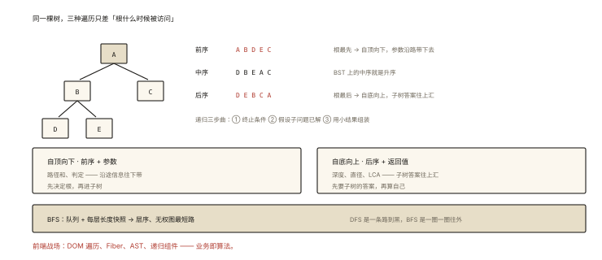

# 前端算法之树与 DFS/BFS

## 从「你每天都在遍历树」说起

```
document 是一棵树（DOM）
虚拟 DOM 是树（handwritten-008）
组件树是树（react-002 / vue-004）
浏览器书签、组织架构、评论楼层、文件目录——全是树
—— 前端工程师 80% 的结构处理，本质是「树的遍历与变换」⭐⭐
```

⭐⭐⭐ 树是递归结构的化身：**每棵子树都是一棵树**——因此递归是母语，DFS/BFS 是两条方言。本篇：遍历四式、路径类题模板、递归思维心法。

## 现象与直觉解释

```
DFS 深度优先: 一条路走到黑再回头 —— 递归/栈 —— "找路径/找深度/判定"
BFS 广度优先: 一层一层扩散 —— 队列 —— "最短步数/层序/最近"
二叉搜索树(BST): 左<根<右 —— 中序遍历=有序 ⭐（js-deep-009 原型链查找的远亲）
```

## 深入原理

### 一、遍历四式与递归心法 ⭐⭐⭐

```js
// 递归三步曲（万物皆可套的心法 ⭐）:
// ① 终止条件（叶子/空树）
// ② 假设子问题已解决（递归调用拿到子树结果）
// ③ 用子结果组装当前答案

// 前/中/后序 —— "根"在什么时候被访问:
const traverse = (node) => {
  if (!node) return;            // ①
  /* 前序位 */ traverse(node.left);   // ②
  /* 中序位 */ traverse(node.right);
  /* 后序位 */
};
// 前: 复制树/序列化 │ 中: BST有序化 │ 后: 求高度/自底向上汇总 ⭐
```

**「自顶向下 vs 自底向上」的选型**（递归题的第一分岔）⭐：

```js
// 自顶向下（前序，参数传"沿途信息"）: 路径总和
function hasPathSum(root, target) {
  if (!root) return false;
  if (!root.left && !root.right) return target === root.val;   // 叶子判定
  return hasPathSum(root.left, target - root.val)              // 沿途扣减
      || hasPathSum(root.right, target - root.val);
}

// 自底向上（后序，返回值是"子树答案"）: 最大深度 / 直径
function maxDepth(root) {
  if (!root) return 0;                                    // ①
  return 1 + Math.max(maxDepth(root.left), maxDepth(root.right)); // ②③
}
// 直径(LC543): 后序里"左深+右深"更新全局ans ⭐ —— 汇总类套路
```

### 二、BFS：层序与最短步 ⭐⭐⭐

```js
// 层序遍历（algorithm-004 的框架落地）
function levelOrder(root) {
  if (!root) return [];
  const q = [root], ans = [];
  while (q.length) {
    const size = q.length, level = [];
    for (let i = 0; i < size; i++) {
      const n = q.shift();
      level.push(n.val);
      n.left && q.push(n.left);
      n.right && q.push(n.right);
    }
    ans.push(level);
  }
  return ans;
}
// BFS 的王牌场景: 无权图最短路径（每层=走一步）⭐
// 例: 迷宫最短步数/单词接龙 —— DFS 找的是"一条路", BFS 找的是"最短路"
```

### 三、路径全家桶模板 ⭐⭐⭐

```js
// 二叉树的所有路径（回溯 = DFS + 撤销）:
function binaryTreePaths(root) {
  const ans = [], path = [];
  (function dfs(node) {
    if (!node) return;
    path.push(node.val);
    if (!node.left && !node.right) ans.push(path.join('->'));   // 叶子收答案
    else { dfs(node.left); dfs(node.right); }
    path.pop();                  // ⭐ 回溯: 撤销选择（换兄弟分支）
  })(root);
  return ans;
}
// 回溯心法: 「进(选择) → 递 → 退(撤销)」三连 —— 与算法007 DP 的分水岭
```

### 四、判定型与构造型 ⭐⭐

```js
// 对称二叉树: 递归比较 (l.left,r.right) 与 (l.right,r.left) —— 镜像同时走
// 翻转二叉树: root.left = invert(root.right)（后序思想，一遍过）
// 从前序+中序构造: 前序首元素=根 → 中序定位 → 分治递归 ⭐
// 最近公共祖先 LCA: 左右子树都找到 → 当前即答案（后序汇总的经典 ⭐）
```

### 五、DOM 树实战（前端的树战场）⭐⭐

```js
// 遍历 DOM: 递归版（children 递归）
function walkDom(root, fn) {
  fn(root);
  for (const child of root.children) walkDom(child, fn);   // 前序
}
// 查找包含某文本的最深节点: 自底向上返回命中深度（后序）
// 组件树深度 / 首屏渲染层级 —— BFS
// React 递归组件 / Vue 递归插槽 —— 递归三步曲的业务版 ⭐
// ⚠️ 超深 DOM 递归有爆栈风险 → 显式栈迭代版（虚拟列表变高版同理）
```

## 回看开篇

「每天遍历树」的机制版：DOM 的 `querySelectorAll`  internals、React 的 Fiber 遍历、Vue 模板的 AST（handwritten-010 的 parse）——底层全是 DFS/BFS 的变体。**树的题海看似庞大，其实只有两问：子问题怎么拆（自顶/自底）、答案在哪收集（路径/汇总）**。

## 实战延伸

**1. 面试答题骨架**：「树是递归结构，递归三步曲是终止条件、假设子问题已解、用子结果组装答案。前中后序的差别在根的访问时机——自顶向下的问题（路径和）用前序带沿途参数，自底向上的问题（深度、直径）用后序返回子树答案并在节点处汇总。BFS 用队列按层扩散，配每层长度快照得层序，其王牌是无权图最短路。路径收集类题目用回溯：选择、递归、撤销三连。经典构造如前序加中序重建树、LCA 的后序判定都是分治思想的落点。DOM 与组件树的操作即同一套遍历的业务化。」

## 图解总结



*图 · 三种遍历的差别只有一句：根排在第几个*

```
递归三步曲: ①终止 ②假设子问题已解 ③组装 ⭐
DFS(递归/栈): 一条路到黑
  自顶向下(前序+参数): 路径和/判定 —— "沿途信息往下带"
  自底向上(后序+返回值): 深度/直径/LCA —— "子树答案往上汇" ⭐
  回溯: 进→递→退（路径收集类）
BFS(队列): 层层扩散 —— 层序 │ 无权图最短路 ⭐
BST: 中序=有序 │ 前序+中序=重建
前端战场: DOM遍历 │ Fiber │ AST │ 递归组件 —— 业务即算法
```

## 总结

- 递归三步曲 + 自顶/自底的分岔选型是树题总纲；
- 前序带参（路径和）、后序汇值（深度/直径/LCA）；
- BFS=队列+层快照；王牌是无权图最短路；
- 回溯三连：选择→递归→撤销；
- DOM/组件树/Fiber/AST 是同一套遍历的前端化身。

**面试一句话回答**：树的核心是递归三步曲——确定终止条件、假设子问题已经解决、用子问题的结果组装当前答案。前中后序的差别只是根节点被访问的时机：自顶向下的问题如路径总和用前序、把沿途信息作为参数下传并在叶子处判定；自底向上的问题如最大深度、直径与最近公共祖先用后序、以返回值汇总左右子树答案。广度优先用队列按层扩散，配合每层长度快照得到层序遍历，其不可替代的场景是求无权图或状态图的最短步数。路径收集类用回溯：进入时做选择、递归、返回时撤销。从前序与中序重建二叉树、镜像判定都是分治的典型。DOM 遍历、组件树递归、AST 处理都是这套算法的前端业务化。

## 思考题

1. 写出「二叉树的右视图」（BFS 取每层最后 / DFS 带深度参数）——两种解法对照。
2. DOM 的 `querySelector` 深度优先还是广度优先？为什么超深页面它可能慢？
3. LCA（LC236）为什么必须后序？（答案依赖左右子树的查找结果——自底向上）
4. 开放实战：实现「组件树渲染耗时统计」——DFS 递归收集每个子树耗时（后序汇总），输出热点路径 Top5。

（思考题解析将同步录入小程序题库，关联本文 id：algorithm-006）

## 参考文献：

- LeetCode 104/102/112/543/236（本篇题单）
- 《算法（第 4 版）》树章节
- 本课程《dom-events-001 DOM 树》《handwritten-010 模板编译 AST》《algorithm-004 栈队列》
