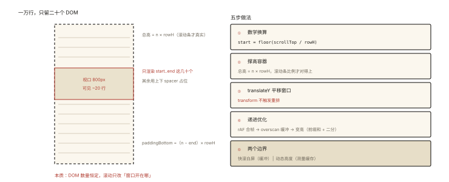
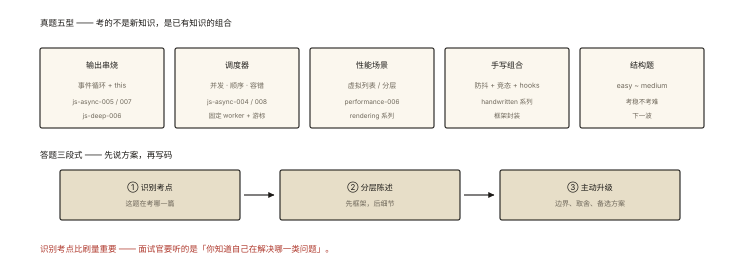

# 前端算法之大厂真题解析（一）

## 大厂前端算法的真实画风（先校准预期）

> 系列收官两连：各选五道有代表性的真题风格，逐题给「考点识别 → 思路 → 参考解 → 加分点」。

```
前端算法岗的真题分布（与后端岗的显著差异 ⭐）:
  ① 异步/事件循环输出题（30%）—— js-async 系列的主场
  ② 手写函数/调度类（25%）—— algorithm-008 的主场
  ③ 数据结构题（25%）—— 双指针/哈希/树的中低难度 LeetCode
  ④ 场景建模题（20%）——「设计一个 xxx」
—— 难度大多在 LeetCode easy~medium; 考的是"稳"而不是"难" ⭐
```

## 真题一（字节·高频）：事件循环 + 异步输出串烧 ⭐⭐⭐

```js
async function async1() {
  console.log('async1 start');
  await async2();
  console.log('async1 end');
}
async function async2() { console.log('async2'); }

console.log('script start');
setTimeout(() => console.log('timeout'), 0);
async1();
new Promise((resolve) => { console.log('promise1'); resolve(); })
  .then(() => console.log('promise2'));
console.log('script end');
```

**考点识别**：js-async-005/007 的合体——async 脱糖、微任务顺序、await 恢复时机。

**推演（三步法）**：同步段依次执行（script start → async1 start → async2 → promise1 → script end）；async1 的恢复与 then 回调按「入队时机+让位一层」排微任务（async1 end、promise2）；宏任务最后（timeout）。

**答案**：`script start / async1 start / async2 / promise1 / script end / async1 end / promise2 / timeout`

**加分点**：说出「await 的恢复回调比后注册的 then 多让一个微任务层级」的规范依据（js-async-007）。

## 真题二（腾讯·高频）：JS 实现一个带并发限制的批量请求 ⭐⭐⭐

```
题面: 有 100 个 url，要求任意时刻最多并发 6 个请求，
     全部完成后按【原始顺序】返回结果数组；失败不中断整体（该位为 null）。
```

**考点识别**：js-async-004 调度器 + 顺序归位 + 失败容错——algorithm-008 题③的完整体。

```js
async function loadAll(urls, limit = 6) {
  const results = new Array(urls.length).fill(null);
  let next = 0;
  async function worker() {
    while (next < urls.length) {
      const i = next++;
      try { results[i] = await fetch(urls[i]).then((r) => r.text()); }
      catch { results[i] = null; }             // 失败不中断 ⭐
    }
  }
  await Promise.all(Array.from({ length: limit }, worker));
  return results;
}
```

**加分点**：①主动说明「按下标归位」解决顺序问题；②提「失败重试 + 指数退避」的升级（js-async-008）；③问清「失败语义」再动手（产品要 null 还是要 throw——沟通意识 ⭐）。

## 真题三（阿里·经典）：虚拟列表实现 ⭐⭐⭐

```
题面: 实现万级数据的滚动列表，要求滚动流畅；说出你的优化分层。
```

**考点识别**：performance-006 的机制 + 分层陈述能力。

**答题骨架（先讲分层再写码）**：



*图 · 左边是「一万行只留二十个 DOM」的空间账，右边是五步做法与两个边界*

```
① 只渲染可视区（数学换算：start = floor(scrollTop/rowH)，DOM 恒定 ~30 个）
② 撑高容器（总高 = n × rowH，滚动条真实）
③ translateY 平移渲染窗口（transform 不触发重排 ⭐）
④ 递进优化: rAF 合帧节流 → overscan 缓冲 → 定高到变高（前缀和+二分）
⑤ 边界: 快速滚动的白屏（缓冲）│ 动态内容高度（测量缓存）
```

**加分点**：主动对比「content-visibility: auto 的免 JS 方案及边界」；说出「与 React/Vue 集成时的组件化形态」。

## 真题四（美团·输出题）：this 与闭包串烧 ⭐⭐

```js
var name = 'window';
const obj = {
  name: 'obj',
  getName() { return () => this.name; },
};
const fn = obj.getName();
console.log(fn());                  // 'obj'（箭头继承 getName 的 this ⭐）
console.log(obj.getName()());       // 'obj'
console.log((0, obj.getName)()());  // 'window'（逗号表达式退化 → 默认绑定 ⭐）
```

**考点识别**：js-deep-006/007 的组合——隐式绑定、箭头词法 this、逗号表达式的引用脱钩。

**推演要点**：`obj.getName()` 的 this=obj；内层箭头沿用；`(0, obj.getName)` 取出的是裸函数（逗号返回值即函数本身）→ 裸调用默认绑定。

**加分点**：解释「括号/逗号/赋值如何让引用脱钩」（js-deep-006 实战延伸的顶级变体）。

## 真题五（快手·场景题）：实现一个防抖搜索（完整链路）⭐⭐

```
题面: 输入框搜索：防抖 300ms、请求竞态治理、失败兜底、loading 态。
     用「hooks/composable」的形态交付。
```

**考点识别**：handwritten-005 + js-async-008 + 框架封装——三篇的组装题。

```js
function useSearch(fetcher, delay = 300) {
  const keyword = ref('');
  const results = ref([]);
  const loading = ref(false);

  watch(keyword, debounce(async (kw) => {      // 防抖（handwritten-005）
    loading.value = true;
    try { results.value = await fetcher(kw); } // 竞态: fetcher 内部带 AbortController
    finally { loading.value = false; }         // 兜底: finally 复位 ⭐
  }, delay));

  return { keyword, results, loading };
}
// React 版: useCallback 包 debounce + useEffect 清理（react-005 的 cleanup）
```

**加分点**：说出「竞态三选一」（序号守卫/abort/once 包装）并解释选型；提「空关键词不发请求」的短路。

## 真题的共性总结 ⭐⭐

```
五道题的考点全部来自课程已有篇目:
  输出题 ← js-async-005/007 + js-deep-006
  调度题 ← js-async-004/008
  性能题 ← performance-006 + rendering 系列陈述
  组合题 ← handwritten 系列 × 框架封装
—— 大厂前端算法不考"新知识"，考"已有知识的组合与陈述分层" ⭐⭐
```

## 图解总结



*图 · 五型是题库，三段式是答法*

```
真题五型: 输出串烧(事件循环+this) │ 调度器(并发+顺序+容错) │
         性能场景(虚拟列表/优化分层) │ 手写组合(防抖+竞态+hooks) │ 结构题(下一波)

答题三段式: ①识别考点(对应知识篇目) ②分层陈述(先框架后细节) ③主动升级(边界/取舍)
            —— "先说方案再写码"是大厂面试的隐形规则 ⭐
```

## 总结

- 大厂前端算法：easy~medium 为主，考稳不考难；
- 输出题三步法：同步段、微任务序、宏任务殿后；
- 调度题三件套：并发限制、顺序归位、失败容错；
- 场景题先分层陈述再写码，主动对比备选方案；
- 真题是课程知识的组合考核——识别考点比刷量更重要。

**面试一句话回答**：大厂前端算法题的主流是中等及以下难度，考的是稳定性与知识组合。事件循环输出题按同步段、微任务队列、宏任务三步推演，注意 async 函数的恢复回调让位一层微任务；并发批量请求题用固定 worker 配共享游标实现限流，结果按下标归位保证顺序，失败置空不中断整体并主动询问失败语义；虚拟列表题先分层陈述——只渲染可视区、撑高容器、transform 平移，再谈缓冲区与变高优化，并对比 content-visibility 方案边界；this 输出题围绕隐式绑定、箭头词法 this 与逗号表达式导致的引用脱钩推演；防抖搜索题展示防抖、竞态治理、失败兜底与 hooks 封装的组合。答题先识别考点、再分层陈述、最后主动升级边界，是通用的高分结构。

## 思考题

1. 真题一的变体：把 `async1()` 放进 `setTimeout` 里，输出如何变化？（整段平移进宏任务）
2. 真题二升级：要求「结果数组按完成顺序」而非原始顺序——改动一处即可（push 替代下标）？顺序语义的产品沟通点在哪？
3. 真题三追问：如果行高完全不可预估（聊天），你的「测量缓存+前缀和」方案怎么降级兜底？（预估高度+滚动锚定修正）
4. 开放演练：把真题五改成 React 版（useDeferredValue/abort controller/useEffect cleanup），对照两框架的心智差异。

（思考题解析将同步录入小程序题库，关联本文 id：algorithm-009）

## 参考文献：

- 本课程《js-async-004/005/007/008》《js-deep-006/007》《performance-006》《handwritten-005》（五道题的出处）
- LeetCode 与牛客网前端面经区（真题风格采样）
