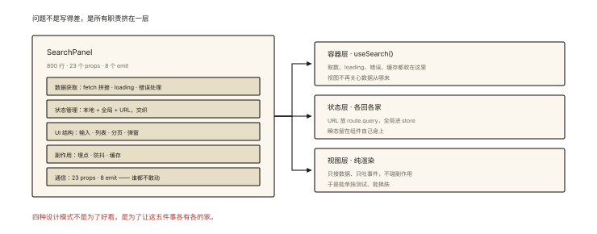
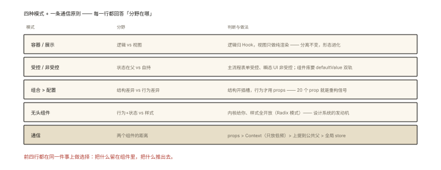

# 前端架构之组件设计模式

## 从「一个 800 行的 SearchPanel 组件」说起



*图 · 五个职责缠在一个文件里，谁都不敢动*

> **系列导读**：《前端架构系列》共 6 篇——组件设计、状态分层、微前端、Monorepo、监控体系与复杂页面权衡，从「写代码」上升到「做决策」。

```
某个"祖传"组件的解剖报告：
  SearchPanel.vue / .tsx —— 800 行
  ├ 数据获取（fetch 拼接、loading、错误处理）
  ├ 状态管理（本地的 + 全局的 + URL 的，交织）
  ├ UI 结构（输入、列表、分页、弹窗）
  ├ 副作用（埋点、防抖、缓存）
  └ 23 个 props、8 个 emit/回调 —— 谁都不敢动
```

它不是写得差，是**所有职责挤在一层**。⭐⭐ 本篇讲组件层的四个经典模式：职责分离（容器/展示）、数据流控制（受控/非受控）、复用形态（组合 vs 配置）、逻辑复用（无头化）。

## 深入原理

### 一、容器/展示分离（Container/Presentational）⭐⭐⭐

```
容器组件（Container）: 管「数据和逻辑」——取数、状态、副作用、事件处理
  ↓ props
展示组件（Presentational）: 管「长什么样」——接收数据、纯渲染、无副作用
```

```jsx
// 容器：一切"脏活"
function UserListContainer() {
  const { data, loading, error, retry } = useUsers();   // 数据获取 Hook
  const { selected, toggle } = useSelection();
  return <UserListView users={data} loading={loading}
                        selected={selected} onSelect={toggle} onRetry={retry} />;
}

// 展示：纯函数式的好测好换肤
function UserListView({ users, loading, selected, onSelect, onRetry }) {
  if (loading) return <Skeleton />;
  return <ul>{users.map((u) => <UserRow key={u.id} active={u.id === selected} onClick={() => onSelect(u.id)} />)}</ul>;
}
```

**收益清单**：展示层可脱离接口开发/测试/换肤（Storybook 的黄金搭档）；容器层可替换数据源（mock/GraphQL）而不动 UI。**注意**：Hooks 时代这条线变柔（自定义 Hook 吸收了容器的多数职责）——**「逻辑与视图分离」的思想不变，实现从「组件分层」进化为「Hook + 展示组件」**。

### 二、受控 vs 非受控：数据流的两份合同 ⭐⭐⭐

```jsx
// 非受控（组件自持状态）—— 用得省心，外部难介入
<Input defaultValue="hi" onChange={(v) => …} />        // 内部状态 + 通知
const value = ref.current?.getValue();                  // 需要时"问"

// 受控（状态在父级）—— 一切尽在掌握，写起来啰嗦
<Input value={value} onChange={(v) => setValue(v)} />   // 父是唯一事实源 ⭐

// 混合形态（现代组件库标配）：defaultValue/value 双轨 ⭐
<Input defaultValue="a" />        // 不传 value → 非受控
<Input value={v} onChange={…} />  // 传 value → 受控（警告：受控必须配 onChange）
```

**设计守则**：

```
选受控: 值需要被外部读写/校验/联动（表单主流程）
选非受控: 纯内部瞬态（下拉开合、hover 态）—— 别把所有状态都上提！
反模式: "伪受控"（传了 value 又不接 onChange → 输入框打不了字 ⭐ 经典 bug）
```

### 三、组合优于配置（Composition over Configuration）⭐⭐⭐

```jsx
// ❌ 配置爆炸型 API：每加一种槽位就加一个 prop
<Card title="…" subtitle="…" cover="…" tags={[…]} actions={[…]} extra="…" footer="…" />

// ✅ 组合型 API（组件即插槽 —— 20 个 prop 化为自然嵌套）
<Card>
  <Card.Cover src={…} />
  <Card.Header title="…" extra={<MoreMenu />} />
  <Card.Body>{content}</Card.Body>
  <Card.Footer><Pagination /></Card.Footer>
</Card>
```

**判据**：内容的「结构差异」用组合（子组件自由拼装）；只有「行为差异」才用 props 配置（disabled/size/type）。React 的 children、Vue 的 slot 是同一思想的两个方言——**把扩展点开在「结构层」而不是「参数层」**。

### 四、无头组件（Headless）与逻辑复用的进化 ⭐⭐⭐

```
逻辑复用的三代进化：
  mixin（来源不明，已淘汰）→ HOC（套娃地狱）→ Hooks/Composables（当下主流 vue-008）
无头组件 = Hook 思想的「组件级完成体」：
  只提供【行为与状态】（开关、键盘导航、ARIA），不提供任何样式 —— 样式完全归你
```

```jsx
// useSwitch 的无头化：行为全给你，长相全不管
const { isOpen, open, close, toggle, getTriggerProps, getMenuProps } = useDropdown();

<button {...getTriggerProps()}>点我</button>     {/* 带键盘/ARIA 的完整行为 */}
<ul {...getMenuProps()} className="我的样式">{items}</ul>

// 工业代表: Radix UI / Headless UI / TanStack Table —— 设计系统的"发动机"层
```

**无头 vs 组件库**：组件库给你「行为+样式」（快但难改）；无头给你「行为」（自担样式成本，换取设计自由）——设计体系成熟的团队走向「无头内核 + 自研皮肤」。

### 五、组件通信的四条正道（规模守则）⭐⭐

```
父子: props/emit（永远的首选）
跨层: provide/inject、Context —— 但 Context 只放"低频变化"的值（主题/鉴权）
      ⚠️ 高频值会导致大范围重渲染（react-008）
兄弟: 状态上提到最近公共父 —— "状态该放哪"的默认答案
全局: 状态管理（architecture-002 的分层世界）
```

## 回看开篇

800 行 SearchPanel 的解剖与重组：数据逻辑抽成 useSearch Hook（容器职责函数化）、UI 拆成 SearchInput/ResultList/Pagination（展示层）、联动状态上提或入 store、埋点等副作用收进 Hook 的 effect——**每个模式都在回答同一个问题：「这段代码的职责是什么，它该住在哪一层」**。

## 实战延伸

**1. 面试答题骨架**：「组件设计四大模式——容器与展示分离让数据逻辑与视图解耦，Hooks 时代以自定义 Hook 承接容器职责；受控与非受控是数据流合同，表单主流程用受控、瞬态 UI 用非受控，组件库应提供 defaultValue/value 双轨；组合优于配置，结构差异开插槽（children/slot）、行为差异才用 props，避免 prop 无限膨胀；无头组件把行为与状态做成可复用内核、样式完全开放，是设计系统的发动机。通信按距离选通道：父子 props、跨层 Context（仅低频值）、兄弟上提状态、全局进状态管理。」

**2. 一道设计题**：给「可编辑表格」设计组件 API——受控的 value/onChange（行数据）、组合型的列定义（Table.Column 的 children 或配置）、无头的核心逻辑（useEditableTable）——三个模式一题打尽。

## 图解总结



*图 · 四种模式 + 一条通信原则，每一行都在回答「分野在哪」*

```
容器/展示: 逻辑(容器→Hook化) │ 视图(纯展示) —— 分离不变、形态进化
受控/非受控: 状态在父(主流程表单) │ 组件自持(瞬态) │ 双轨 defaultValue/value
组合>配置: 结构差异→插槽 │ 行为差异→props │ 20个prop=重构信号
无头: 行为+状态全给你，样式全开放（Radix 模式）← 设计系统内核
通信: props > Context(低频) > 状态上提 > 全局store —— 按距离就近
```

## 总结

- 容器/展示分离：逻辑与视图解耦，Hook 是现代容器形态；
- 受控管主流程、非受控管瞬态；伪受控是经典 bug 源；
- 组合优于配置：结构开插槽、行为用 props；
- 无头组件：行为内核+样式自由，设计系统的发动机；
- 通信按距离选道：props → Context（低频）→ 上提 → 全局。

**面试一句话回答**：组件设计的第一原则是职责分离——数据获取、状态与副作用归容器（Hooks 时代由自定义 Hook 承接），展示组件只接收数据做纯渲染，从而可独立测试与换肤。数据流上受控组件由父级持有状态、适合需要校验联动的表单主流程，非受控组件自持瞬态状态如下拉开合，成熟组件库提供 defaultValue 与 value 双轨 API。复用设计遵循组合优于配置——结构上的差异用插槽与 children 表达、只有行为差异才用 props，避免配置项无限膨胀；无头组件则把交互行为、键盘导航与可访问性封装成不包含样式的内核，样式完全交由使用方，成为设计系统的发动机。组件通信按距离选择：父子用 props，跨层用 Context 且只放低频变化值，兄弟状态上提最近公共父，全局状态进状态管理。

## 思考题

1. 把课程中的 useSearch（vue-008/react-005 均有）升级为无头组件 useSearchBox：返回 triggerProps 与 resultProps 的完整行为集——列出 API。
2. 「Context 放了高频更新的 state 导致全树重渲染」——用 react-008 的知识拆分 Context（拆为 state/dispatch 两个 context）。
3. 受控表格的「编辑态行」设计：整表受控 vs 行内受控 vs 临时编辑副本提交——三种的 undo/多人协作成本对比。
4. 开放讨论：你们的组件库要不要「双轨 API」？维护成本（两套代码路径）vs 使用者自由的权衡表。

（思考题解析将同步录入小程序题库，关联本文 id：architecture-001）

## 参考文献：

- Dan Abramov — Presentational and Container Components（原始论文级博文）
- Radix UI / Headless UI 文档（无头模式的工业范本）
- 本课程《vue-008 组合式 API》《react-008 性能优化》《architecture-002 状态分层》
