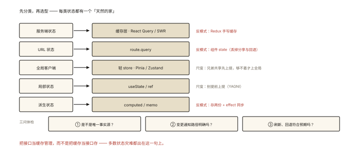

# 前端架构之状态管理的架构思考

## 从「所有状态都塞进 Vuex/Redux」的黄金时代谬误说起

```
2018 年的"标准答案"：一切状态进 store（包括接口数据、URL、表单临时输入）
2024+ 的现实：store 里的接口缓存成了"第二后端"——
  手写 loading/error/缓存失效/分页去重/竞态…… 累死且bug多
```

⭐⭐⭐ 现代状态管理的核心思想是**「先分类，再选型」**——状态不是一种东西，是五种东西。本篇给出分类框架与对位工具，这是架构层最重要的一张决策表。

## 现象与直觉解释

**五类状态分野**（按「谁拥有、活多久、怎么变」划分）：

```
① 服务端状态（Server State）: 数据的真身在服务器 —— 前端只是"缓存视图"
   订单列表、用户信息、搜索结果
② URL 状态（URL State）: 应该随链接走的 —— 刷新/分享后还在
   筛选条件、分页、tab、排序
③ 全局客户端状态: 真正"应用级"的、与服务器无关的
   主题、语言、登录态快照、全局弹窗
④ 局部状态: 组件私有的 —— 表单输入、开关、hover
⑤ 临时态/派生态: 计算可得、不要存储 —— fullName、filteredList
```

**分类的判据三问**：刷新后该不该保留？（→URL/持久化）真身在哪？（→服务器/本地）多少组件要读？（→局部/全局）。

## 深入原理：对位工具与反模式 ⭐⭐⭐

### ① 服务端状态 → 专门的缓存层（React Query / SWR / RTK Query / VueUse 的 useFetch 族）

```js
const { data, isLoading, error, refetch } = useQuery({
  queryKey: ['users', page],          // ⭐ 缓存键 = 数据的身份证
  queryFn: () => fetchUsers(page),
  staleTime: 30_000,                  // 新鲜期（期内直接用缓存）
});
// 白送的能力（手写 store 的痛点全是它送你的）:
//   缓存与去重 │ 重新验证(focus/网络恢复) │ 分页/无限加载 │ 竞态处理 │ 突变后失效
// 「把接口当缓存管理，而不是把缓存当接口存」—— 十年教训的一句话总结 ⭐
```

### ② URL 状态 → 路由本身就是状态库（vue-006 联动）

```js
// 筛选、分页进 query string —— 可分享、可回退、可收藏
const { page, filters } = route.query;          // 读
router.push({ query: { ...route.query, page: 2 } }); // 写
// 反模式: 筛选条件放组件 state —— 一刷新就没，分享不了，运营投放链接都做不了 ⭐
```

### ③ 全局客户端状态 → 轻量 store（Zustand/Pinia/Redux Toolkit——按团队口味）

```js
// 只放真正全局且"客户端独有"的:
const useApp = create((set) => ({
  theme: 'light', user: null,
  setTheme: (t) => set({ theme: t }),
}));
// ⚠️ 尺度: 若某状态只有两个兄弟要读 → 上提到父组件，别进全局(architecture-001)
```

### ④ 局部状态 → 组件内（useState/ref）

```
表单输入、下拉开合 —— 放在离家最近的地方
反模式: "以后可能全局用" → 提前上提（YAGNI：等你需要时再提 ⭐）
```

### ⑤ 派生态 → 计算属性，永远不存储

```
const fullName = computed(() => first + last);    // vue-003
const visible = useMemo(() => list.filter(f), [list, f]);
反模式: 用 effect 把派生值同步进 state —— 多一次渲染+可能不同步（react-005 误区④）
```

### 一张总决策表 ⭐⭐⭐

| 状态 | 家 | 工具 | 反模式 |
|---|---|---|---|
| 服务端数据 | 缓存层 | React Query/SWR | 塞进 Redux 手写缓存 |
| 分页筛选 | URL | route.query | 组件 state |
| 主题/登录 | 全局 store | Pinia/Zustand | 每组件一份拷贝 |
| 输入/开关 | 组件 | useState/ref | 提前进全局 |
| 可计算的 | 派生 | computed/memo | 存两份+同步 |

### 状态流转的健康检查三问 ⭐⭐

```
问1: 同一数据有几份"可写的副本"？—— >1 就是 bug 温床（单一事实源原则）
     「服务器是服务端状态唯一事实源；URL 是页面状态唯一事实源」
问2: 变更路径有几条？（A 页面改了，B 页面如何知道？—— 事件/失效/轮询要有明确答案）
问3: 刷新/回退/新标签页打开，状态是否符合用户预期？（URL 状态的验收标准）
```

## 回看开篇

「一切进 store」谬误的病理：把**服务端状态**（本质是缓存问题）当成**客户端状态**（本质是数据流问题）来管——于是每个开发者都在手写缓存失效与竞态。分诊之后：接口归 Query 库、筛选归 URL、主题归轻 store、输入归组件——**每类状态回到它天然的家中，store 瘦身 70%，bug 少一半**。

## 实战延伸

**1. 面试答题骨架**：「状态管理先分类再选型——服务端状态真身在服务器，前端本质在做缓存，应交给 React Query/SWR 这类专门方案，获得缓存去重、失效重验证与竞态处理；URL 状态如筛选分页应放路由 query，天然可分享可回退；真正的全局客户端状态如主题登录态用轻量 store；组件瞬态留在本地，能计算出的派生值永远不存储。健康检查三问：数据是否单一事实源、变更通知路径是否明确、刷新回退行为是否符合预期——多数状态灾难源于把服务端数据塞进全局 store 手写缓存。」

**2. 一道分诊题**：电商列表页的 12 个状态（商品列表/关键词/页码/排序/购物车数/用户信息/主题/搜索框输入/加载态/错误信息/筛选弹窗开合/会员价开关）——逐个标注归属家与工具。

## 图解总结



*图 · 五类状态各有各的家，反模式也都写在同一行*

```
状态分诊（先分类再选型）:
 服务端状态 ──▶ 缓存层(React Query/SWR)   反模式: Redux手写缓存
 URL状态   ──▶ route.query                反模式: 组件state(丢分享)
 全局客户端 ──▶ 轻store(Pinia/Zustand)    尺度: 兄弟共享→上提即可
 局部状态  ──▶ useState/ref               尺度: 别提前上提(YAGNI)
 派生状态  ──▶ computed/memo              反模式: 存两份+effect同步

三问体检: 唯一事实源? │ 变更路径明确? │ 刷新/回退符合预期?
「把接口当缓存管理，而不是把缓存当接口存」
```

## 总结

- 五类状态：服务端/URL/全局客户端/局部/派生——各自有天然的家；
- 服务端状态的本质是缓存：Query 库白送你手写的全部痛点；
- URL 状态的可分享可回退是硬需求，route.query 是家；
- 派生不存储；局部别提前上提；全局 store 只留真正全局的；
- 三问体检：事实源、变更路径、刷新预期。

**面试一句话回答**：现代状态管理的第一步是分类而非选库——服务端状态的真身在服务器，前端持有的本质是缓存，应交给 React Query、SWR 这类方案，天然获得缓存去重、失效重验证、竞态处理与分页加载；URL 状态如筛选条件与页码应放进路由 query，天然可分享、可回退、可收藏；真正的全局客户端状态如主题、语言与登录快照用 Pinia 或 Zustand 这类轻量 store 管理；组件私有的输入与开关状态留在本地，遵循需要时再上提的原则；可由现有状态计算出的派生值用 computed 或 useMemo 表达、永远不要双份存储。健康检查的三问是：同一数据是否只有一个可写的事实源、变更后其他页面如何得知的路径是否明确、刷新与回退时行为是否符合用户预期——历史上多数状态管理灾难都源于把服务端数据塞进全局 store 手写缓存。

## 思考题

1. 购物车是服务端状态还是客户端状态？（未登录的本地购物车 vs 登录后的同步——混合态的合并策略）
2. React Query 的 staleTime 与 cacheTime 的区别？（新鲜期内不发请求 vs 缓存多久后回收——两套时钟）
3. 「表单复杂校验状态」放哪？（局部+派生为主，跨页向导式表单才考虑 store/URL 存草稿）
4. 开放设计：一个「后台管理框架」的初始状态架构图：5 个 store、3 个 Query 域、URL 约定表——画出并给出选型理由。

（思考题解析将同步录入小程序题库，关联本文 id：architecture-002）

## 参考文献：

- Tanner Linsley（React Query 作者）— The World Needs State Management… or Does It?
- Tk Dodo — Query Keys 与缓存策略系列
- 本课程《react-007 Redux》《vue-007 Pinia》《architecture-001 组件模式》
