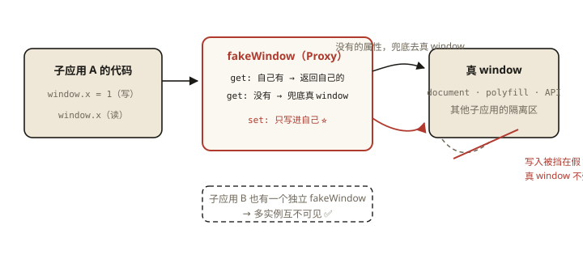
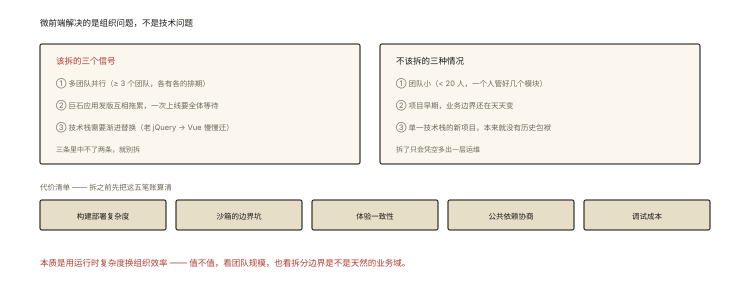

# 前端架构之微前端：qiankun 原理与实践

## 从「2 个团队、1 个仓库、0 次发版」说起

```
巨石应用的日常：
  交易团队改个按钮 → 提 MR → 等 6 个团队过审 → 统一回归 → 周四窗口统一发版
  —— 任何一个团队的慢，都是所有人的慢
```

微前端的承诺：**按业务域拆成独立应用（独立仓库/构建/部署），运行时拼装成一个页面**——团队自治、技术异构、独立发布。⭐⭐ 本篇讲清它的实现核心（JS 沙箱、样式隔离、路由分发）与「值不值得」的判断。

## 现象与直觉解释

微前端要回答三个根本问题：

```
① 怎么拼: 子应用的 HTML/JS/CSS 怎么进入主应用？（加载与挂载）
② 怎么隔离: 子应用之间的 JS 全局变量、CSS 样式怎么不打架？
③ 怎么协作: 路由怎么分发、公共依赖怎么共享、子应用间怎么通信？
```

## 深入原理

### 一、qiankun 的实现三支柱 ⭐⭐⭐

**支柱①：加载与生命周期（基于 single-spa）**

```js
// 主应用注册：URL 匹配 → 拉取子应用
registerMicroApps([{
  name: 'trade',
  entry: '//cdn.example.com/trade/index.html',   // 子应用完整入口
  activeRule: '/trade',                           // 激活路由
  container: '#subapp-viewport',                  // 挂载容器
}]);
start({ prefetch: 'all' });   // 预加载全部子应用资源

// 子应用导出三个生命周期钩子（约定协议）⭐:
export async function bootstrap() {}   // 首次加载（一次）
export async function mount(props) {}  // 每次激活（渲染）
export async function unmount() {}     // 每次失活（销毁——不能真卸载 JS！）
```

**qiankun 拉子应用的原理**：fetch 子应用 entry 的 HTML → 解析出 js/css → **用 import-html-entry 把 script 代码取回并「代理执行」**（不是 script 标签——为了注入沙箱与拿到导出）。

**支柱②：JS 沙箱——三档隔离 ⭐⭐⭐**

```js
// 档1: 快照沙箱（SnapshotSandbox，legacy）
//   激活时拍 window 快照，失活时恢复 —— 只能单实例、隔离不彻底

// 档2: 代理沙箱（ProxySandbox，主流）⭐
const fakeWindow = new Proxy({}, {
  get(target, key) {
    return target[key] ?? window[key];      // 读: 自己的优先，兜底真 window
  },
  set(target, key, value) {
    target[key] = value;                     // 写: 只写"假 window" ⭐
    return true;
  },
});
// 把子应用代码包进 with(fakeWindow){...} 执行 —— window.xxx 的读写落在代理上
// 多实例安全：每个子应用一个 fakeWindow，互不可见 ✅（es6-008 Proxy 的工业级应用）

// 档3: with 沙箱的漏洞与补丁
//   逃逸通道: window 直接引用/father 拿顶层/一些 DOM API 天生挂全局
//   qiankun 的对策: 劫持常见的逃逸口（document.addEventListener 等）+ 规范约定
```

**支柱③：样式隔离**

```
方案A: scoped（Shadow DOM）——最彻底，但弹窗（挂 body）样式失效、事件穿透问题 ⚠️
方案B: experimentalStyleIsolation ——编译期给子应用选择器加前缀 div[data-qiankun=trade] .btn{…}
方案C: 约定（BEM 命名/CSS Modules/前缀）——零成本但靠人 ⭐ 多数团队的现实选择
```



*图 · Proxy 沙箱——读兜底真 window（保功能），写只进假 window（保隔离），多实例各有一个假 window*

### 二、公共依赖：去重与共享 ⭐⭐

```
问题: 5 个子应用各带一份 Vue/React —— 体积×5、内存×5、还可能版本冲突
方案A: externals + 主应用注入（qiankun 时代常用）
       主应用加载 vue → 挂 window.__POWERED_BY_VUE__ → 子应用 externals 掉
       ⚠️ 代价: 版本被主应用锁死（异构性受限）
方案B: Module Federation（Webpack5/Rspack/Vite 皆支持）⭐ 现代
       // 宿主
       new ModuleFederationPlugin({ shared: { vue: { singleton: true } } })
       // 运行时按需共享 + 版本协商（singleton 保唯一；不满足时各自加载）
方案C: 不共享 —— 各玩各的（内存换自由，子应用少时其实可接受 ⭐ 冷静评估）
```

### 三、通信与路由 ⭐⭐

```
通信: qiankun initGlobalState（一个发布订阅，props 下发）│ CustomEvent │ 共享 store
     ⚠️ 原则: 通信越少越健康 —— 按业务域拆分的初衷就是"低耦合"
     跨子应用通信频繁 = 拆错了边界的信号 ⭐
路由: 主应用统一守卫（登录/权限）→ activeRule 分发 → 子应用接管内部路由
     双路由系统的坑: base 路径、history 模式 base、互相触发 popstate 的防抖
```

### 四、Module Federation 与「微前端 2.0」一句话 ⭐

```
MF 的颗粒是【模块】不是应用: 跨应用共享组件/函数级代码，运行时按需拉取
"微组件"模式: 主应用直接 import 远程暴露的 Button —— 无生命周期、无沙箱
定位: 组件级共享（MF） vs 应用级拆分（qiankun 式）——解决的问题不同，常互补
```

### 五、「要不要微前端」的判断表 ⭐⭐⭐



*图 · 先数信号，再算代价 —— 三个信号中不了两条就别拆*

```
适合: 多团队（≥3）并行、巨石发版互相拖累、技术栈需渐进替换（老 jQuery → Vue 渐迁）
不适合: 团队小（<20 人）｜ 项目早期 ｜ 单一技术栈的新项目 ——
       "微前端解决的是组织问题，不是技术问题" ⭐（康威定律的前端版）
代价清单: 构建部署复杂度 │ 沙箱的边界坑 │ 体验一致性 │ 公共依赖协商 │ 调试成本
```

## 回看开篇

2 团队互相拖累的问题本质是「耦合的发布单元」；微前端把发布单元按团队切开（独立仓库/流水线/部署），运行时用沙箱与样式隔离把「拼装」做到用户无感——**用运行时复杂度换组织效率**，值不值取决于团队规模与拆分边界是否天然（业务域）。

## 实战延伸

**1. 面试答题骨架**：「微前端按业务域把巨石拆成独立开发部署的子应用，运行时拼装。qiankun 三支柱——基于 single-spa 的生命周期协议拉取并执行子应用、Proxy 代理沙箱把子应用的 window 读写落到假 window 实现多实例隔离、样式用 Shadow DOM 或选择器前缀或约定隔离；公共依赖通过 externals 注入或 Module Federation 的运行时共享与版本协商；通信用全局状态总线但以少为原则。判断上它解决的是多团队的组织协作问题，小团队单一技术栈的项目引入只会增加复杂度。」

**2. 一道排查题**：「子应用 A 的弹窗样式被 B 的全局 CSS 污染」——三条路：加前缀隔离（B 的全局收敛）、弹窗挂载到子应用容器内（而非 body）、或该弹窗下沉为共享组件。

## 图解总结

```
微前端三问: 拼装 │ 隔离 │ 协作
qiankun: 生命周期协议(bootstrap/mount/unmount)
        + import-html-entry 取代码代理执行
        + Proxy沙箱(读兜底真window/写只进假window ⭐ 多实例安全)
        + 样式隔离(Shadow DOM/前缀/约定)
依赖共享: externals(锁版本) vs Module Federation(运行时协商 singleton) vs 不共享
通信: 越少越健康——频繁跨子通信=拆错边界信号
判断: ≥3团队+发版拖累+技术异构 → 值; 小团队新项目 → 别碰（组织问题的技术表达）
```

## 总结

- 三支柱：生命周期协议、JS 沙箱（Proxy 假 window）、样式隔离（三档）；
- 代理沙箱读写规则：读兜底真 window、写只进假 window——多实例安全；
- 公共依赖：externals 锁版本 vs MF 运行时协商 vs 不共享；
- 通信以少为健康，频繁跨子通信是拆分边界错误的信号；
- 判断标准：组织问题（多团队发版耦合）才是它的靶心。

**面试一句话回答**：微前端把巨石应用按业务域拆成独立开发、构建与部署的子应用再在运行时拼装。qiankun 的实现三支柱是：基于 single-spa 的生命周期协议——子应用导出 bootstrap、mount、unmount 三个钩子，主应用按路由规则拉取并代理执行其资源；JS 沙箱用 Proxy 实现——子应用对 window 的读取先查自己的假 window、兜底真 window，写入只落在假 window 上，从而多实例互不污染；样式隔离可选 Shadow DOM、编译期选择器前缀或团队约定。公共依赖共享走 externals 注入或 Module Federation 的运行时版本协商；子应用间通信用全局状态总线但以少为原则，频繁跨应用通信说明拆分边界有误。微前端解决的核心是多团队发布互相拖累的组织问题，小团队和单一技术栈项目引入只会徒增复杂度。

## 思考题

1. 代理沙箱的「读兜底真 window」为什么必须？（子应用要用的浏览器 API/polyfill 都在真 window——全隔离会废掉子应用）
2. 子应用的 unmount 里「不能卸载 JS」意味着什么风险？（全局副作用残留——重复注册监听/定时器；v8-007 泄漏模式在微前端的放大）
3. 用 Module Federation 共享 vue 的 singleton: true——版本不满足时 MF 的行为？（降级各自加载——协商机制的兜底）
4. 开放讨论：你们的业务适合「物理拆分（qiankun）」还是「逻辑拆分（monorepo + 模块边界）」？列出决策的关键变量（团队数/部署窗口/技术栈差异）。

（思考题解析将同步录入小程序题库，关联本文 id：architecture-003）

## 参考文献：

- qiankun 官方文档（沙箱与样式隔离章节）
- Webpack Module Federation 官方说明
- Phodal — 《前端架构：从入门到微前端》
