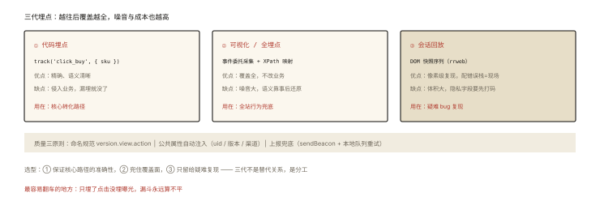
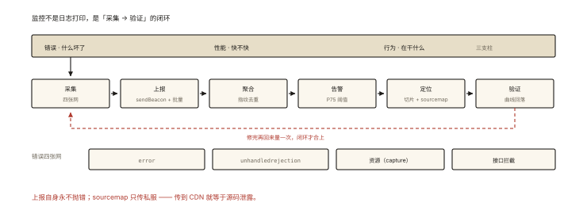

# 前端架构之监控体系：错误、性能与行为

## 从「用户说页面白了，但你什么都没看到」说起

```
没有监控的前端：
  用户: "你们的页面打不开"
  客服: 转发给开发
  开发: "我这边好的呀" —— 复现不了、没有日志、不知道影响面
有监控的前端：
  告警群: [P1] JS错误率突增 0.2%→6.4%，版本 v2.31.0，集中在 iOS 15 Safari
  开发: 打开错误详情 → sourcemap 还原 → chunk-9f2c.js 加载失败
       → 关联发版记录 → 回滚 v2.30.0 ✅ 8 分钟止血
```

⭐⭐⭐ 监控是架构的「感官系统」——本篇讲全量设计：三大支柱（错误/性能/行为）的采集、上报、消费闭环。它也是本课程多条线索（performance-002、js-core-009、engineering-008）的最终汇流点。

## 现象与直觉解释

监控三支柱各答一个问题：

```
错误监控(RUM): 什么东西坏了？—— 谁的版本、什么环境、影响多少用户
性能监控(RUM): 用户快不快？—— 指标(performance-001)按版本/机型的分布
行为监控(埋点): 用户在干什么？—— 转化漏斗、功能使用、异常路径回放
```

**一个完整闭环**：采集（SDK）→ 上报（通道）→ 聚合（平台）→ 告警（人）→ 定位（还原）→ 修复验证（曲线回落）。

## 深入原理

### 一、错误采集：四张网的全覆盖 ⭐⭐⭐

```js
// ① 运行时同步错误（含框架未捕获）
window.addEventListener('error', (e) => {
  report({ type: 'js_error', message: e.message, stack: e.error?.stack,
           filename: e.filename, line: e.lineno });
});

// ② Promise 未处理拒绝（js-core-009 的四张网在监控侧的落地）
window.addEventListener('unhandledrejection', (e) => report({ reason: serialize(e.reason) }));

// ③ 资源加载失败（img/script/css —— capture 阶段才接得到）
window.addEventListener('error', (e) => {
  if (e.target?.src || e.target?.href) report({ type: 'resource', url: e.target.src });
}, true);   // ⭐ 捕获阶段

// ④ 接口错误（拦截 fetch/XHR —— handheld-007 的拦截器挂监控点）
//   状态码/耗时/接口名 —— 错误归因的最大来源（后端 or 网络 or 前端逻辑）

// 框架层补充: Vue errorHandler / React ErrorBoundary —— 组件树级捕获带组件名
```

### 二、错误消费的三个关键设计 ⭐⭐⭐

**① 聚合去重：错误指纹（fingerprint）**

```
同源错误会海量重复 —— 按「message + 首个堆栈帧」哈希生成指纹:
  fp = hash('Cannot read property x of undefined' + 'at checkout.js:1024')
动态部分（用户id/时间戳）要归一化（替换为 *）—— 否则指纹爆炸，聚合失效 ⭐
```

**② sourcemap 还原：压缩代码 → 源码**

```
构建产物: chunk-9f2c.js（列号全乱）
配套生成: chunk-9f2c.js.map（位置映射表）
还原: 上报 {file, line, col} → 平台查 map → 源码位置+原始变量名 ⭐
⚠️ 安全纪律: sourcemap 【不上生产 CDN】—— 只传监控平台（私服）；
   否则任何人可还原你的源码（安全大坑）
```

**③ 版本与环境的维度切片**：每个错误带 version/ua/uid/page——「v2.31.0 + iOS15」的切片让归因从大海捞针变成查表。

### 三、性能采集：RUM 的指标管道 ⭐⭐⭐

```js
// performance-002 的采集代码在监控侧的完整化:
const [nav] = performance.getEntriesByType('navigation');
report({
  // 核心三件套（PerformanceObserver，performance-002）
  lcp, cls, inp,
  // 辅助: ttfb: nav.responseStart, fcp, 
  // 环境: netType(网络), deviceMemory, model(机型归一化)
});
// 上报时机 ⭐: visibilitychange(hidden) 时统一发 —— 用户离开前最完整的数据
// 采样: 全量还是 10%？—— 新版本全量 24h，稳定后降采样（成本与精度的平衡）
```

**告警阈值设计**：P75 连续 N 个窗口超阈值（performance-001 的 P75 口径）——防止单点抖动误报。

### 四、行为埋点：从「计数」到「还原」⭐⭐



*图 · 三代埋点不是替代关系，是分工；底部三原则决定数据能不能用*

```
三代埋点:
① 代码埋点: track('click_buy', {sku}) —— 精确但侵入
② 可视化/全埋点: 事件委托统一采集(dom-events-004)+XPath 映射 —— 覆盖全但噪音大
③ 会话回放(rrweb): DOM 快照序列 → 像素级还原用户操作 ⭐
   用途: 复现疑难 bug（配合错误栈 = 完整现场）；隐私字段要先打码 ⚠️

埋点的质量三原则:
  事件命名规范(version.view.action) │ 公共属性自动注入(uid/版本/渠道) │
  上报失败兜底(sendBeacon + 本地队列重试)
```

### 五、上报通道的工程细节 ⭐⭐

```js
// ① sendBeacon: 页面卸载不丢（浏览器保证送达）—— 首选
navigator.sendBeacon('/collect', JSON.stringify(batch));
// ② 批量与节流: 内存队列 + 定时flush（500ms/满20条）—— 省 95% 请求
// ③ 降级: sendBeacon 不可用 → keepalive fetch → image 打点
// ④ 上报自身不能引发错误（try包住、失败静默——监控挂了不能拖垮业务 ⭐）
```

## 回看开篇

「用户说白了但你不知道」与「8 分钟止血」的差距就是本篇的全链路：四张网接住错误 → 指纹聚合不淹没 → sourcemap 还原到源码行 → 版本切片对上发版记录 → 回滚后错误率曲线回落验证。**监控不是日志打印，是「采集-聚合-告警-定位-验证」的闭环系统**。

## 实战延伸

**1. 面试答题骨架**：「前端监控三支柱——错误、性能、行为。错误侧用 error、unhandledrejection、捕获阶段资源错误与接口拦截四张网全覆盖，上报按 message 加首个堆栈帧哈希做指纹聚合，动态信息归一化防指纹爆炸，平台侧用 sourcemap 还原压缩代码到源码位置，sourcemap 只传私服不上 CDN。性能侧用 PerformanceObserver 采集 LCP、CLS、INP 加 TTFB，在 visibilitychange 时批量上报，配网络机型维度与 P75 阈值告警。行为侧从代码埋点到全埋点到 rrweb 会话回放，公共属性自动注入。上报通道用 sendBeacon 加批量队列，监控自身故障不能影响业务。」

**2. 一道设计题**：为「白屏率」设计专项监控：定义（FCP 超时 or 主容器无内容）、采集（采样 DOM 探针）、告警（1% 阈值）、常见归因清单（JS 失败/资源404/接口挂/容器选择器变更）。

## 图解总结



*图 · 六段流水走完还要回到采集，闭环才合上*

```
三支柱: 错误(什么坏了) │ 性能(快不快) │ 行为(在干什么)
闭环: 采集 → 上报(sendBeacon+批量) → 聚合(指纹去重) → 告警(P75阈值)
   → 定位(版本/机型切片 + sourcemap还原) → 修复 → 曲线回落验证

错误四网: error │ unhandledrejection │ 资源(capture) │ 接口拦截
指纹 = hash(message+首帧) —— 动态值归一化 ⚠️
sourcemap: 只传监控平台（私服）—— 传CDN=源码泄露 ⭐
行为三代: 代码埋点 → 全埋点(委托+XPath) → rrweb回放(隐私打码)
纪律: 上报自身永不抛错 │ 新版本全量→稳定降采样
```

## 总结

- 三支柱：错误/性能/行为，各有采集方案与消费形态；
- 错误四张网 + 指纹聚合 + sourcemap 还原（map 不上生产）；
- 性能三件套 + 环境维度 + P75 告警；visibilitychange 上报时机；
- 行为三代演进，会话回放补齐「复现」短板；
- 上报：sendBeacon+批量+降级；监控自身故障不影响业务。

**面试一句话回答**：前端监控体系分错误、性能、行为三大支柱。错误监控用 window error 事件、unhandledrejection、捕获阶段的资源加载错误与请求拦截四张网全面捕获，按错误消息加首个堆栈帧哈希生成指纹聚合去重，动态内容归一化防止指纹爆炸，平台用 sourcemap 把压缩产物的堆栈还原到源码，sourcemap 只上传监控私服绝不上生产 CDN。性能监控通过 PerformanceObserver 采集 LCP、CLS、INP 与 TTFB，附带机型网络维度，在页面隐藏时用 sendBeacon 批量上报，按 P75 分位设置告警阈值。行为监控从手工埋点、全埋点到 rrweb 会话回放三级演进，回放需做隐私打码。整个体系要求监控自身绝不影响业务，上报失败静默降级。

## 思考题

1. sourcemap 的位置映射原理： mappings 字段的 VLQ 编码——一段 60 字符的 map 如何把 (行,列) 映射回源码？
2. 采样 10% 的 P75 与全量 P75 的偏差有多大？（分位数对采样的敏感度——尾部指标要更保守的采样）
3. 设计「灰度版本的监控对比视图」：同错误指纹在新旧版本的对比、性能三件套的 A/B——列出关键列。
4. 开放讨论：rrweb 回放的隐私红线——输入内容/屏幕信息哪些必须打码？出事故的法律边界（个保法视角）。

（思考题解析将同步录入小程序题库，关联本文 id：architecture-005）

## 参考文献：

- MDN — sendBeacon / PerformanceObserver
- Sentry 前端 SDK 源码（错误指纹与 sourcemap 还原的工业实现）
- rrweb 文档（会话回放原理）
- 本课程《js-core-009 错误处理》《performance-001/002》《engineering-008 部署》
