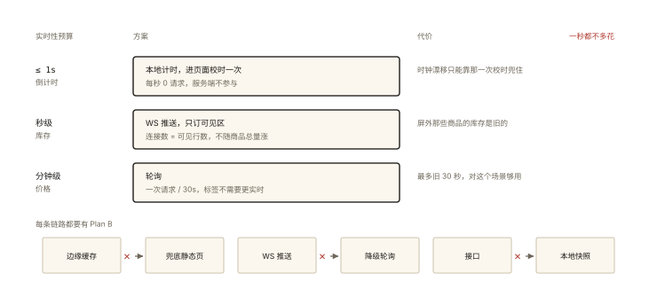

# 前端架构之复杂页面的设计权衡

## 一个真实需求（本系列的收官案例）

> 前 5 篇讲了组件、状态、微前端、Monorepo、监控的「分科知识」；本篇做一次**综合会诊**——用一个真实复杂页面，演示架构决策的完整过程。

```
需求：营销活动页「618 主会场」
  - 秒杀倒计时 + 万级商品瀑布流 + 实时库存 + 弹幕 + 分享裂变
  - 首屏 1.5s 内可交互（营销指标）
  - 大促当天 QPS 峰值 10w+
  - 5 人小组、3 周工期
```

⭐⭐ 架构师的真正工作不是罗列技术，而是**在约束（时间/人力/性能目标）下做取舍**——本篇演示这套思维。

## 会诊过程：五个决策点

### 决策①：渲染方案——SSR / SSG / CSR？⭐⭐

```
候选分析:
  SSR: 首屏最快但服务器成本高（10w QPS 峰值要扩容渲染集群）+ 3 周工期学不起
  SSG: 构建期出静态页 —— 商品数据是动态的（库存/价格），纯 SSG 不行
  CSR: 首屏慢 —— 1.5s 目标难达
  【ESR/边缘渲染 + CSR 激活】折中 ⭐:
    骨架+首屏商品 由 CDN 边缘缓存(短 TTL 30s) 输出 →
    剩余数据 CSR 拉取（库存等强实时数据）
决策: 边缘缓存首屏 + CSR 增量 —— 首屏目标达标，服务器零扩容
理由链: 「首屏快的本质是字节早到」而非「必须 SSR」——静态化到边缘同样成立
```

### 决策②：万级商品流——虚拟滚动 or 分页瀑布？⭐⭐

```
虚拟滚动(performance-006): DOM 恒定丝滑，但「实时库存」要求行级更新——
  虚拟化的行被回收，库存推送的订阅管理复杂 ⚠️
分页瀑布(按需加载): 实现简单，但滚动 1w+ 后 DOM 累积卡死
【混合】决策 ⭐: 分页加载(每页 50) + 滚出视口的页「冻结」(
  仅保留占位高度+断开订阅，IntersectionObserver 管理激活/冻结)
理由: 库存推送只订阅可见区（性能-实时性的折中）；实现成本 1 天 < 全量虚拟化 3 天
```

### 决策③：实时性分级——什么数据要多实时？⭐⭐⭐

```
盘点数据的"实时需求":
  秒杀倒计时:   秒级 —— 本地时钟 + 服务端校时纠偏（不需要推送）
  库存:        10s 级 —— WebSocket 推送「仅可见区」(决策②)
  弹幕:        1s 级 —— WebSocket 广播 + 客户端随机延迟(削峰显示)
  价格/标签:    分钟级 —— 轮询/页面刷新即可 ⭐ 别过度设计！
决策: 按需分级，一秒都不多花 —— 「实时性预算」与「性能预算」同样重要
反例警告: 全量 WebSocket 推送所有数据 —— 连接数爆炸 + 服务器成本 + 无意义
```

### 决策④：弹幕——DOM or Canvas？⭐⭐

```
DOM(transition 动画): 100 条同屏 → 100 个合成层/重排 —— 掉帧边缘 ⚠️
Canvas: 一张画布 requestAnimationFrame 重绘(rendering-004) —— 万条同屏无压力
决策: Canvas 弹幕池（文字离屏渲染缓存，同字符直接 drawImage ⭐）
取舍记录: 文字不可选中/无障碍降级 —— 营销场景可接受（a11y 提供"关闭弹幕"）
```

### 决策⑤：容灾——大促挂了怎么办？⭐⭐

```
降级清单(预案):
  边缘缓存挂 → 回源静态兜底页(构建期产出的 last-good 版本) ⭐
  WebSocket 挂 → 自动降轮询(30s) + UI 移除"实时"角标
  接口挂 → 展示缓存快照(localStorage 上次成功数据 + 时间戳提示)
  前端崩 → window.onerror 上报 + 自动刷新一次(带 retry 标记防循环)
决策: 每条链路都有 Plan B —— 「大促页面的 SLA 是设计出来的，不是祈祷出来的」
```

## 决策的总原则（可迁移的方法论）⭐⭐⭐

```
① 先量化约束，再谈方案: 首屏多少秒/QPS多少/工期几天 —— 没数字就没有权衡
② 每个"性能问题"先问数据分级: 什么需要多实时、什么可以缓存多久（决策③）
③ 折中方案优先于理想方案: 边缘缓存而非SSR、冻结而非全虚拟化 ——
   「工程最优 ≠ 技术最优」⭐
④ 降级是需求的一部分: 正常链路写完只完成 70%，容灾占 30% 但保命
⑤ 决策要留痕: 每个决策记录「候选/取舍/理由」—— 三个月后复盘与新人的第一手资料
```

## 回看整个系列（以及整个课程）

```
architecture-001 组件模式  → 决策②的商品卡片组件化
architecture-002 状态分层  → 库存(服务端状态)/倒计时(本地)/UI(局部) 各归其家
architecture-003 微前端    → 本案例不需要（单团队）—— 知道何时不用也是架构
architecture-004 Monorepo  → 活动页进现有 monorepo 的 apps/
architecture-005 监控      → 大促当天的作战地图
本篇: 把分科知识在真实约束下【会诊】—— 架构 = 约束下的取舍艺术
```

**课程的最后一张图**：从 js-deep 的执行上下文到本篇的架构权衡——前端知识的完整光谱是「机制 → 原理 → 框架 → 工程体系 → 架构决策」，每一层都以下一层为地基，每一层都在回答同一个问题的不同尺度：**「在约束下，怎样把系统做对」**。

## 图解总结



*图 · 三行方案差的是机制，不是「哪个更先进」*

```
618 会诊五决策:
 渲染: 边缘缓存首屏+CSR增量(≈SSR效果×零扩容成本)
 万级流: 分页+视口冻结订阅(虚拟化与实时的折中)
 实时分级: 倒计时本地校时│库存推送仅可见区│价格轮询 —— 一秒不多花
 弹幕: Canvas+离屏缓存(DOM 会掉帧; 牺牲可选中换万级流畅)
 容灾: 边缘→兜底页│WS→轮询│接口→快照│崩溃→上报+自愈

五原则: 先量化约束│数据分级│折中优先于理想│降级是需求│决策留痕
```

## 总结

- 架构决策始于量化约束：性能/成本/工期数字先行；
- 数据分级决定技术分级：实时性预算与性能预算同样关键；
- 折中方案（边缘缓存、冻结、Canvas）常常优于理想方案——工程最优；
- 容灾是需求的一部分：每条链路有 Plan B 才有 SLA；
- 决策留痕（候选/取舍/理由）是团队最便宜的知识管理。

**面试一句话回答**：复杂页面的架构设计是在量化约束下做取舍的过程。以大促会场为例——渲染方案上用 CDN 边缘缓存输出首屏加客户端增量渲染，以静态化达到接近服务端渲染的首屏效果且免去渲染集群扩容；万级商品流采用分页加载加视口冻结的折中，让实时库存推送只订阅可见区域，兼顾流畅与实时；实时性按数据分级——倒计时本地计算配合服务端校时、库存走 WebSocket 推送、价格标签轮询即可，一秒实时性都不浪费；弹幕用 Canvas 离屏缓存支撑万级同屏；每条链路设计降级预案——边缘缓存故障回退兜底静态页、推送故障自动降级轮询、接口故障展示本地快照。方法论五条：先量化约束、按数据分级、折中优先于理想方案、降级是需求的一部分、决策记录候选与理由留痕供复盘。

## 思考题

1. 把决策①改成「SSR」的什么条件下成立？（团队已有 SSR 基建/预算充足/长尾 SEO 需求——重列约束对比两方案）
2. 库存推送的「仅可见区订阅」在快速滚动时如何防抖动（订阅风暴）？（延迟订阅/防抖 300ms 后再订）
3. 弹幕 Canvas 方案的无障碍代价还有哪些补偿手段？（隐藏文本层/关闭开关/精简模式）
4. 开放作业：选你项目里最复杂的一个页面，按本篇五决策维度写一页「架构决策记录」（ADR 格式）。

（思考题解析将同步录入小程序题库，关联本文 id：architecture-006）

## 参考文献：

- 《Designing Data-Intensive Applications》第 1 章（权衡思维，跨领域通读）
- ADR（Architecture Decision Records）实践指南
- 本课程全系列——本篇是它们的综合演练场
