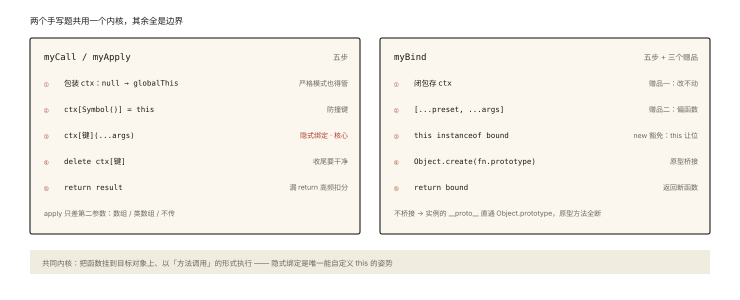

# 手写 call、apply、bind

## 手写题的评分逻辑

> **系列导读**：《手写源码系列》共 12 篇，是面试实战的「武器库」——每篇交付可直接默写的完整实现 + 边界处理清单。原理篇见《js-deep》《js-async》两系列，本系列专注「写对、写全、讲清」。

面试官看手写题的三层评分：

1. **能不能写出来**（核心逻辑）；
2. **边界全不全**（null 处理、Symbol 键、严格模式、返回值）；
3. **能不能讲出来**（每行代码对应的原理）。

⭐⭐ 本篇以《js-deep-007》的原理为地基，直接进入「考场可用版」。

## 手写 call

### 版本一：核心三行（讲原理用）

```js
Function.prototype.myCall = function (ctx, ...args) {
  ctx.fn = this;              // this 就是调用 myCall 的函数
  const result = ctx.fn(...args);
  delete ctx.fn;
  return result;
};
```

### 版本二：考场完整版 ⭐

逐项补齐边界（每一条都是追问点）：

```js
Function.prototype.myCall = function (ctx, ...args) {
  // ① 原始值包装：非严格模式下 null/undefined → 全局；原始值 → 包装对象
  //    （规范行为：ToObject(thisArg)）
  if (ctx === null || ctx === undefined) {
    ctx = globalThis;
  } else {
    ctx = Object(ctx);
  }

  // ② Symbol 键防冲突：目标对象可能已有同名的 fn 属性
  const fnKey = Symbol('fn');
  ctx[fnKey] = this;

  const result = ctx[fnKey](...args);   // ③ 隐式绑定：this 落在 ctx 上

  delete ctx[fnKey];                    // ④ 清理现场
  return result;                        // ⑤ 别忘了返回值
};

// 验证
function greet(prefix) { return `${prefix} ${this.name}`; }
greet.myCall({ name: '小明' }, '你好');   // '你好 小明'
greet.myCall(null, 'hey');               // globalThis.name —— 非严格行为
```

边界清单（自检表）：

| 边界 | 处理 | 追问话术 |
|---|---|---|
| null/undefined | 回退 globalThis | 「规范如此；严格模式下原生 call 保持 null/undefined，此处模拟非严格」 |
| 原始值 thisArg | `Object(ctx)` 包装 | `greet.myCall(42)` → 包装成 Number 对象 |
| 键名冲突 | Symbol 生成唯一键 | 「对象可能已经有 fn 属性，Symbol 保证不覆盖」 |
| 返回值 | return | 「构造/求值场景需要返回值」 |
| 不可变对象 | 严格模式下会静默失败 | 「Symbol 键 + try/finally 更稳」（见思考题） |

## 手写 apply

与 call 只差第二参数（数组/类数组，且可不传）：

```js
Function.prototype.myApply = function (ctx, argsArray) {
  if (ctx === null || ctx === undefined) {
    ctx = globalThis;
  } else {
    ctx = Object(ctx);
  }

  const fnKey = Symbol('fn');
  ctx[fnKey] = this;

  // ⭐ apply 特有边界：第二参可能不传 / null / 类数组
  let result;
  if (argsArray === null || argsArray === undefined) {
    result = ctx[fnKey]();
  } else {
    // 规范要求「可迭代或类数组」，考场简化版用数组化：
    const args = Array.isArray(argsArray) ? argsArray : Array.from(argsArray);
    result = ctx[fnKey](...args);
  }

  delete ctx[fnKey];
  return result;
};

Math.max.myApply(null, [1, 5, 3]); // 5
```

高频追问：「argsArray 传个普通对象 `{0:'a',length:1}` 行不行？」——原生 apply 规范接受类数组；`Array.from` 把这条边界也兜住了。

## 手写 bind ⭐⭐（三件赠品的实现）

bind 的考点密度最高：**this 永久锁定 + 参数预置 + new 时豁免**。

```js
Function.prototype.myBind = function (ctx, ...preset) {
  const targetFunc = this;                    // 保存原函数

  // ③ new 豁免：作为构造函数时 this 让位给实例
  const bound = function (...args) {
    // this instanceof bound === true ⇔ 当前函数是被 new 调用的
    // （new 的第②步把实例原型链到 bound.prototype，见 js-deep-008）
    const isNew = this instanceof bound;
    return targetFunc.apply(
      isNew ? this : ctx,                     // new 时用新实例，否则用绑定的 ctx
      [...preset, ...args]                    // ② 参数预置：预置在前、调用在后
    );
  };

  // ④ 原型链接：让 new bound() 的实例能访问原函数原型上的方法
  //    （实例的 [[Prototype]] 指向 bound.prototype；原函数的方法在 targetFunc.prototype 上）
  bound.prototype = Object.create(targetFunc.prototype);

  return bound;
};
```

逐段对应规范行为：

```js
// 验证 ①：this 永久锁定
function f() { return this.v; }
const bound = f.bind({ v: 1 });
bound();                       // 1
bound.call({ v: 99 });         // 1 —— 改不动 ✅

// 验证 ②：参数预置（偏函数）
function add(a, b, c) { return a + b + c; }
add.myBind(null, 1)(2, 3);     // 6

// 验证 ③④：new 豁免 + 原型方法可达
function Person(name) { this.name = name; }
Person.prototype.hi = function () { return this.name; };
const BoundPerson = Person.myBind({ fake: true });
const p = new BoundPerson('小明');
p.name;                        // '小明'（this 是实例，没被 fake 绑架）✅
p.hi();                        // '小明'（原型链经 Object.create 接通）✅
```

**为什么 `bound.prototype = Object.create(targetFunc.prototype)`**：new 的第②步把实例链到 `bound.prototype`，若不桥接，`bound.prototype.__proto__` 是 Object.prototype——原函数原型上的方法全断。用 `Object.create`（而非直接赋值 `= targetFunc.prototype`）避免「实例直接改坏原函数原型」——这正是寄生组合式继承（《js-deep-010》）的同款手法。

**规范补完度说明**：原生 bound function 还有两点考场上知道即可——bound 不能再被 bind 改 this（我们用 `targetFunc` 直存已天然满足）；`new.target` / `Function.prototype.bind` 生成的函数没有 prototype 属性（它靠内部槽工作）——手写版以 `instanceof` 近似模拟，足以通过绝大多数面试追问。

## 三道自测题（面试官的爱用变体）

**变体 1：不用 Symbol，怎么防键冲突？**

```js
// 用「随机后缀 + 存在性检测」的兼容老写法（象征性给出思路）
let key = '__fn__';
while (key in ctx) key = '_' + key;
```

**变体 2：为什么 `ctx[fnKey](...args)` 不写成 `this(...args)`？**——this 是原函数，直接调用走默认绑定；必须「挂到 ctx 上再以方法形式调用」才是隐式绑定。

**变体 3：`myCall` 返回值丢了会怎样？**——`[1,2].concat.myCall([3], [4])` 变 undefined；「手写方法必须 return」是高频扣分点。

## 图解总结



*图 · 左边是 call 的骨架，右边是 bind 在骨架上加的三个赠品*

```
myCall(ctx, ...args)              myBind(ctx, ...preset)
  ctx 包装(null→globalThis)          返回 bound 函数
  ctx[Symbol键] = this               调用时：new? this : ctx
  ctx[键](...args) ← 隐式绑定         参数：[...preset, ...args]
  delete + return                    prototype 桥接：
                                       Object.create(原函数.prototype)
myApply：同 call，第二参数可为 数组/类数组/不传
```

## 总结

- 三兄弟共用一个内核：**把函数挂到目标上以隐式绑定方式调用**；
- call/apply 的边界五件套：null 回退、原始值包装、Symbol 键、返回值、（apply 特有）类数组兼容；
- bind 的三大赠品各有实现钥匙：锁定（闭包存 ctx）、预置（preset 拼接）、new 豁免（`this instanceof bound`）+ 原型桥接（`Object.create`）；
- 每个边界都对应一条规范行为——**写手写题的过程就是把规范翻译成代码**。

**面试一句话回答**：手写 call/apply 的核心是把原函数作为目标对象上通过 Symbol 生成的临时属性、以隐式绑定方式调用后删除，边界处理包括 null 或 undefined 回退 globalThis、原始值用 Object 包装、保留返回值、apply 需兼容数组与类数组参数；手写 bind 返回新函数并用闭包保存 this 与预置参数实现永久绑定和偏函数，通过 this instanceof bound 判断 new 调用让 this 让位给实例，并用 Object.create 将新函数原型桥接到原函数原型，保证实例能继承原型方法。

## 思考题

1. 把 `delete ctx[fnKey]` 改成 `try/finally` 结构——为什么对「执行函数体抛错」的场景更严谨？
2. 用 bind 实现 `listify(fn)`：把 `f(1,2,3)` 变成 `f([1,2,3])` 的适配器（提示：apply 与 bind 的组合）。
3. 原生 bind 后的函数 `bound.prototype` 是 undefined，而你的手写版有——这个差异会在什么代码里暴露出行为不同？
4. 开放设计：不用 `this instanceof bound`，改用 ES6 的 `new.target` 实现 new 豁免——写出代码并说明为什么它更贴近规范语义。

（思考题解析将同步录入小程序题库，关联本文 id：handwritten-001）

## 参考文献：

- ECMA-262 现行版 — Function.prototype.call/apply/bind、BoundFunctionCreate
- 本课程《js-deep-007 call、apply、bind》（原理篇）、《js-deep-008 new》《js-deep-010 继承》（new 与原型桥接的机制）
- 冴羽《JavaScript 深入之 call 和 apply 的模拟实现》
