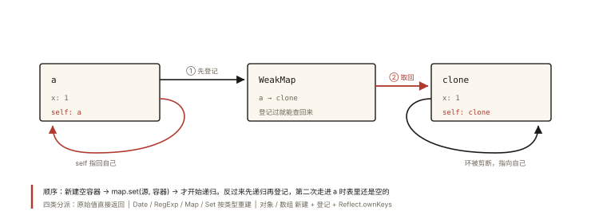

# 手写深拷贝

## 从「JSON.parse(JSON.stringify(x)) 的三宗罪」说起

深拷贝的民间偏方：

```js
const copy = JSON.parse(JSON.stringify(obj));
```

三宗罪现场：

```js
const obj = {
  date: new Date(),            // ① 变成 ISO 字符串，不再是 Date 对象
  reg: /abc/gi,                // ② 变成空对象 {}
  fn: () => {},                // ③ 直接丢失（undefined）
  undef: undefined,            //    属性直接消失
  nan: NaN,                    //    变 null
  self: null,                  //    循环引用 → 直接抛错 💥
};
obj.self = obj;
JSON.parse(JSON.stringify(obj)); // TypeError: Converting circular structure to JSON
```

⭐⭐ 手写深拷贝是手写题里「层级最深」的一题：递归、循环引用、特殊对象、WeakMap——一层层往下问，能问出候选人的完整功底。

## 现象与直觉解释

深拷贝 = **递归地复制每一层**，直到撞上「不需要再拆的叶子」（原始值）：

```
浅拷贝：只复制第一层，嵌套层共享引用
  a = {x:1, inner:{y:2}};  b = shallow(a);  b.inner === a.inner ✅ 同一个对象

深拷贝：每一层都新建
  b = deep(a);  b.inner === a.inner ❌ 全新对象
```

浅拷贝三件套（`{...obj}` / `Object.assign({}, obj)` / `arr.slice()`）是一层；深拷贝是递归到叶。

## 深入原理：四个递进版本

### 版本一：朴素递归（40 分）

```js
function deepClone(target) {
  if (target === null || typeof target !== 'object') return target; // 叶子：原始值/函数
  const clone = Array.isArray(target) ? [] : {};
  for (const key in target) {
    if (Object.hasOwn(target, key)) {           // 排除原型链键（for...in 的坑）
      clone[key] = deepClone(target[key]);       // 递归复制
    }
  }
  return clone;
}
```

**两个致命缺陷**：循环引用 → 无限递归栈溢出；`obj.self` 直接爆栈：

```js
const a = {}; a.self = a;
deepClone(a); // RangeError: Maximum call stack size exceeded 💥
```

### 版本二：循环引用——WeakMap 的「原配登记处」⭐⭐

思路：**已经拷贝过的对象，登记在 WeakMap（原对象 → 拷贝）；再次遇到直接取登记的拷贝**——环就此剪断：

```js
function deepClone(target, map = new WeakMap()) {
  if (target === null || typeof target !== 'object') return target;

  // ⭐ 循环引用检测：查登记处
  if (map.has(target)) return map.get(target);

  const clone = Array.isArray(target) ? [] : {};
  map.set(target, clone);                        // 先登记再递归（顺序关键！）

  for (const key in target) {
    if (Object.hasOwn(target, key)) {
      clone[key] = deepClone(target[key], map);  // 携带同一个 map 下传
    }
  }
  return clone;
}

const a = { name: 'x' }; a.self = a;
const b = deepClone(a);
b.self === b;      // true ✅ 环结构被「等价重建」（b 的 self 指向 b 自己）
b.self === a;      // false ✅ 不再指回原对象
```

三个精妙点（全是追问点）：

1. **为什么先登记再递归**——递归进入 `a.self` 时必须能查到「a 正在/已经拷贝」，否则先递归就死循环了；
2. **为什么是 WeakMap 不是 Map**——`原对象 → 拷贝` 的映射属于「附加元数据」：原对象死了，登记条目应随之消亡（弱引用，关联《es6-007》《v8-005》）；用 Map 会「为已死对象无限囤积拷贝」；
3. **环被等价重建**——b.self 指向 b 自身，拓扑关系保真。

### 版本三：特殊对象——分派表 ⭐

Date、RegExp、Map、Set、Error、Blob… 每类都有正确的重建方式。用**分派表**让代码清爽（而不是 if-else 长龙）：

```js
function deepClone(target, map = new WeakMap()) {
  // 叶子
  if (target === null || typeof target !== 'object') return target;
  if (map.has(target)) return map.get(target);

  // ⭐ 分派表：按构造器重建特殊对象
  if (target instanceof Date) return new Date(target);
  if (target instanceof RegExp) {
    const reg = new RegExp(target.source, target.flags);
    reg.lastIndex = target.lastIndex;            // 别忘了 g 标志的游标
    return reg;
  }
  if (target instanceof Map) {
    const m = new Map();
    map.set(target, m);                          // 登记同样适用于容器
    target.forEach((v, k) => m.set(deepClone(k, map), deepClone(v, map))); // 键也要深拷贝！
    return m;
  }
  if (target instanceof Set) {
    const s = new Set();
    map.set(target, s);
    target.forEach((v) => s.add(deepClone(v, map)));
    return s;
  }

  // 普通对象/数组
  const clone = Array.isArray(target) ? [] : {};
  map.set(target, clone);
  // 用 Reflect.ownKeys：连 Symbol 键一起拷（for...in 拷不到）
  for (const key of Reflect.ownKeys(target)) {
    clone[key] = deepClone(target[key], map);
  }
  return clone;
}
```

**函数怎么办**——共识：**函数不深拷**（拷行为没有意义：同一份逻辑共享即可），直接返回原引用。这是多数库（lodash）的选择，主动说明这个决策是加分项。

### 版本四：生产环境——structuredClone 与库 ⭐

```js
// 浏览器/Node 17+ 原生：structuredClone
structuredClone(obj);            // ✅ 循环引用、Date、RegExp、Map、Set、ArrayBuffer、Blob 全支持
                                 // ❌ 函数、DOM 节点、Symbol、原型链丢失（拷成普通对象）、Error 细节
// lodash 的 cloneDeep：覆盖面最广、性能优化过的递归
```

**手写版与生产版的关系**：面试考手写版（考功底），生产用 `structuredClone`/`cloneDeep`（讲工程判断）——主动对比两者边界，是「懂原理也知道什么时候不用原理」的成熟度信号。

### 延伸边界（面试的「还有呢？」弹药库）

- **原型链**：普通 for-in 拷贝后 `clone.__proto__` 是 Object.prototype；`Object.create(Object.getPrototypeOf(target))` 可保留（structuredClone 不保留）；
- **Symbol 键**：`Reflect.ownKeys` 覆盖；
- **不可枚举属性**：默认丢（需要 getOwnPropertyDescriptor 逐个复制描述符）；
- **爆栈**：超深嵌套（万层）递归会溢出——改成显式栈的迭代版（思考题 4）；
- **性能**：大对象的深拷贝是昂贵操作——架构上应「避免深拷贝」（immutable 结构共享、immer 结构化不可变，见《architecture-002》）。

## 回看开篇

三宗罪对位三处修复：函数/undefined/NaN 丢失与 Date/RegExp 变形 → 分派表按类型正确重建；循环引用抛错 → WeakMap 登记处；而生产环境的正解是 structuredClone——**手写深拷贝的价值不在「用于生产」，在于它把递归、引用、类型系统、GC 语义串成了一道题**。

## 图解总结



*图 · 表里那一行不是缓存，是「这个对象已经在造了」的凭据*

```
deepClone(target, map=WeakMap)
  ├─ 原始值/函数 ──────────▶ 直接返回（叶子）
  ├─ map.has(target) ─────▶ 返回登记的拷贝（剪断环）⭐
  ├─ Date/RegExp/Map/Set ─▶ 分派表重建（Map/Set 的键值递归）
  └─ 对象/数组 ───────────▶ 新容器 → map.set 登记 ⭐ → Reflect.ownKeys 逐键递归

登记顺序：先 set 再递归 —— 迟一步就是死循环
```

## 总结

- JSON 法三宗罪：特殊对象变形、函数/undefined 丢失、循环引用抛错；
- 循环引用的正解：WeakMap 登记处——先登记再递归、遇环取登记拷贝、弱引用不阻碍 GC；
- 特殊对象用分派表重建：Date/RegExp（含 lastIndex）/Map（键也深拷）/Set；函数默认共享不拷；
- Symbol 键靠 Reflect.ownKeys；生产用 structuredClone/lodash 并能讲清边界差异；
- 深拷贝很贵——架构层面优先避免它。

**面试一句话回答**：手写深拷贝分四层递进——原始值直接返回；用 WeakMap 登记已拷贝对象解决循环引用（先登记再递归、遇环取登记拷贝、弱引用不阻止原对象回收）；对 Date、RegExp、Map、Set 等特殊对象按类型分派重建，其中 Map 的键也要递归深拷、函数选择共享不拷；普通对象用 Reflect.ownKeys 连 Symbol 键一起复制。与 JSON 序列化相比它不丢函数、不变形特殊对象、支持循环引用，与生产环境相比 structuredClone 是原生正解但不保留原型链与 Symbol。

## 思考题

1. 把 `map.set(target, clone)` 移到递归之后会发生什么？构造一个最小复现用例。
2. 为什么 lodash 的 cloneDeep 大量使用 `Object.create` + `initCloneArray` 之类的优化？从「保持原型与数组 hole」角度分析。
3. 深拷贝一个 Proxy 代理对象会发生什么？（提示：读操作全部经过 handler——trap 里的逻辑会被执行）
4. 开放设计：把 deepClone 改写成「显式栈 + 循环」的迭代版，消除万层嵌套的爆栈风险；画出栈中要存的状态四元组。

（思考题解析将同步录入小程序题库，关联本文 id：handwritten-003）

## 参考文献：

- MDN — [structuredClone](https://developer.mozilla.org/zh-CN/docs/Web/API/structuredClone)
- lodash 源码 — baseClone（分派与优化的工业实现）
- 本课程《es6-007 Set 与 Map》《js-deep-005 闭包》（WeakMap 与递归的原理地基）
