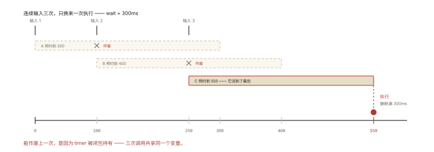
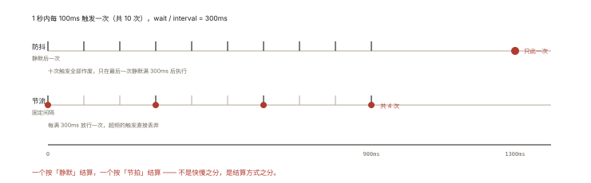
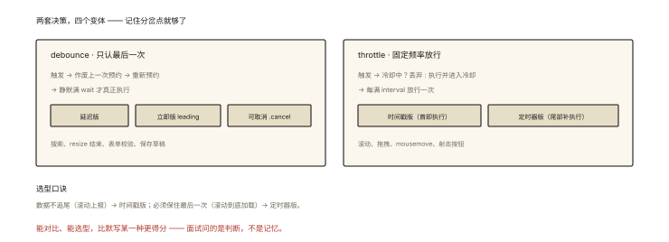

# 手写防抖与节流

## 从两个真实场景出发

```
场景 A：搜索框输入 —— 用户连打 10 个字符，希望"停顿 300ms 后"才请求一次
        → 期望：连续触发时只在【最后一次】后执行          → 防抖

场景 B：滚动加载/滚动条位置上报 —— 持续滚动 5 秒
        → 期望：期间【每隔 500ms】执行一次，不能一次不做  → 节流
```

一句话区分：**防抖管「最后一次」，节流管「固定频率」**。⭐⭐ 防抖节流是手写题出题率 Top 2，变体（立即执行/取消/取返回值）是拉开差距的地方。

## 深入原理与实现

### 一、防抖 debounce：核心版与「闭包三件套」

```js
function debounce(fn, wait) {
  let timer = null;                    // ① 闭包持有：跨调用存活的定时器引用

  return function (...args) {          // ② 返回新函数（this 后面处理）
    if (timer) clearTimeout(timer);    // ③ 每次触发：作废上一次的"预约"
    timer = setTimeout(() => {
      fn.apply(this, args);            // 等真正静默 wait 毫秒后才执行
    }, wait);
  };
}

const onSearch = debounce((kw) => search(kw), 300);
input.addEventListener('input', (e) => onSearch(e.target.value));
```

执行轨迹（wait=300，连续输入）：



*图 · 三次输入各自预约了一次，只有第三次活到了执行*

```
t=0    触发 ── 预约 A(t=300)
t=100  触发 ── 作废 A，预约 B(t=400)
t=250  触发 ── 作废 B，预约 C(t=550)
t=550  ✅ C 执行（最后一次输入后静默满 300ms）
```

**闭包分析**（关联《js-deep-005》）：`timer` 被返回的函数引用 → 每次调用共享同一个 timer 变量——这是「作废上一次预约」得以实现的前提。

### 二、防抖的三个必考变体 ⭐⭐

**变体 1：立即执行版（leading）**——「第一次立刻执行，静默期内不再执行」：按钮防连点用它：

```js
function debounceImmediate(fn, wait) {
  let timer = null;
  return function (...args) {
    const callNow = !timer;              // 没有"冷却"→ 本次立即执行
    if (timer) clearTimeout(timer);
    timer = setTimeout(() => { timer = null; }, wait);   // 只负责冷却，不执行 fn
    if (callNow) fn.apply(this, args);
  };
}
```

**变体 2：可取消版**——组件卸载时清理定时器（防「卸载后 setState」警告/内存泄漏）：

```js
function debounceCancel(fn, wait) {
  let timer = null;
  const debounced = function (...args) {
    if (timer) clearTimeout(timer);
    timer = setTimeout(() => fn.apply(this, args), wait);
  };
  debounced.cancel = function () {       // 挂在函数对象上的方法
    clearTimeout(timer);
    timer = null;
  };
  return debounced;
}
// React: useEffect(() => () => onSearch.cancel(), []);  // 卸载时取消
```

**变体 3：this 与返回值**——两处常见扣分点：

```js
// this：事件回调里 this 是元素——箭头函数里没有 this，
// 所以 fn.apply(this, args) 的 this 必须来自外层普通函数 ✅（本系列实现已处理）
const handler = debounce(function () { console.log(this.id); }, 300);
element.addEventListener('click', handler); // this = element ✅

// 返回值：setTimeout 是异步的，防抖函数无法同步返回 fn 的结果——
// 需要结果时用 Promise 包装（思考题 3）
```

### 三、节流 throttle：两种实现流派 ⭐⭐

**流派 1：时间戳版（leading，立即执行）**：

```js
function throttle(fn, interval) {
  let lastTime = 0;                     // 上次执行时间
  return function (...args) {
    const now = Date.now();
    if (now - lastTime >= interval) {   // 距上次执行够久了
      lastTime = now;
      fn.apply(this, args);             // 立即执行（第一次必然执行：0 起步）
    }                                   // 不够久 → 什么都不做（丢弃！）
  };
}
```

特点：第一次立即执行；间隔内的触发被**丢弃**；最后一次触发可能被丢（滚动停在某位置时不补执行）。

**流派 2：定时器版（trailing，延迟执行）**：

```js
function throttleTimer(fn, interval) {
  let timer = null;
  return function (...args) {
    if (timer) return;                  // 冷却中：忽略
    timer = setTimeout(() => {
      fn.apply(this, args);             // 冷却结束执行一次
      timer = null;
    }, interval);
  };
}
```

特点：第一次延迟 interval 后执行；能兜住「最后一次」触发（在冷却结束时执行）。

**面试标准答案的写法选择**：说明两个流派的差异（首触发时机 + 尾触发是否补执行），再按场景选择——滚动上报选时间戳版（数据不追尾）、滚动到底加载选定时器版（保住最后一次）。**能对比、能选型，比默写某一种更加分**。

### 四、防抖 vs 节流终极对照 ⭐



*图 · 同一根时间轴上，一个结算成 1 次，一个结算成 4 次*

```
连续触发 1 秒（间隔 100ms，共 10 次），wait/interval = 300ms：

防抖：只在 t=1000（最后一次触发后 300ms）执行 1 次
     ── ── ── ── ── ── ── ── ── ── ── ✅
节流(时间戳)：t=0, t=300, t=600, t=900 共 4 次
     ✅ ── ── ✅ ── ── ✅ ── ── ✅ ── ──
```

| | 防抖 | 节流 |
|---|---|---|
| 执行时机 | 静默后一次 | 固定间隔多次 |
| 期间触发 | 全部作废 | 超频部分丢弃 |
| 高频下执行数 | 1 | N = 总时长/间隔 |
| 典型场景 | 搜索、resize 结束、表单校验、保存草稿 | 滚动、拖拽、mousemove、射击按钮 |

### 五、工程补完（现代答案的加分项）

1. **现成轮子**：lodash 的 `debounce/throttle` 支持 `{leading, trailing, maxWait}` 全参数——`maxWait` 解决防抖的「长时间连续输入一次都不执行」问题；
2. **requestAnimationFrame 节流**：动画/拖拽类按帧节流（16.7ms 对齐渲染节拍，《rendering-004》）比时间节流更顺滑；
3. **v-focus 场景速记**：Vue 自定义指令 + 防抖、React 的 useMemo 化 debounce——框架只是包装，闭包内核不变。

## 回看开篇

搜索框 = 防抖（等用户打完）；滚动上报 = 节流（固定频率）。两个场景都不该把每次原生事件全量处理——**防抖节流的共同本质：用闭包跨调用持有状态（timer/lastTime），把高频触发压缩成低频执行**。

## 图解总结



*图 · 分岔点只有一个：作废旧预约，还是进入冷却*

```
debounce（最后一次）：                throttle（固定频率）：
 触发→作废旧预约→新预约               触发→冷却中? 丢弃 : 执行+进入冷却
   ────────✅(静默满 wait)            ✅──✅──✅──✅(每 interval)

变体矩阵：
 防抖: 延迟版 / 立即版(leading) / 可取消版(.cancel)
 节流: 时间戳版(首即执行,尾部丢) / 定时器版(尾部补执行)
```

## 总结

- 防抖：连续触发只在最后一次后执行——闭包持有 timer、clearTimeout 作废旧预约；
- 节流：固定间隔执行一次——时间戳版（立即执行/尾丢）与定时器版（延迟执行/尾保）两流派；
- 防抖三变体：立即执行（callNow 标志）、可取消（挂 cancel 方法）、this 处理（普通函数接 this + apply）；
- 选型判据：要「停顿后一次」防抖、要「匀速执行」节流；动画场景 rAF 节流；
- lodash 版本有 leading/trailing/maxWait 全参数，生产直接用。

**面试一句话回答**：防抖用闭包保存定时器，每次触发先 clearTimeout 作废上次预约、再重新 setTimeout，使得连续触发只在最后一次静默满 wait 后执行一次，变体有 leading 立即执行版和挂 cancel 方法的可取消版，注意用普通函数接收 this 再 apply 透传；节流保证固定间隔至多执行一次，时间戳版首次立即执行但可能丢弃最后一次触发，定时器版延迟执行但能兜住尾部——搜索输入用防抖、滚动上报用节流，动画场景用 requestAnimationFrame 按帧节流。

## 思考题

1. 手写「防抖 + 节流」混合体 `debounceThrottle(fn, wait, maxWait)`：静默 wait 执行，但最长不超过 maxWait 必须执行一次（即 lodash 的 maxWait）。
2. 时间戳节流版在「最后一次触发被丢弃」后，如何加 trailing 补执行？（提示：记录 pending 的 args，冷却外再挂一个 setTimeout）
3. 把防抖改成 Promise 返回值版：`debouncedAsync(args)` 返回 Promise，静默后 resolve fn 的结果——连续调用时之前的 pending promise 该如何处理？
4. 开放设计：拖拽排序场景（mousemove 高频 + mouseup 终态）——用 rAF 节流 mousemove、mouseup 时立即 flush，写出骨架并解释为什么这里比时间节流更优。

（思考题解析将同步录入小程序题库，关联本文 id：handwritten-005）

## 参考文献：

- lodash 源码 — debounce.js（maxWait 与 leading/trailing 的完整状态机）
- MDN — [resize 事件示例](https://developer.mozilla.org/zh-CN/docs/Web/API/Window/resize_event)（官方防抖示例）
- 本课程《js-deep-005 闭包》（timer 跨调用的原理）、《rendering-004 rAF》
