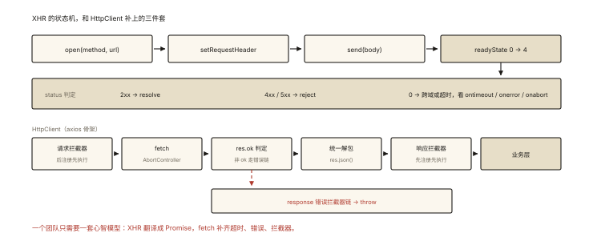

# 手写 Ajax 与 fetch 封装

## 从「一页五个请求库」说起

老项目里常见的景观：jQuery `$.ajax`、原生 XHR、axios、fetch 裸用混居——每个的报错格式、超时行为、错误处理都不同。请求层的价值就在**统一**：统一拦截、统一错误、统一取消。⭐ 手写 ajax 是经典考题；**设计一个带拦截器的请求封装**则是「资深度」考题——axios 的核心就这么大。

## 第一部分：手写 Ajax（XMLHttpRequest 状态机）

### XHR 的五态生命周期

```
0 UNSENT           open() 之前
1 OPENED           open() 之后（可 setRequestHeader）
2 HEADERS_RECEIVED send() 之后，头已到
3 LOADING          响应体下载中（可多次触发，流式）
4 DONE             完成（成败在此判定）
```

`onreadystatechange` 在状态每次变化时触发——**它就是一个状态机的事件流**。

### 手写 ajax 函数（Promise 化的 XHR）

```js
function ajax({ method = 'GET', url, data = null, timeout = 10000, headers = {} }) {
  return new Promise((resolve, reject) => {
    // ① 创建实例
    const xhr = new XMLHttpRequest();

    // ② 初始化：true = 异步（第三个参数千万别忘了）
    xhr.open(method, url, true);

    // ③ 请求头（必须在 open 之后、send 之前设置）
    Object.entries(headers).forEach(([k, v]) => xhr.setRequestHeader(k, v));
    if (data && !(data instanceof FormData) && !headers['Content-Type']) {
      xhr.setRequestHeader('Content-Type', 'application/json; charset=utf-8');
    }

    // ④ 超时与错误通道（XHR 自带，别忘了）
    xhr.timeout = timeout;
    xhr.ontimeout = () => reject(new AjaxError('TIMEOUT', `请求超时(${timeout}ms)`));
    xhr.onerror = () => reject(new AjaxError('NETWORK', '网络错误')); // 断网/DNS
    xhr.onabort = () => reject(new AjaxError('ABORTED', '请求被取消'));

    // ⑤ 状态机主体
    xhr.onreadystatechange = function () {
      if (xhr.readyState !== 4) return;          // 只关心 DONE
      const { status, responseText } = xhr;

      if (status >= 200 && status < 300) {
        try {
          resolve(JSON.parse(responseText));     // 假设 JSON API
        } catch (e) {
          reject(new AjaxError('PARSE', '响应体不是合法 JSON'));
        }
      } else if (status >= 400) {
        let body = responseText;
        try { body = JSON.parse(responseText); } catch { /* 保留原文 */ }
        reject(new AjaxError('HTTP', `HTTP ${status}`, { status, body }));
      } else {
        // status === 0：被 CORS 拦截 / file:// 协议等「拿不到状态」的场景
        reject(new AjaxError('CORS', 'status 为 0，多为跨域或协议限制'));
      }
    };

    // ⑥ 发送：body 必须序列化
    xhr.send(data ? JSON.stringify(data) : null);
  });
}

// 自定义错误类型：统一错误的载体（catch 时可按 code 分流）
class AjaxError extends Error {
  constructor(code, message, extra = {}) {
    super(message);
    this.name = 'AjaxError';
    this.code = code;          // TIMEOUT / NETWORK / HTTP / PARSE / CORS / ABORTED
    Object.assign(this, extra);
  }
}
```

六个追问点：`open(method, url, true)` 第三参（同步 XHR 已废弃）；请求头设置时机；readyState 4 + status 三段判定（2xx/4xx-5xx/0）；`onerror` 与 `ontimeout` 的分工；status === 0 的含义（CORS 拦截时浏览器拿不到状态）；错误要带结构化 code。

## 第二部分：设计一个 fetch 封装（axios 的骨架）⭐⭐

fetch 的问题清单（封装要逐条解决）：

| fetch 的「坑」 | 封装的对策 |
|---|---|
| 4xx/5xx **不 reject**（只有网络错误才 reject） | 手动判 res.ok |
| 默认**无超时** | AbortController + setTimeout |
| 两次调用才拿数据（res.json() 返回 Promise） | 封装内统一解析 |
| 无拦截器、无 baseURL | 自己设计 |

### 带拦截器的完整封装

```js
class HttpClient {
  constructor({ baseURL = '', timeout = 10000 } = {}) {
    this.baseURL = baseURL;
    this.timeout = timeout;
    this.interceptors = {
      request: [],   // { onFulfilled, onRejected }
      response: [],
    };
  }

  // 拦截器注册（axios 同款 API）
  use(type, onFulfilled, onRejected = null) {
    this.interceptors[type].push({ onFulfilled, onRejected });
    return this; // 支持链式
  }

  async request(url, options = {}) {
    // 组装配置
    let config = { url: this.baseURL + url, ...options };

    // ① 请求拦截器：后注册的先执行（axios 语义——更"靠近代码"的先改配置）
    const reqChain = [...this.interceptors.request].reverse();
    for (const { onFulfilled } of reqChain) {
      config = await onFulfilled(config);
    }

    // ② 超时：AbortController（真取消，《js-async-008》）
    const controller = new AbortController();
    const timer = setTimeout(() => controller.abort(), this.timeout);
    if (config.signal) {
      // 用户自带 signal：任一触发即取消（简化版组合）
      config.signal.addEventListener('abort', () => controller.abort());
    }

    try {
      let res = await fetch(config.url, { ...config, signal: controller.signal });

      // ③ fetch 不把 4xx/5xx 当错误 —— 手动统一
      if (!res.ok) {
        throw new HttpError(res.status, await safeJson(res));
      }
      let data = await safeJson(res);   // 统一解析

      // ④ 响应拦截器：先注册的先执行
      for (const { onFulfilled } of this.interceptors.response) {
        data = await onFulfilled(data, res);
      }
      return data;
    } catch (err) {
      // ⑤ 响应错误拦截器链
      let e = err;
      for (const { onRejected } of this.interceptors.response) {
        if (onRejected) e = await onRejected(e);
      }
      throw e;
    } finally {
      clearTimeout(timer);   // ⭐ 无论成败都要清定时器
    }
  }

  get(url, params) {
    const qs = params ? '?' + new URLSearchParams(params).toString() : '';
    return this.request(url + qs);
  }
  post(url, data) { return this.request(url, { method: 'POST', body: JSON.stringify(data) }); }
}

async function safeJson(res) {
  try { return await res.json(); } catch { return null; }
}
class HttpError extends Error {
  constructor(status, body) { super(`HTTP ${status}`); this.status = status; this.body = body; }
}
```

### 使用：拦截器的三个经典用途 ⭐

```js
const http = new HttpClient({ baseURL: '/api', timeout: 8000 });

// 用途 1：统一注入 token
http.use('request', (config) => {
  config.headers = { ...config.headers, Authorization: `Bearer ${getToken()}` };
  return config;
});

// 用途 2：401 自动刷新 token（简化版——完整版要处理「并发 401 只刷一次」）
http.use('response', null, async (err) => {
  if (err.status === 401 && !err.config?._retried) {
    await refreshToken();
    return http.request(err.config.url, { ...err.config, _retried: true });
  }
  throw err;
});

// 用途 3：统一解包业务码
http.use('response', (data) => {
  if (data && data.code !== 0) throw new Error(data.message);
  return data?.data ?? data;
});
```

## XHR vs fetch 对照（概念题收尾）

| | XHR | fetch |
|---|---|---|
| 设计 | 事件模型（状态机回调） | Promise（.then/await） |
| 流式读取 | onprogress（下载） | ReadableStream（请求/响应双向流式） |
| 取消 | abort() | AbortController |
| 超时 | timeout 属性 | 自己组合（AbortController + timer） |
| 上传进度 | xhr.upload.onprogress | 原生不支持（XHR 或分片模拟） |
| 默认带 cookie | 同源带 | 同源带；跨域需 credentials（关联《network-007》） |

## 回看开篇

统一的本质：`ajax` 函数把 XHR 状态机翻译成 Promise + 结构化错误；`HttpClient` 把 fetch 补齐超时、错误统一、拦截器三件套——**一个团队只需要一套心智模型**处理所有请求。

## 图解总结



*图 · 上排是状态机，下排是补上三件套之后的流水线*

```
XHR: open → setRequestHeader → send → readyState 0→4 状态机 → status 判定
     (2xx resolve | 4xx/5xx reject | 0 = CORS) + ontimeout/onerror/onabort

HttpClient（axios 骨架）：
  request拦截器(后注册先执行) ─▶ fetch + AbortController超时
       ─▶ res.ok 判定 ─▶ 统一JSON ─▶ response拦截器(先注册先执行) ─▶ 业务层
                    └── 错误 ─▶ response错误拦截器链 ─▶ throw
```

## 总结

- 手写 ajax 的六个要点：open 三参、请求头时机、readyState=4 + status 三段判定、ontimeout/onerror/onabort 三通道、body 序列化、结构化错误；
- fetch 封装四补丁：res.ok 手动判错、AbortController 超时（finally 清 timer）、统一 JSON、拦截器；
- 拦截器语义：request 后注册先执行、response 先注册先执行（axios 同款）；错误也走拦截器链；
- 拦截器三用途：token 注入、401 刷新重放、业务码解包；
- 上传进度仍需 XHR——fetch 的流是响应向的。

**面试一句话回答**：手写 ajax 要覆盖 XHR 的完整生命周期——open 指定方法地址与异步、在 send 前设置请求头、onreadystatechange 里只在 readyState 为 4 时按 status 分流（2xx 解析 JSON、4xx 5xx 拒绝、0 为跨域拦截），并挂好 ontimeout、onerror、onabort 三个错误通道，把结果包装为 Promise 与结构化错误对象；fetch 封装则要补齐原生短板——用 AbortController 加定时器实现超时并在 finally 清理、手动判断 res.ok 统一 4xx 5xx 为错误、统一 JSON 解析，并设计请求/响应双向拦截器链（请求侧后注册先执行、响应侧先注册先执行、错误也走链），实现 token 注入、401 刷新重放、业务码解包等横切逻辑。

## 思考题

1. 实现「并发 401 只刷新一次」：同时 5 个请求都 401，refresh 只发一次、5 个全部重放成功（提示：共享一个 pending 的 refreshPromise）。
2. 给 HttpClient 加 `download` 方法：带 onProgress 回调（fetch 用 res.body 的 ReadableStream 逐块读取统计进度）。
3. XHR 判定成功用 `status === 200` 有什么隐患？（204/206/201/301 缓存命中的 304……区间判定的理由）
4. 开放设计：小程序环境的请求封装（wx.request）与浏览器有何不同？无 CORS 概念、并发上限、登录态维护——列出你的适配层设计。

（思考题解析将同步录入小程序题库，关联本文 id：handwritten-007）

## 参考文献：

- MDN — [XMLHttpRequest](https://developer.mozilla.org/zh-CN/docs/Web/API/XMLHttpRequest)、[fetch](https://developer.mozilla.org/zh-CN/docs/Web/API/fetch)
- axios 源码 — core/Axios.js 与拦截器链（本文 HttpClient 的工业原型）
- 本课程《js-async-008 异步实战》（AbortController 与重试的原理篇）
