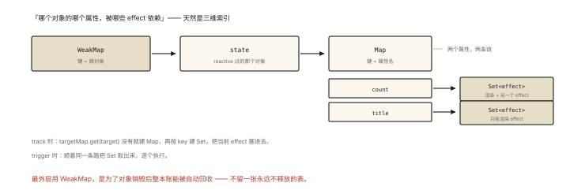
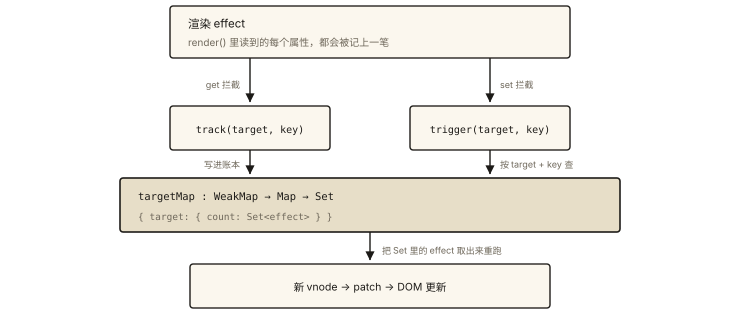

# 手写 mini-Vue（上）：响应式与渲染

## 60 行代码还原 Vue3 的灵魂

《es6-008》给了 Proxy 的地基，《handwritten-008》给了 vnode 的地基——本篇把两者拼起来：**响应式系统 + 渲染引擎 = 一个能跑的 mini-Vue**。⭐⭐⭐ 「手写 Vue 响应式」是框架原理面试的最高频题，其核心只有两个函数：`track`（谁在读我）与 `trigger`（通知读过我的人）。

## 目标效果（先看最终能跑什么）

```html
<div id="app"></div>
<script src="mini-vue.js"></script>
<script>
  const { createApp, reactive, effect } = MiniVue;

  const state = reactive({ count: 0, user: { name: '小明' } });

  createApp({
    render() {
      return h('div', { class: 'box' }, [
        h('p', null, `${state.user.name} 点击了 ${state.count} 次`),
        h('button', { onClick: () => state.count++ }, '点我'),
      ]);
    },
  }).mount('#app');
  // 点击按钮 → count 变化 → render 自动重跑 → 视图自动更新 ✅
</script>
```

## 第一部分：响应式系统（reactive + effect）⭐⭐

### 数据结构：三层嵌套的「依赖账本」



*图 · 三层嵌套放大了看，就是一个具体对象的两条依赖链*

```
targetMap: WeakMap ── target(原对象)
    └─ depsMap: Map ── key(属性)
        └─ dep: Set ── effect 函数集合（谁在依赖这个属性）
```

为什么是这三层？——「哪个对象的哪个属性被哪些副作用依赖」天然是三维索引；WeakMap 让对象销毁后账本自动回收（《es6-007》）。

### 完整实现

```js
// ═══ 依赖账本 ═══
const targetMap = new WeakMap();

// ═══ 当前正在执行的副作用（依赖收集的「探头」）═══
let activeEffect = null;
const effectStack = []; // 栈：支持 effect 嵌套（内层完成后恢复外层）

function effect(fn) {
  const effectFn = () => {
    cleanup(effectFn);                 // ⭐ 先清理旧依赖（解决分支切换遗留，见下文）
    activeEffect = effectFn;
    effectStack.push(effectFn);
    try {
      return fn();                     // 执行副作用：期间的属性读取全部被 track 记账
    } finally {
      effectStack.pop();
      activeEffect = effectStack.at(-1); // 恢复外层 effect
    }
  };
  effectFn.deps = [];                  // 反向账本：我依赖了哪些 dep 集合
  effectFn();                          // 立即执行一次（首次渲染/计算）
  return effectFn;
}

function cleanup(effectFn) {
  // 从每个依赖集合中移除自己（下次执行会重新收集——「先清后收」）
  effectFn.deps.forEach((depSet) => depSet.delete(effectFn));
  effectFn.deps.length = 0;
}

// ═══ track：属性被读取时记账 ═══
function track(target, key) {
  if (!activeEffect) return;           // 不在 effect 中读取 → 不需要收集

  let depsMap = targetMap.get(target);
  if (!depsMap) targetMap.set(target, (depsMap = new Map()));
  let dep = depsMap.get(key);
  if (!dep) depsMap.set(key, (dep = new Set()));
  if (!dep.has(activeEffect)) {
    dep.add(activeEffect);
    activeEffect.deps.push(dep);       // 双向登记（cleanup 需要）
  }
}

// ═══ trigger：属性被写入时通知 ═══
function trigger(target, key) {
  const depsMap = targetMap.get(target);
  if (!depsMap) return;
  const dep = depsMap.get(key);
  if (!dep) return;

  // ⭐ 复制一份再遍历：cleanup+重新 add 会边遍历边改 Set，导致跳项（无限循环的经典坑）
  const effectsToRun = new Set(dep);
  effectsToRun.forEach((fn) => fn());
}

// ═══ reactive：Proxy 包装 ═══
const reactiveMap = new WeakMap();     // 同一对象只代理一次（代理 !== 原对象，见 es6-008）

function reactive(obj) {
  if (typeof obj !== 'object' || obj === null) return obj;
  if (reactiveMap.has(obj)) return reactiveMap.get(obj);       // 缓存
  if (obj.__isReactive) return obj;                            // 传入的已是代理

  const proxy = new Proxy(obj, {
    get(target, key, receiver) {
      if (key === '__isReactive') return true;                 // 标记
      track(target, key);                                      // 读 → 记账
      const res = Reflect.get(target, key, receiver);          // receiver 保 this 正确
      return typeof res === 'object' && res !== null
        ? reactive(res)                                        // 惰性深代理：读到才包一层
        : res;
    },
    set(target, key, value, receiver) {
      const oldVal = target[key];
      const res = Reflect.set(target, key, value, receiver);
      if (oldVal !== value) trigger(target, key);              // 变了才通知（NaN 场景从简）
      return res;
    },
  });
  reactiveMap.set(obj, proxy);
  return proxy;
}
```

### 三个精妙设计（面试的「你为什么这么写」）⭐⭐

**设计 1：activeEffect 栈——依赖收集的「谁在读」探头**

track 无法知道「是谁在读属性」，只能靠全局变量 `activeEffect` 暗示——**effect 执行前把自己挂上去，执行完恢复外层**。没有栈的话，effect 嵌套时内层结束后 activeEffect 就丢了（外层后续读取收不到账）。

**设计 2：cleanup 先清后收——分支切换的正确性**

```js
const state = reactive({ ok: true, text: 'A' });
effect(() => state.ok ? state.text : 'else');  // ok=true 时依赖 {ok, text}
state.ok = false;                              // 重跑后只依赖 {ok}
state.text = 'B';                              // ❗ 若不 cleanup：旧依赖未清，
                                               // text 变化仍会触发这个 effect（过度更新）
```

**设计 3：惰性深代理 + 缓存**——嵌套对象读到才 reactive（避免初始化全量递归）；reactiveMap 保证「同一对象反复经过 reactive 得到同一个代理」（否则 `state.a === state.a` 都会是 false）。

### 依赖收集全流程推演 ⭐

```js
const state = reactive({ count: 0 });
effect(() => console.log(state.count));   // 打印 0
state.count = 1;                          // 打印 1 ✅ 自动更新
```

```
① effect(fn) 立即执行 fn
② fn 读 state.count → proxy.get 触发 → track(target, 'count')
   → activeEffect（fn 的包装）进 targetMap[target]['count'] 集合
③ state.count = 1 → proxy.set 触发 → trigger(target, 'count')
   → 取出集合里的 effectFn 重新执行 → console.log(1)
```

## 第二部分：渲染引擎（把响应式接到 vnode 上）

复用《handwritten-008》的 h / mount / patch，只需要一个「渲染 effect」：

```js
function createApp(component) {
  return {
    mount(selector) {
      const container = document.querySelector(selector);
      let prevVnode = null;

      // 渲染函数包进 effect：模板里读过的每个响应式属性，都会登记依赖
      effect(() => {
        const vnode = component.render();        // render 中读取 state → 收集依赖
        if (!prevVnode) mount(vnode, container); // 首次：挂载
        else patch(prevVnode, vnode);            // 之后：最小变更（diff）
        prevVnode = vnode;
      });
    },
  };
}
```

**闭环就此形成**：

```
render() 读 state.count ──track──▶ 账本登记「渲染 effect 依赖 count」
点击按钮 state.count++ ──trigger──▶ 重跑渲染 effect
   → 新 vnode → patch(旧,新) → DOM 最小更新 ✅
```

（真实 Vue 在 effect 与 DOM 之间还有一层调度器：把同步多次 trigger 合并成微任务里的一次更新——批量异步更新，思考题 3。）

## 常见追问（答不全等于没写懂）

| 追问 | 要点 |
|---|---|
| 为什么用 Proxy 不用 defineProperty？ | 新增/删除属性、数组下标、惰性深度——《es6-008》对照表 |
| 为什么 WeakMap？ | 对象销毁依赖账本自动回收 |
| 嵌套 effect 怎么办？ | effectStack 恢复外层 |
| 读但没在 effect 里？ | activeEffect 为空，track 直接 return（普通读取零成本） |
| 数组方法怎么响应？ | 本篇 set 拦截天然覆盖 `arr[0]=x` 与 `arr.push`（push 会读写多个属性）；Vue 真实实现重写了部分方法以修正 length 与依赖语义 |
| 与 ref 的关系？ | ref 是「包装原始值」的响应式（对象壳 + get/set 拦截 + .value 访问触发 track/trigger）——本篇聚焦 reactive，ref 是思考题 4 |

## 图解总结



*图 · 读的时候把「谁在读」记下来，写的时候才知道该叫醒谁*

```
          ┌────────── 渲染 effect（render 的包装）──────────┐
          │  render() 读取 state.count / state.user.name    │
          └───────┬───────────────────────────┬─────────────┘
                  │ get 拦截                    │ set 拦截（count++）
                  ▼                            ▼
              track(target,key)           trigger(target,key)
                  │                            │
   targetMap: WeakMap ─ Map ─ Set            从 Set 取出 effect 重跑
   {target: {count: Set[renderEffect]}}      → 新 vnode → patch → DOM 更新
   惰性深代理 | reactiveMap 缓存 | cleanup 先清后收 | effectStack 嵌套
```

## 总结

- 响应式三支柱：reactive（Proxy 拦截读写 + 惰性深代理 + 缓存）、effect（副作用包装 + activeEffect 探头 + 栈支持嵌套）、track/trigger（WeakMap-Map-Set 三层账本）；
- cleanup「先清后收」解决分支切换的过期依赖；trigger 复制集合防遍历中修改；
- 渲染引擎 = 渲染函数包进 effect：读属性自动登记依赖、写属性自动重渲染、patch 做最小 DOM 变更；
- 真实 Vue 的增量：调度器（批量异步）、ref/computed、组件系统——《vue-001》与《handwritten-010》续写。

**面试一句话回答**：mini-Vue 的响应式核心是三层账本 targetMap（WeakMap 存对象→Map 存属性→Set 存副作用）加两个时机——Proxy 的 get 拦截里若存在 activeEffect 就把它记入该属性的依赖集合完成 track，set 拦截里值变化时把集合中的 effect 取出重跑完成 trigger；effect 用栈维护当前副作用以支持嵌套，执行前先 cleanup 清空旧依赖防止分支切换的过期触发；reactive 用 reactiveMap 缓存同一代理并惰性深包装嵌套对象；最后把组件 render 包进 effect，读取状态即收集依赖、修改状态即触发重新渲染，经 vnode 的 patch 得到最小 DOM 更新——这就是 Vue3 响应式到视图更新的完整闭环。

## 思考题

1. `trigger` 里去掉 `new Set(dep)` 的复制，构造一个「cleanup + 重新收集」导致的死循环或漏执行用例。
2. `state.obj.newKey = 1`（obj 已是代理、newKey 是新属性）会被追踪到吗？逐步分析 get/set 拦截路径（注意：读 state.obj 触发的是 state 的 obj 键）。
3. 实现 `flushJob`：trigger 不立即执行 effect，而是放入微任务队列去重后批量执行（同步改 3 个属性只重渲染 1 次）。
4. 实现 `ref(value)`：对象壳 `{ get value(){track…} set value(v){…trigger} }`，支持原始值与对象（对象内部转 reactive）。

（思考题解析将同步录入小程序题库，关联本文 id：handwritten-009）

## 参考文献：

- 《Vue.js 设计与实现》第 2~5 章（本篇实现的工业完整版）
- Vue 3 reactivity 源码（@vue/reactivity，约 1k 行）
- 本课程《es6-008 Proxy 与 Reflect》《handwritten-008 虚拟 DOM 与 diff》
