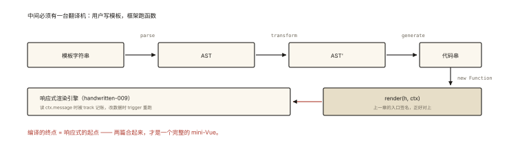
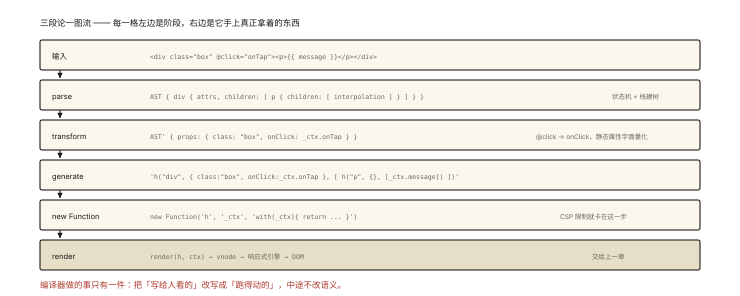
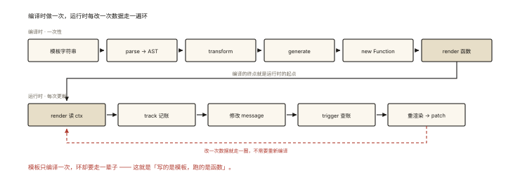

# 手写 mini-Vue（下）：模板编译

## 从「写模板」到「跑函数」之间发生了什么

```html
<div class="box" @click="onTap">
  <p>{{ message }}</p>
</div>
```

上一章的 mini-Vue 只认 **render 函数**（手写 h(...)）——但 Vue 用户写的是**模板**。中间必须有一台翻译机：



*图 · 编译的终点正好是响应式的起点，两篇在这里对接*

```
模板字符串 ──parse──▶ AST ──transform──▶ 优化后的 AST ──generate──▶ render 函数代码字符串
```

⭐⭐⭐ 模板编译三段论（parse → transform → generate）是「Vue 原理」面试的收官考点——它的终点恰好是上一篇的起点（render 函数），两篇合起来就是完整的 mini-Vue。

## 现象与直觉解释

三段论的分工（和任何编译器一样）：

| 阶段 | 输入 → 输出 | 职责 |
|---|---|---|
| parse | 字符串 → AST | 「读懂结构」：标签、属性、文本、插值切成树 |
| transform | AST → AST | 「改写优化」：标记静态节点、处理指令（v-if/@xx） |
| generate | AST → 代码字符串 | 「生成代码」：拼出 `h(...)` 嵌套调用的源码 |

AST（抽象语法树）是中间表示——**树状的结构化程序**，让「改写」可以精确到节点而不必再碰字符串。

## 深入原理

### 一、parse：状态机切分模板 ⭐

教学版 parser 用「指针推进 + 状态切换」处理三类语法：标签、插值 `{{ }}`、普通文本：

```js
function parse(template) {
  // 用栈维护当前打开的标签，形成树
  const root = { type: 'root', children: [] };
  const stack = [root];
  let i = 0;

  while (i < template.length) {
    const current = stack.at(-1);

    if (template.startsWith('<', i)) {
      // ── 标签区 ──
      if (template.startsWith('</', i)) {
        // 结束标签：</div> → 弹栈
        const end = template.indexOf('>', i);
        stack.pop();
        i = end + 1;
      } else {
        // 开始标签：<div class="box"> → 解析标签名+属性 → 压栈
        const tagEnd = template.indexOf('>', i);
        const isSelfClose = template[tagEnd - 1] === '/';
        const seg = template.slice(i + 1, isSelfClose ? tagEnd - 1 : tagEnd);
        const [tagName, ...attrParts] = seg.split(/\s+/);

        const attrs = {};
        attrParts.filter(Boolean).forEach((p) => {
          const m = p.match(/^(.*?)(?:="([^"]*)")?$/);
          attrs[m[1]] = m[2] ?? true;             // @click="onTap" → { '@click': 'onTap' }
        });

        const node = { type: 'element', tag: tagName, attrs, children: [] };
        current.children.push(node);
        if (!isSelfClose && !['br', 'img', 'input'].includes(tagName)) stack.push(node);
        i = tagEnd + 1;
      }
    } else if (template.startsWith('{{', i)) {
      // ── 插值区：{{ message }} ──
      const end = template.indexOf('}}', i);
      const expr = template.slice(i + 2, end).trim();
      current.children.push({ type: 'interpolation', expr });
      i = end + 2;
    } else {
      // ── 文本区：读到下一个 < 或 {{ 为止 ──
      let next = template.length;
      const lt = template.indexOf('<', i);
      const mu = template.indexOf('{{', i);
      if (lt !== -1) next = Math.min(next, lt);
      if (mu !== -1) next = Math.min(next, mu);
      const text = template.slice(i, next).trim();
      if (text) current.children.push({ type: 'text', text });
      i = next;
    }
  }
  return root;
}
```

对开篇模板产出的 AST（缩略）：

```js
{ type: 'root', children: [
  { type: 'element', tag: 'div', attrs: { class: 'box', '@click': 'onTap' }, children: [
    { type: 'element', tag: 'p', children: [
      { type: 'interpolation', expr: 'message' }
    ]}
  ]}
]}
```

### 二、transform：节点改写 ⭐

把「Vue 方言语法」翻译成「h 函数参数」。三个典型改写：

```js
function transform(node) {
  if (node.type === 'element') {
    // ① 事件指令：@click="onTap" → props: { onClick: ctx.onTap }
    const props = {};
    for (const [k, v] of Object.entries(node.attrs ?? {})) {
      if (k.startsWith('@')) props['on' + k.slice(1)[0].toUpperCase() + k.slice(2)] = `_ctx.${v}`;
      else if (k.startsWith(':')) props[k.slice(1)] = v;      // :xx 动态绑定（简化：表达式字符串）
      else props[k] = JSON.stringify(v);                      // 静态属性变成字面量
    }
    node.props = props;
    node.children?.forEach(transform);
  }
  return node;
}
```

（真实 Vue 在这步还做**静态提升**——纯静态子树被提取到 render 外只创建一次，及 **PatchFlag** 标记「这个节点只有 class 会变」让 patch 跳过无关 diff——transform 阶段是编译时优化的主战场。）

### 三、generate：拼出 render 源码 ⭐

```js
function generate(node) {
  if (node.type === 'text') return JSON.stringify(node.text);   // "文本"
  if (node.type === 'interpolation') return `_ctx.${node.expr}`; // 表达式 → 上下文取值
  if (node.type === 'element') {
    const children = node.children.map(generate);
    return `h("${node.tag}", {${Object.entries(node.props)
      .map(([k, v]) => `${k}: ${v}`).join(', ')}}, [${children.join(', ')}])`;
  }
  return `[${node.children.map(generate).join(', ')}]`;          // root
}

generate(transform(parse(template)))
// 产出：
// h("div", {class: "box", onClick: _ctx.onTap}, [
//   h("p", {}, [_ctx.message])
// ])
```

### 四：新 Function —— 从代码字符串到 render 函数 ⭐⭐

```js
function compile(template) {
  const code = generate(transform(parse(template)));
  // with：让代码里的裸标识符（message、onTap）从 ctx 上取值
  const render = new Function('h', '_ctx', `with(_ctx) { return ${code}; }`);
  return render;
}

// 组装进上一章的 createApp：
function mount(selector) {
  const ctx = { ...setupData, onTap };          // 模板里用到的变量都挂进 ctx
  const renderFn = compile(this.template);      // 模板 → render
  effect(() => {
    const vnode = renderFn(h, ctx);             // 读 ctx.message → 依赖收集 ✅
    prevVnode ? patch(prevVnode, vnode) : mount(vnode, container);
    prevVnode = vnode;
  });
}
```

两个必答追问：

- **为什么用 `with(_ctx)`**：模板里写的是 `{{ message }}` 而非 `_ctx.message`——with 把「裸标识符查找」重定向到 ctx 对象（严格模式禁 with，所以编译产物运行在非严格环境，或编译期就把标识符改写成 `_ctx.message`——**Vue3 实际用的是后者**：`prefixIdentifiers`，顺带换取更友好的 ESM 输出）；
- **`new Function` 与 eval 的关系**：都是动态执行代码；new Function 创建**全局作用域函数**（不携带当前闭包），比 eval 安全一点、性能更好；浏览器 CSP 的 unsafe-eval 限制对两者生效——**这正是「预编译」（vue-loader 编译成 render 存进产物）存在的理由**：运行时不带编译器（runtime-only 版本小 30%+），CSP 兼容。

### 五：完整流水线一图流 ⭐



*图 · 每一步的输入输出都摆出来，三段论就不再是名词*

```
"<div class=box @click=onTap><p>{{message}}</p></div>"
   │ parse（状态机：标签/插值/文本三分支 + 栈建树）
   ▼
AST { element div { attrs…, children: [ p { children: [ interpolation message ] } ] } }
   │ transform（@click→onClick、静态属性字面量化、（真实版：静态提升/PatchFlag））
   ▼
AST' { props: { class:"box", onClick:_ctx.onTap } … }
   │ generate（递归拼接 h(...) 源码）
   ▼
'h("div", {class:"box", onClick:_ctx.onTap}, [h("p", {}, [_ctx.message])])'
   │ new Function('h','_ctx', 'with…')
   ▼
render(h, ctx) ──▶ vnode ──▶ 上一章的响应式渲染引擎 ═▶ mini-Vue 完全体
```

## 回看开篇

`{{ message }}` 之所以能随数据变，全链路是：**模板编译成 render（编译时一次）→ render 读 ctx.message 被响应式系统记账（运行时每次）→ 修改触发重渲染**。「写的是模板，跑的是函数」——编译器就是这句话中间的翻译官。

## 实战延伸

**1. 面试答题骨架**：「Vue 模板编译分三步——parse 用状态机把模板切成 AST（标签栈建树、插值与文本分支）；transform 把 Vue 方言改写为标准属性（@click 转 onClick、静态属性字面量化，工业版再做静态提升与 PatchFlag 优化）；generate 递归拼出 h 调用的代码字符串，最后 new Function 加 with(ctx)（或前缀化标识符）生成 render 函数，交给响应式渲染引擎执行。运行时编译依赖 new Function 受 CSP 限制且体积大，所以工程上用预编译的 runtime-only 版本。」

**2. 动手建议**：把本篇与《handwritten-009》的代码合并成 `mini-vue.js`（约 250 行），你就拥有了一个「模板 + 响应式 + diff」全通的自制框架——面试时说「我写过一个 250 行的 Vue」的分量，远超背十遍原理。

## 图解总结



*图 · 编译一次，运行一万次 —— 这条分界线决定了体积与性能*

```
     编译时（一次性）                     运行时（每次更新）
模板 ─parse→ AST ─transform→ AST'        render(h, ctx) ─读ctx.message→ track
     └──generate→ 代码串                  │
        └─new Function→ render ──────────▶┴─修改 message → trigger → 重渲染
                         ⭐ 编译的终点 = 响应式的起点
```

## 总结

- 三段论：parse（状态机 + 栈建树）→ transform（方言改写与优化）→ generate（拼接 h 源码）；
- 插值/指令在 transform 里翻译为 props 与 ctx 取值；
- new Function + with（或标识符前缀化）把代码串变成 render；CSP 与体积是运行时编译的天花板，预编译是工业答案；
- 静态提升与 PatchFlag 是 transform 阶段的编译时优化，换来运行时 diff 的减负；
- 与上篇拼合即完整 mini-Vue：模板 → render → 响应式 → vnode → patch。

**面试一句话回答**：Vue 模板编译遵循 parse、transform、generate 三段式——parse 以状态机扫描模板，按标签、插值、文本三类分支并用标签栈构建出 AST；transform 阶段把 @click 等指令改写为标准 props、静态属性转为字面量，工业实现还做静态提升与 PatchFlag 等编译时优化；generate 递归拼出 h 函数嵌套调用的代码字符串，再用 new Function 配合 with(ctx) 或标识符前缀化生成 render 函数；由于运行时编译受 CSP 限制且增加体积，工程上普遍使用构建期预编译的 runtime-only 版本，编译产物交给响应式系统执行即可完成数据到视图的自动更新。

## 思考题

1. 给 parser 加上 `<!-- 注释 -->` 与 `<br>` 自闭合支持；再问：`<p>文本<b>加粗</b>继续</p>` 的 AST 长什么样（画出来）。
2. 把 `with(_ctx)` 方案改成「generate 时就输出 `_ctx.message`」——两者在标识符冲突（模板里有变量叫 h）时的行为差异？
3. 实现 `v-if="show"`：transform 阶段把它改写为三元表达式 `show ? h(...) : null`——写出 generate 分支；patch 遇到 null 节点怎么处理（衔接上篇）？
4. 开放设计：给 mini-Vue 加 `computed(fn)`——用 effect 的 lazy 模式（不立即执行）+ 脏检查实现缓存，说清它与「直接 effect」在重渲染次数上的差异。

（思考题解析将同步录入小程序题库，关联本文 id：handwritten-010）

## 参考文献：

- 《Vue.js 设计与实现》第 8~11 章（编译器完整实现）
- Vue 3 compiler-core 源码（AST 节点类型与 transform 插件化设计）
- 本课程《handwritten-009 mini-Vue（上）》《engineering-006 Babel 与 AST》（同源思想的另一应用）
