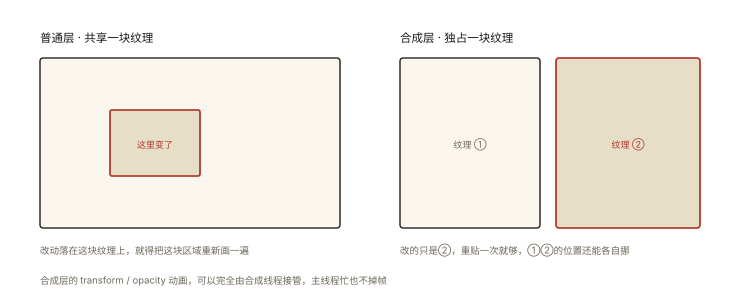

# 渲染原理之合成层与 GPU 加速

## 从「加了一行 will-change，内存翻倍」说起

```css
.list-item { will-change: transform; }   /* 听说能加速，给每个列表项都加上 */
/* 一千个列表项 → 一千个合成层 → 每层一张 GPU 纹理 → 内存暴涨、反而更卡 */
```

「GPU 加速」是前端最常被**误用**的优化——它不是免费的开关，而是**空间换时间**的交易。⭐⭐⭐ 本篇讲透合成层的创建条件、收益与代价，以及著名的「层爆炸」治理。

## 现象与直觉解释

回顾管线分工（rendering-001）：主线程负责 Style/Layout/Paint 的**计算**，光栅化与合成交给 GPU。**合成层（Compositing Layer）**的含义：

```
普通层：跟别人共享一张大纹理，改动要重绘受影响区域
合成层：独享一张 GPU 纹理（自己的一块"画布"）
  ✅ 收益: ① transform/opacity 更新只需 GPU 重新拼装（主线程零参与）
          ② 已光栅化的内容滚动/动画时直接复用（browser-basic-002 的丝滑滚动）
  ❌ 代价: ① 每层一张纹理 = 显存/内存（层数×面积×4字节）
          ② 层管理开销 + 首次提升的重绘
```

**一句话：合成层把「重绘的成本」前置成「常驻的内存」**——适合「频繁小更新」的元素，不适合静态大面积内容。

## 深入原理

### 一、什么会创建合成层 ⭐⭐⭐

```
显式（直接创建）:
  3D transform（translate3d/translateZ ≠ 0）⭐（"骗"GPU 提层的 hack 鼻祖）
  will-change: transform/opacity（明确告知"我要动画了"）⭐
  position: fixed（顶部悬浮条）
  video / canvas / WebGL
  opacity < 0.01 的"淡出中"等（部分场景）

隐式（被"逼"创建）——层叠与裁剪的连带 ⭐:
  overlap: 与合成层在层叠顺序上重叠的元素，可能被拉进来单独光栅化
  （"我有 3D transform 邻居" → 邻居们可能集体升级 —— 层爆炸的引信）
```

**overlap 是层爆炸的机制根源**：一个合成层如一块玻璃，压在它上下视觉范围内的元素为保正确混合可能各自被迫提层——一层带出一串。

### 二、GPU 为什么「快」⭐⭐

```
CPU Paint: 逐指令在内存里算像素（串行、通用）
GPU 合成: 纹理贴图运算（矩阵变换/透明度混合）—— GPU 的看家本领:
  ① 数千核心并行（天生为像素级运算设计）
  ② 独立于主线程 —— 主线程 JS 卡死，transform 动画照跑 ⭐
     （css-deep-010 "死循环时动画还在动"的真相）
  ③ 纹理复用 —— 内容不变只挪位置时零重绘
```

### 三、层爆炸（Layer Explosion）的治理 ⭐⭐⭐

```
症状: Layers 面板/DevTools 里几十上百层、内存高、滚动反而卡、掉帧伴随合成耗时高

三个治理方向:
① 精准 will-change: 只给"正在动画的那个元素"加，动画结束移除 ⭐
   el.style.willChange = 'transform';  // 动画前
   el.addEventListener('transitionend', () => {
     el.style.willChange = 'auto';      // 用完即撤 ⭐
   });
② 避免触发 overlap 链: 大面积背景别贴着 3D transform 元素；
   用 z-index/contain 控制"被牵连"的范围
③ 3D hack 的现代替代: will-change 是官方语义化的 translateZ(0)
   （hack 时代结束——别再无脑 transform: translateZ(0)）
```

### 四、判定「该不该提层」的决策表 ⭐⭐

```
值得提层（频繁更新的窄小元素）:
  - 持续 transform/opacity 动画的核心元素（轮播、悬浮球、过渡中的卡片）
  - 吸顶/悬浮的固定元素
  - video/canvas（天然层）

不值得（静态/大面积/海量重复）:
  - 静态文本与背景
  - 千行列表（除非虚拟滚动 + 个别行动画）
  - 「以防万一」的全局 will-change ❌
```

### 五、观测工具 ⭐

```
DevTools → Layers 面板: 3D 展示全部合成层（面积、内存估算、为什么提升）
DevTools → Rendering → Layer borders: 页面上高亮层边界（层爆炸可视化）
Performance 面板: Composite/GPU 轨道的耗时占比
```

## 回看开篇

will-change 翻车的机制：每个列表项独立成层 → 千张 GPU 纹理（内存）+ 合成器管理千层的开销 → 「加速」变成「加负」。正解：**只给正在动画的元素临时提层、用完即撤**——GPU 加速是手术刀，不是保健品。

## 实战延伸

**1. 面试答题骨架**：「合成层是独享 GPU 纹理的渲染层——transform/opacity 更新只需合成器重新拼装、主线程零参与，已光栅化内容复用让滚动丝滑；代价是每层一张纹理的显存与层管理开销。显式创建靠 3D transform、will-change、fixed 与 video；隐式创建来自与合成层重叠的 overlap 连带，这是层爆炸的根源——一层 3D 变换可能牵连周边元素集体提层。治理是精准临时 will-change 并在动画结束移除、控制重叠范围、用 Layers 面板观测层数与内存。判定标准是频繁小更新的窄小元素才值得提层，静态大面积内容不值得。」

**2. 一个快手判断题**：「`transform: translateZ(0)` 万金油加速」——错（层爆炸风险 + 静态内容零收益）；「死循环时 CSS 动画还在动说明 JS 线程没卡」——错（动画在合成线程/GPU，主线程已死）。

## 图解总结



*图 · 独立纹理换来了「只重贴、不重画」*

```
普通层: 共享纹理 │ 改动→重绘区域
合成层: 独享GPU纹理 │ transform/opacity→仅重新拼装(主线程无关) ⚡
        GPU: 数千核并行 │ 独立于主线程 │ 纹理复用

创建: 显式 3D transform │ will-change │ fixed │ video/canvas
     隐式 overlap(与合成层重叠被牵连) ← 层爆炸引信 ⭐
代价: 纹理内存(面积×4B) │ 层管理 │ 首次提升重绘
治理: 临时 will-change(动画前加/结束撤) │ 控制重叠 │ Layers面板观测
判定: 频繁小更新→值得 │ 静态/大面积/海量重复→不值得
```

## 总结

- 合成层 = 独享 GPU 纹理；收益是更新免重绘与纹理复用；代价是显存与管理；
- 显式创建：3D transform、will-change、fixed、video；隐式创建：overlap 连带；
- GPU 快在并行、独立主线程、纹理复用——transform 动画能在 JS 卡死时继续；
- 层爆炸源于 overlap 链与滥用 will-change；治理=精准临时提层+用完即撤；
- Layers 面板与 Layer borders 是观测手段。

**面试一句话回答**：合成层是拥有独立 GPU 纹理的渲染层，元素一旦提升为合成层，其 transform 与 opacity 的更新就只需合成器重新拼装纹理、完全不占用主线程，已光栅化的内容在滚动和动画中直接复用——这是 GPU 加速的本质收益；代价是每层一张按面积计算显存的纹理以及层管理开销。显式创建条件包括 3D transform、will-change、position fixed 与 video 等媒体元素，此外与合成层发生层叠重叠的元素会被隐式拉入合成层，这正是层爆炸的机制根源。正确用法是只给正在执行动画的元素临时添加 will-change 并在动画结束后移除，静态大面积内容与海量重复元素不值得提层，可用 Layers 面板观测层数量与内存占用。

## 思考题

1. 为什么 `will-change: transform` 要「临时加、用完撤」？浏览器对 will-change 的内存预算机制（超出撤销已有提示）。
2. 设计实验证明「JS 死循环时 transform 动画继续」：需要的条件（动画已在合成层上、无 JS 驱动）与反例（JS 改 left 的动画停摆）。
3. 轮播图容器提层，而轮播的指示器盖在容器上——指示器为什么可能被 overlap 拉层？怎么让它留在普通层（z-index 隔离/独立容器）？
4. 开放讨论：移动端显存有限（低端机更紧）——你的「层预算」规范怎么定（如 ≤ 15 层、单层 ≤ 1/3 视口面积）？

（思考题解析将同步录入小程序题库，关联本文 id：rendering-003）

## 参考文献：

- Chrome 开发者文档 — Layers 面板 / GPU 加速合成
- web.dev — 坚持仅合成器属性（compositor-only properties）
- 本课程《rendering-001 管线》《css-deep-010 动画》《performance-005 重排重绘》
