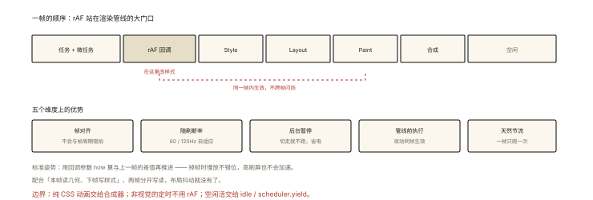

# 渲染原理之 requestAnimationFrame 与渲染时机

## 从「setInterval 做动画的原罪」说起

```js
// 用 setInterval 驱动动画的三个先天缺陷：
setInterval(move, 16);        // ① 16ms ≠ 帧周期（显示器可能 16.7/8.3/33ms）
                              // ② 主线程忙时照样排队 → 帧内多次执行被合并（跳帧感）
                              // ③ 后台标签页照跑 → 白费电
// rAF 的答案：把「何时执行」交还给【最懂渲染时机的人】——浏览器
```

⭐⭐⭐ rAF（requestAnimationFrame）是 JS 动画的正统入口——本篇讲清它与渲染管线的精确关系（在渲染的哪一步、为什么对齐不掉帧）。

## 现象与直觉解释

**rAF 的本质：在「本帧渲染之前」注册一个回调**。

```
浏览器的一帧（60Hz ≈ 16.7ms）：
  ① 执行任务（JS）→ 微任务
  ② 执行【rAF 回调队列】⭐ —— 帧的开端、Style/Layout/Paint 之前
  ③ Style → Layout → Paint → Composite（渲染管线，rendering-001）
  ④ 空闲（requestIdleCallback 的地盘）

rAF 回调在 ② 执行 —— 意味着:
  ✓ 回调里改样式 → 本帧管线立刻处理（同帧生效，不跨帧闪烁）
  ✓ 回调时序与屏幕刷新严格对齐（浏览器调度，与显示器同步）
```

## 深入原理

### 一、rAF vs setTimeout/setInterval 的五维碾压 ⭐⭐⭐

| 维度 | setTimeout/setInterval | rAF |
|---|---|---|
| 时机 | 「不早于 N ms」——拍脑袋定 | **帧对齐**（下一帧渲染前）⭐ |
| 帧率适应 | 固定间隔，与 120Hz/节能屏错拍 | 自动跟随屏幕刷新率 |
| 后台标签 | 照跑（最低限流到 1s） | **暂停**（省电）⭐ |
| 与渲染顺序 | 可能在帧内任意点（改样式可能错过本帧） | 保证在管线前执行 ⭐ |
| 掉帧行为 | 间隔漂移、回调堆积 | 每帧一次、天然节流 |

### 二、rAF 回调的执行细则（四个精确知识点）⭐⭐⭐

```js
// ① 时间戳参数：回调收到「帧的起始时间」
function tick(now) {
  const delta = now - lastTime;      // ⭐ 按【真实间隔】推进动画（掉帧时慢放不错位）
  lastTime = now;
  box.style.transform = `translateX(${x += speed * delta / 16.7}px)`;
  requestAnimationFrame(tick);
}
requestAnimationFrame(tick);

// ② 一帧内多次注册 → 同帧全部执行（按注册序）——rAF 不去重
requestAnimationFrame(a); requestAnimationFrame(b);   // 都在本帧 ② 执行

// ③ 回调里注册下一帧 → 下一帧才执行（不会当帧递归）
// ④ cancelAnimationFrame(id) 取消；页面隐藏时队列挂起、恢复时继续
```

**按 delta 推进**是 rAF 动画的标准姿势——帧率波动（掉帧/高刷）下动画速度恒定，不会「60Hz 屏正常、144Hz 屏快三倍」。

### 三、rAF 与管线的配合：读写分离的完美落点 ⭐⭐

《performance-005》的 Layout Thrashing 修复用到了 rAF——现在可以说清「为什么」：

```
rAF 回调（帧初、管线前）—— 最适合: 读几何（本帧 Layout 之前读，触发一次必然要做的布局）
微任务/下一帧 rAF —— 适合: 写样式（合并进本帧/下帧管线）
```

```js
// 经典模式：本帧读、下帧写
function tick() {
  const positions = items.map((el) => el.offsetTop);     // 读（本帧）
  requestAnimationFrame(() => {                          // 写（下一帧）
    items.forEach((el, i) => { el.style.transform = `translateY(${positions[i] + 1}px)`; });
    requestAnimationFrame(tick);
  });
}
```

### 四、rAF 不是万能：三类不适用 ⭐⭐

```
① 纯 CSS 能做的动画（transform/opacity 过渡）—— 交给合成器更省（css-deep-010）
   rAF 每帧都要主线程参与；CSS 动画可全程合成线程 ✅ 能 CSS 不 JS
② 非视觉的定时任务（轮询/倒计时）—— 语义错误（rAF 挂后台会停）
③ 高频数据更新（>帧率的 stock 行情）—— rAF 天然节流到帧率，反而合适？✅
   （反例提醒：若更新本身昂贵，考虑 OffscreenCanvas/Worker）
```

**决策句**：动画优先 CSS，需要 JS 逐帧控制（物理模拟、跟随手势、canvas 游戏）才上 rAF。

### 五、现代伙伴一览 ⭐

```
requestIdleCallback: 帧内空闲时段（低优先级任务——deadline 时间预算）
scheduler.postTask / yield(): 主动让出主线程（长任务拆分的新 API）
vsync 概念: rAF 对齐的「垂直同步」——屏幕刷新的物理节拍
```

## 回看开篇

setInterval 做动画的三宗罪对位 rAF 的三恩赐：时机交给浏览器（帧对齐）→ 不掉帧不错拍；后台暂停 → 省电；回调位于管线前 → 改动同帧生效。**「让最懂帧的人调度帧」**——rAF 的设计哲学。

## 实战延伸

**1. 面试答题骨架**：「rAF 把回调注册到每帧渲染流程的最前端——任务与微任务之后、样式计算布局绘制之前执行，因此回调中的样式修改会在同一帧生效；它与屏幕刷新率对齐并自动适应高低刷屏，后台标签页自动暂停以省电。回调参数是帧起始时间，动画应按时间差推进以兼容掉帧与高刷。它天然每帧一次不堆积，配合本帧读下帧写的模式可根治布局抖动；纯 transform/opacity 动画应交给 CSS 合成器，需要 JS 逐帧控制时才用 rAF。」

**2. 一道综合题**：把「scroll 事件里直接改 transform」改造成 rAF 合帧版——scroll 高频触发只置 dirty 标志，rAF 里统一应用——写出骨架（这也是 vue-005 批处理思想的渲染版）。

## 图解总结



*图 · rAF 站在渲染管线的门口，改的东西同一帧就能上屏*

```
一帧的结构:
 [任务→微任务] → [rAF回调 ⭐] → Style→Layout→Paint→Composite → [空闲(idle)]

rAF 五维优势: 帧对齐 │ 随刷新率 │ 后台暂停 │ 管线前执行(同帧生效) │ 天然节流
标准姿势: now 参数按 delta 推进（掉帧慢放不错位/高刷不加速）
配合: 本帧读(读几何于Layout前) + 下帧写(合并进管线) ← 治布局抖动
边界: 纯CSS动画优先 │ 非视觉定时不用 │ 伙伴: idle/yield
```

## 总结

- rAF 回调位于每帧「任务→微任务之后、渲染管线之前」——改动同帧生效；
- 五维优势：帧对齐、随刷新率、后台暂停、管线前执行、天然节流；
- 按 now 时间差推进动画——掉帧与高刷都稳；
- 本帧读下帧写的 rAF 模式治布局抖动；
- 能 CSS 不 JS；rAF 适用于需要逐帧 JS 控制的动画。

**面试一句话回答**：requestAnimationFrame 把回调安排在每帧渲染流程的最前端——在任务与微任务执行完之后、样式计算布局绘制之前运行，因此回调里修改的样式会在同一帧内生效而不跨帧闪烁；它的时机由浏览器按屏幕刷新率调度，自动适配高刷屏且不会与帧周期错拍，页面切到后台时自动暂停以省电。回调参数是当前帧的时间戳，动画应按与上一帧的时间差推进，这样掉帧时动画慢速播放不错位、高刷屏也不会加速。它天然每帧只执行一次不堆积；配合本帧读取几何、下一帧写入样式的模式可以根治布局抖动；纯 transform 与 opacity 动画应交给 CSS 合成器完成，只有需要 JS 逐帧控制的动画才使用 rAF。

## 思考题

1. 一帧内 `requestAnimationFrame(a); requestAnimationFrame(b); b 里再注册 c` —— a/b/c 各在哪一帧执行？
2. 掉帧实验：rAF 回调里故意跑 40ms 的死循环——观察帧率与 now 时间差的变化（delta 变大 → 动画正确慢放）。
3. 为什么 rAF 回调里「同步读取 offsetTop」比 setTimeout 回调里读更不容易抖？（读发生在本帧 Layout 前——这次布局横竖要做）
4. 开放设计：Canvas 小游戏循环——rAF 主循环 + 固定步长物理更新（accumulator 模式）+ 渲染插值——写出骨架并说明为什么不用 setInterval 固定步长。

（思考题解析将同步录入小程序题库，关联本文 id：rendering-004）

## 参考文献：

- HTML Standard — Event loop processing model（rAF 在帧中的规范位置）
- MDN — requestAnimationFrame / cancelAnimationFrame
- 本课程《js-async-005 事件循环》《performance-005 读写分离》《rendering-005 节拍》
