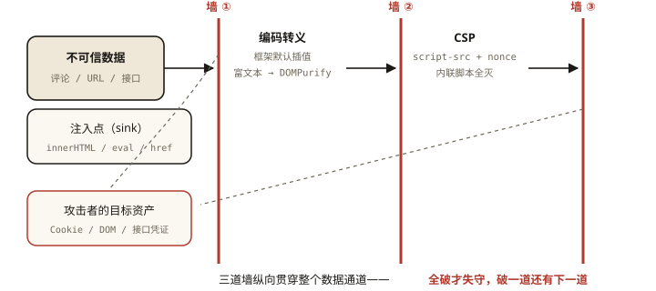

# 前端安全之 XSS：类型、防御与 CSP

## 从「一条评论偷走你的登录态」说起

> **系列导读**：《前端安全系列》共 5 篇——XSS、CSRF、点击劫持、数据安全、供应链。每篇按「攻击面 → 防御体系 → 工程清单」展开。

```
攻击者在评论区提交：
  好用！
你的浏览：
  1. 评论被渲染进 DOM —— onerror 执行（图片必失败）
  2. document.cookie 里有 session —— 发给了攻击者 💥
  3. 攻击者拿着你的身份逛你的账号
```

⭐⭐⭐ XSS（跨站脚本）是前端安全的头号敌人——本质：**攻击者的代码跑在了你的页面上，继承了你页面的一切权限**（Cookie、localStorage、DOM、接口）。

## 现象与直觉解释

XSS 的统一模型：

```
不可信数据（用户输入/URL/存储/接口）──▶ 未净化 ──▶ 进入"会被执行的上下文"
                                                      │
                          ├─ HTML 上下文（新标签/属性）
                          ├─ JS 上下文（script/事件）
                          └─ URL 上下文（href/src）

防御总公式: 数据按"去向上下文"做对应编码 + 默认不执行（CSP 兜底）
```

## 深入原理

### 一、三大类型：按「恶意脚本从哪来」分 ⭐⭐⭐

```
① 存储型（最危险）: 恶意代码存进数据库 → 每个访问者中招（开篇的评论）
② 反射型: 恶意代码在 URL 里 → 服务端"反射"回页面（搜索结果回显 q 参数）
   https://bank.com/search?q=<script>steal()</script>
③ DOM 型: 全程不经过服务器 —— 前端 JS 自己把数据写进可执行位置 ⭐
   location.hash → innerHTML（服务端防护对它无效！）
```

### 二、注入点地图（DOM 型的主战场）⭐⭐⭐

```js
// 高危 sink 清单（不可信数据到达即攻击）:
el.innerHTML = userInput;             // HTML 上下文
document.write(userInput);
el.setAttribute('href', userInput);   // javascript: 伪协议 ⚠️
eval(userInput); new Function(userInput);   // JS 上下文（v8-001 的老朋友）
setTimeout(userInput, 0);             // 字符串参数 = eval！
location.href = userInput;            // 开放重定向/伪协议

// 安全替代:
el.textContent = userInput;           // 纯文本 ⭐
const url = new URL(userInput);       // 解析后校验 origin 再用 ⭐
setTimeout(() => fn(userInput), 0);   // 函数形式
```

### 三、防御体系的三道墙 ⭐⭐⭐

**第一道：编码转义（按上下文）——主防线**

```
数据去向           必须做的转义
→ HTML 元素体      & < > " ' （HTML 实体）
→ HTML 属性值      同上 + 严格引号包裹
→ JS 字符串        \xXX unicode 转义（防 </script> 逃逸）
→ URL 参数         encodeURIComponent
⚠️ 没有万能转义 —— 「按去向编码」是 XSS 防御的第一原则 ⭐
```

**框架的现代红利**：React 的 `{}` 与 Vue 的 {{}} 默认转义（textContent 语义）——**框架默认安全，危险来自你主动逃离**：

```jsx
// React: dangerouslySetInnerHTML ── Vue: v-html —— 唯二的官方逃生口 ⭐
<div dangerouslySetInnerHTML={{ __html: userRichText }} />
// 逃生口的守则: 内容必须过 sanitize（DOMPurify）：
import DOMPurify from 'dompurify';
<div dangerouslySetInnerHTML={{ __html: DOMPurify.sanitize(userRichText) }} />
```

**第二道：CSP（Content Security Policy）——兜底防线** ⭐⭐⭐

```
// 响应头声明"本页面允许什么来源的什么资源" —— 违规的执行直接拦截:
Content-Security-Policy:
  default-src 'self';                  // 默认只允许同源
  script-src 'self' 'nonce-r4nd0m';    // 脚本仅限同源 + 带随机 nonce 的 ⭐
  object-src 'none';
  img-src * data:;
  report-uri /csp-report               // 违规上报（先观察模式上线 ⭐）

// 效果: 内联脚本(onerror/href=javascript:) 全灭 —— DOM 型 XSS 的天敌
// nonce 方案: 每次响应生成随机数 → 仅匹配的 <script nonce="r4nd0m"> 可执行
// ⚠️ 代价: 第三方脚本/内联样式要逐一放行 —— 渐进式收紧（Content-Security-Policy-Report-Only 先跑）
```

**第三道：Cookie 的 HttpOnly——损失控制** ⭐⭐

```
Set-Cookie: sid=xxx; HttpOnly; Secure; SameSite=Lax
// HttpOnly: JS 读不到 cookie → XSS 偷不走会话（network-008 的三件套之一）
// 即便前两道被突破，攻击者拿不到 Cookie —— 纵深防御的最后一环
// ⚠️ 但 XSS 仍可"以你身份"发请求（不需要偷 Cookie）——所以 CSRF 那篇是队友
```

### 四、工程清单（Review 时逐条勾）⭐⭐

```
□ 所有用户输入渲染: 框架默认插值（不用 v-html/dangerouslySetInnerHTML）
□ 富文本必须 DOMPurify.sanitize + 白名单配置
□ 跳转链接: new URL() 解析 + 协议白名单（http/https）
□ 不用 eval/new Function/字符串 setTimeout
□ CSP 已上线（Report-Only → 强制）+ script-src 带 nonce
□ 会话 Cookie: HttpOnly + Secure + SameSite
□ 文件上传: 校验类型/MAGIC 数/隔离域名（SVG 可含脚本 ⚠️ 常被忽略）
□ 第三方脚本的 SRI（integrity 哈希——security-005 的伏笔）
```



*图 · XSS 纵深防御地图——不可信数据流经的通道上，编码、CSP、HttpOnly 三道墙层层设卡*

## 回看开篇

评论偷 Cookie 的攻击链断在哪：框架默认转义（第一道）让 `` 变纯文本；即便漏网，CSP 拦截内联事件（第二道）；即便再漏，HttpOnly 让 `document.cookie` 读不到任何东西（第三道）——**任何单道防线都可能破，纵深防御的意义就是「全破才失守」**。

## 实战延伸

**1. 面试答题骨架**：「XSS 是攻击者脚本注入到页面并继承其权限，分存储型、反射型与全程不经服务器的 DOM 型。防御是三道纵深的墙——按数据去向上下文做对应编码，框架默认插值就是转义、危险只在 v-html 与 dangerouslySetInnerHTML 逃生口，富文本必须 DOMPurify 白名单净化；CSP 用 default-src 与 nonce 化 script-src 拦截一切未授权脚本包括内联事件，先 Report-Only 观察再强制；会话 Cookie 加 HttpOnly 让 XSS 偷不走凭证。Review 清单覆盖转义、跳转白名单、禁 eval、SVG 上传隔离与第三方 SRI。」

**2. 一道攻击链推演题**：`?redirect=` 参数被写入 `location.href`——推演危害（钓鱼跳转）与修复（origin 白名单）。

## 图解总结

```
XSS = 你的页面执行了别人的代码（继承 Cookie/DOM/接口权限）
三型: 存储(库→全员) │ 反射(URL→回显) │ DOM(前端sink，绕过服务端) ⭐

注入 sink: innerHTML │ setAttribute │ eval/字符串setTimeout │ location 赋值
三道墙:
 ①编码(按上下文): 框架默认已做 │ 逃生口v-html/dangerously→必须DOMPurify
 ②CSP: default-src 'self' + script-src nonce —— 内联全灭(Report-Only渐进)
 ③HttpOnly: 偷不走Cookie(损失控制)
清单: 转义│URL白名单│禁eval│SVG隔离│SRI —— 纵深防御=全破才失守
```

## 总结

- XSS 三型：存储、反射、DOM（前端 sink、绕过服务端）；
- 第一道墙：按上下文编码——框架默认安全，逃生口必须 sanitize；
- 第二道：CSP + nonce——内联与未授权脚本全拦，Report-Only 渐进上线；
- 第三道：HttpOnly Cookie 损失控制；
- 高危 sink 与 SVG 上传是 Review 重点；纵深防御是核心思想。

**面试一句话回答**：XSS 指攻击者把脚本注入页面从而继承页面的全部权限，按来源分存储型——恶意代码入库后波及所有访问者、反射型——恶意参数被服务端回显、DOM 型——前端直接把不可信数据写入 innerHTML 等危险节点、完全不经过服务端。防御是三道纵深：其一是按数据去向的上下文做对应编码，现代框架的默认插值就是转义，风险集中在 v-html 与 dangerouslySetInnerHTML 两个逃生口，富文本必须经 DOMPurify 白名单净化；其二是内容安全策略，通过 default-src 与带随机 nonce 的 script-src 拦截一切未授权脚本与内联事件，建议先用 Report-Only 观察再强制；其三是给会话 Cookie 加 HttpOnly，即使注入成功也偷不走凭证。跳转链接要做协议与域名白名单，禁用 eval 与字符串定时器，SVG 上传与第三方脚本的 SRI 也在清单之内。

## 思考题

1. `encodeURIComponent` 转义后的数据放进 `innerHTML` 安全吗？（不——那是 URL 编码不是 HTML 编码——「按上下文」的反面教材）
2. CSP 的 nonce 与 hash 两种放行方式差异？（每响应随机 vs 固定内容指纹——缓存与 SSG 场景的适配）
3. `target="_blank"` 的 `rel="noopener"` 防的是什么？（反向 tabnabbing——window.opener 钓鱼，与 XSS 的近亲）
4. 开放设计：给「用户自定义主页装扮（背景图/公告/昵称徽章）」设计 XSS 防线——每个字段按去向列出编码与白名单。

（思考题解析将同步录入小程序题库，关联本文 id：security-001）

## 参考文献：

- OWASP — XSS Prevention Cheat Sheet（上下文转义的权威清单）
- MDN — Content Security Policy
- DOMPurify 文档（白名单配置）
- 本课程《es6-003 标签模板》（safeHtml 的转义收口）、《network-008 Cookie》
