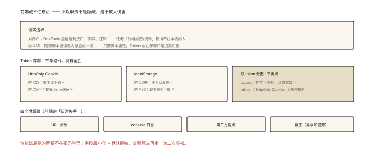

# 前端安全之数据安全：加密与脱敏

## 从「F12 里躺着明文身份证号」说起

```
排查一个"用户信息泄露"工单：
  DevTools → Network → 响应体: { "idCard": "110101199003077758", "phone": "13800138000" }
  —— 明文全量下发到浏览器，任何 XSS / 任何打开 F12 的同事都看得见
```

⭐⭐ 前端数据安全的第一性原理：**浏览器是公开环境**——一切到达前端的数据都视为「用户可见、攻击者可得」。本篇讲正确的期望边界：什么能防、什么防不了、工程上怎么做。

## 现象与直觉解释：信任边界的诚实清单 ⭐⭐⭐

```
前端【不可能】做到的（诚实期望）:
  ✘ 对「用户本人」隐藏数据（他 F12/抓包就能拿）
  ✘ 前端加密对抗「能执行 JS 的攻击者」（XSS 下密钥与明文同在 ⭐）

前端【能】做到的:
  ✓ 传输层防窃听（HTTPS —— network-005）
  ✓ 降低泄露的「爆炸半径」（脱敏/最小化/时效）
  ✓ 防水平误读（日志/截图/URL 中的敏感信息治理）
  ✓ 配合服务端方案（token 时效、接口级权限、二次鉴权）
```

**核心心法：前端安全的多数正确答案在服务端，前端的职责是「不放大伤害」**。

## 深入原理

### 一、数据最小化与脱敏（性价比之王）⭐⭐⭐

```
原则1 最小下发: 列表页不需要身份证全号 → 服务端只回脱敏版
原则2 展示脱敏（前端兜底 + 服务端脱敏双保险）:
  maskPhone('13800138000')  // 138****8000
  maskIdCard('110101…7758') // 110101**********58
  maskName('张三丰')         // 张**  / **丰（保留姓）
原则3 默认脱敏 + 显性脱敏交互:
  敏感字段默认打码，"查看完整"按钮触发【二次鉴权接口】
  （后端校验 + 审计日志）—— 客服系统的标准形态 ⭐
```

### 二、Token 的存放之争：三种方案的攻防表 ⭐⭐⭐

```
方案A: HttpOnly Cookie
  ✅ 免疫 XSS 偷取 │ ✅ 天然带 SameSite 属性 │ ❌ 需要 CSRF 防御（security-002）
方案B: localStorage
  ✅ 免疫 CSRF（不自动携带）│ ❌ XSS 一锅端（读到就永久有效 ⭐）
方案C: 内存变量（refresh token 换短期 access）
  ✅ XSS 只偷到当次会话的短期 access（15min 失效）
  ✅ refresh token 可存 HttpOnly cookie —— 攻击者两头都够不着 ⭐ 推荐
  ❌ 刷新页面要重走 refresh 流程（体验成本）
```

**攻防结论**：没有完美方案——「**短时效 + 双 token 分置**」是当下最佳平衡（XSS/CSRF 各防一半）。

### 三、前端加密的正确定位 ⭐⭐

```
「登录密码 RSA/HTTPS 之外再加密一次」有意义吗？
✅ 有边界意义的场景:
  · 传输层之外的纵深（万一 HTTPS 被剥离/企业代理看流量）—— 密码不明文进日志 ⭐
  · 本地缓存的敏感配置（配合 WebCrypto 的 AES-GCM）
❌ 无意义/有害的幻想:
  · "加密防止用户看到接口数据"（解密代码在前端，F12 单步即破）
  · 自造加密算法/混淆当安全（obfuscation ≠ security ⭐）

工程姿势: WebCrypto API（SubtleCrypto）替代老 JS 加密库
  const key = await crypto.subtle.generateKey({name:'AES-GCM',length:256}…)
  const cipher = await crypto.subtle.encrypt({name:'AES-GCM',iv}, key, data)
```

### 四、容易被忽视的四个泄露面 ⭐⭐

```js
// ① URL 里的敏感数据（会进: 浏览器历史/服务器日志/Referer/分享）
location.href = `/user?phone=13800138000`;   // ❌
// → 敏感标识走 POST body / 用不可逆的替代 ID

// ② 前端日志的过度打印
console.log('提交订单', order);   // 含身份证的 order 进了开发者的控制台/上报
// → 生产禁用 verbose 日志（terser drop_console）+ 敏感字段脱敏函数 ⭐

// ③ 第三方脚本的"合法窃听"
分析/客服脚本拿到你页面的全部 DOM —— 埋点别把敏感字段塞进
track('view_user', { idCard }) ❌ —— 脱敏后才可出域 ⭐

// ④ 截图水印（震慑 + 追责）: 页面级透明水印（工号+时间哈希）——
// 泄露后可溯源（内部系统的标配）
```

## 回看开篇

F12 明文身份证的修复组合拳：服务端**脱敏下发**（列表页只要掩码版）+ **默认脱敏、查看完整走二次鉴权**（最小暴露面）+ 接口日志脱敏治理——「加密传输保途中、脱敏治理保两头」。前端数据安全的正解从来不是「藏」，而是**控制暴露面与时效**。

## 实战延伸

**1. 面试答题骨架**：「前端数据安全的边界是浏览器属于公开环境——对用户本人和能执行脚本的攻击者都无法真正隐藏数据，因此多数正确答案在服务端，前端职责是不放大伤害。核心手段是数据最小化与默认脱敏，查看完整信息走二次鉴权接口；认证凭证采用短期 access token 存内存配合 refresh token 存 HttpOnly Cookie 的双 token 分置，使 XSS 与 CSRF 各只能偷到一半；前端加密仅作传输层之外的纵深与本地缓存防护，用 WebCrypto 而非自造算法；同时治理 URL 参数、前端日志、第三方埋点与截图水印四个易漏泄露面。」

**2. 一道判断题**：「密码 RSA 加密后传输，被抓包也安全吗？」——若 HTTPS 正常，RSA 那层是纵深（防代理日志/剥离）；若攻击者能剥离 HTTPS，通常也能改你的加密 JS——**不要用「前端加密」替代传输安全**。

## 图解总结



*图 · 先承认藏不住，再决定把 Token 放在哪*

```
诚实边界: 前端藏不住(对用户/对XSS) —— 前端的职责=不放大伤害
最小化+脱敏: 列表只要掩码 │ 默认脱敏+二次鉴权查看 ⭐
Token三案: HttpOnly Cookie(防XSS不防CSRF) │ localStorage(反之) │
          双token分置(access内存短期+refresh HttpOnly) ⭐平衡点
前端加密定位: 纵深(防代理日志/本地缓存) ≠ 替代HTTPS ≠ 混淆即安全
四泄露面: URL参数 │ console日志 │ 第三方埋点 │ 截图水印(溯源)
```

## 总结

- 诚实边界：前端无法对用户/XSS 隐藏数据——正解多在服务端；
- 最小化与默认脱敏 + 二次鉴权是性价比之王；
- 双 token 分置平衡 XSS/CSRF 两难；
- 前端加密是纵深不是替代；用 WebCrypto；
- 治理四个暗面：URL、日志、埋点、截图。

**面试一句话回答**：前端数据安全的第一性原理是浏览器属于公开环境——数据一旦到达前端就必须视为用户可见、攻击者可得，因此真正的隐藏只能由服务端完成，前端的职责是不放大伤害。工程手段上：坚持数据最小化与默认脱敏，完整敏感信息通过带审计的二次鉴权接口按需查看；认证凭证采用双 token 分置——短期 access token 放内存、refresh token 放 HttpOnly Cookie，让 XSS 只能偷到短期凭证、CSRF 又拿不到刷新令牌，两头各防一半；前端加密只作为传输层之外的纵深防御与本地缓存保护，使用 WebCrypto 而非自造算法，绝不能替代 HTTPS；同时治理 URL 参数、控制台日志、第三方埋点数据与截图水印这四个常被忽视的泄露面。

## 思考题

1. 「页面级水印」如何做到「删除 DOM 也没用」？（MutationObserver 重建 + canvas 背景图双层——dom-events-006 的安全应用）
2. log 系统「敏感字段自动脱敏」的拦截点设计？（重写 console / 上报 SDK 的 transform——在架构层收口）
3. 内嵌第三方页面向你 postMessage 数据——接收侧的校验清单？（origin 白名单 + schema 校验 + 最小字段）
4. 开放讨论：个保法语境下「最小必要」原则对前端的数据采集清单意味着什么？（采集字段逐条对齐业务目的——合规视角的技术落地）。

（思考题解析将同步录入小程序题库，关联本文 id：security-004）

## 参考文献：

- MDN — Web Crypto API
- OWASP — Cheat Sheet Series（数据保护条目）
- 本课程《network-005 HTTPS》《network-008 Cookie》《security-001 XSS》（三块地基）
