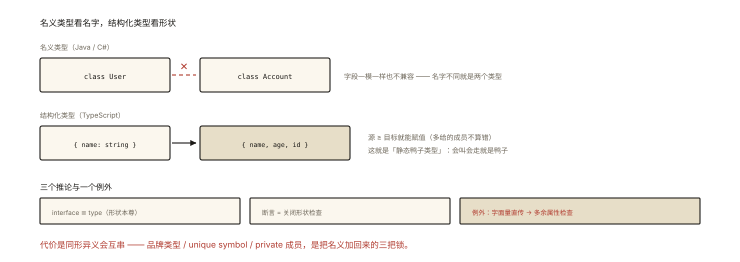

# TypeScript 之结构化类型系统

## 从「两个不同名字的类型为什么能互相赋值」说起

> **系列导读**：《TypeScript 系列》共 8 篇——从类型系统的本质到类型体操、工程实践，把 TS 从「会写注解」带到「懂系统」。

```ts
interface User { name: string; age: number }
interface Person { name: string; age: number }

const u: User = { name: 'a', age: 1 };
const p: Person = u;   // ✅ 竟然不报错！User 和 Person 明明是两个类型
```

Java/C# 里这是天大的错误（不同名义类型绝不兼容）；TS 里这是**设计使然**——**结构化类型（Structural Typing）**：**类型兼容看「形状」，不看「名字」**。⭐⭐ 这是 TS 类型系统的第一性原理，后续所有类型行为（鸭子检查、宽窄兼容、any 的危害）都由它推导。

## 现象与直觉解释

两种类型哲学对照：

```
名义类型（Nominal，Java/C#/Rust）:
  类型 A 和 B 是什么，由【声明的名字】决定 —— 名不同即不兼容

结构化类型（Structural，TS）:
  类型是什么，由【值的结构】决定 —— 形状匹配即兼容
  "If it walks like a duck and quacks like a duck, it's a duck"（鸭子类型的静态版）
```

```ts
function greet(x: { name: string }) { return `hi ${x.name}` }

greet({ name: '小明' });                      // ✅ 形状匹配
greet(new User('小明'));                       // ✅ 任何"有 name: string"的东西
greet({ name: 'a', age: 1, extra: true });     // 作为【变量】✅（多余属性无妨）
greet({ name: 'a', age: 1 });                 // 作为【字面量直传】❌ ❗
// ↑ 著名的「多余属性检查」：仅对象字面量直接赋值时触发（防拼写错误的特例）
```

## 深入原理

### 一、兼容规则：宽窄与「至少有」⭐⭐⭐

结构化系统的核心判定：**目标类型的每个成员，源类型都有兼容的实现**（源 ≥ 目标，「多给可以，少给不行」）：

```ts
interface Point2D { x: number; y: number }
interface Point3D { x: number; y: number; z: number }

let p2: Point2D;
let p3: Point3D = { x: 1, y: 2, z: 3 };
p2 = p3;        // ✅ 3D ⊇ 2D（多的无所谓）—— 赋值兼容方向
// p3 = p2;     // ❌ 2D 缺 z —— 反方向不行

// 函数参数位发生的同样判定 = 「逆变/协变」的直观来源（ts-005 展开）:
function render(p: Point2D) {}
render(p3);     // ✅ 传"更多"的没问题
```

### 二、为什么 TS 选结构化？（历史与工程的双答案）⭐⭐

```
历史: TS 要给【海量存量 JS】（无类型=全部互相兼容）渐进加类型——
      结构化允许"任何 JS 值"平滑获得一个"形状描述"，无需改造。
工程: 前端数据多来自 JSON（运行时就是无名结构）——
      接口返回的 { name, age } 天然是"形状"，名义化反而要强加仪式。
```

### 三、结构化的代价与「名义化」的需求 ⭐⭐⭐

**坑现场**：两个语义完全不同、形状恰好相同的类型静默互串：

```ts
interface Meters { value: number }
interface Seconds { value: number }

function wait(t: Seconds) {}
wait({ value: 100 });          // ✅ 编译器毫不阻拦 —— 但 100 米当 100 秒用了 💥
```

**名义化的三种手工方案**（结构化系统里造「防串门标记」）⭐：

```ts
// 方案1: 品牌类型（Branding）—— 不可达的标记成员
type Meters = number & { __brand: 'Meters' };
type Seconds = number & { __brand: 'Seconds' };
const asMeters = (n: number) => n as Meters;
const asSeconds = (n: number) => n as Seconds;
wait(asMeters(100));           // ❌ 编译期拦截！✅
wait(asSeconds(100));          // ✅ 必须显式声明单位

// 方案2: unique symbol（品牌升级版，Symbol 唯一性防伪造）
// 方案3: 私有类字段（class 的 private 使结构不兼容 —— 天然名义化通道）
class UserId { private __tag = 'UserId'; constructor(public id: string) {} }
```

### 四、结构化视角下的三个高频现象 ⭐⭐

```ts
// ① 类型断言的本质: "形状上说得通就闭嘴"
const el = document.querySelector('#x') as HTMLInputElement;
// 断言不是转换，只是关闭检查——双向形状差距过大时 as 也不给过（要先 as unknown）

// ② 字面量类型为什么是「收窄的形状」
let x: 'a' | 'b';              // x 的形状被限制到两个精确值
// 字面量 = 结构的最小颗粒 —— ts-005 收窄的基石

// ③ 接口 vs 类型别名: 结构化视角下等价
// interface Point { x: number } ≡ type Point = { x: number }
// 差异只剩: extends 能力/声明合并/报错可读性 —— 形状才是本尊
```

### 五、编译后的真相：类型擦除 ⭐⭐⭐

```ts
const u: User = { name: 'a', age: 1 };
// 编译产物:
const u = { name: 'a', age: 1 };        // 类型消失！
```

**推论三连**：① TS 是「编译期检查器」不是运行时保障（外部 JSON 仍需校验——zod/valibot 补运行时层）；② 类型不影响性能（擦除后与 JS 等价）；③ 品牌/枚举等「类型把戏」在运行时**不存在**（Branding 的标记成员编译后消失——所以它只需「类型上不可达」）。

## 回看开篇

User 赋给 Person 不报错的原因：TS 只问「Person 要的每个成员，User 有没有兼容的」——名字是文档、形状才是身份。「多余属性检查」是结构化海洋中唯一的小岛（字面量直传时的拼写防线）——理解它是特例，才算真正理解结构化。

## 实战延伸

**1. 面试答题骨架**：「TS 采用结构化类型系统——类型兼容由成员结构决定而非名称，源类型具备目标类型的全部成员即可赋值，多出的成员不影响（对象字面量直传时的多余属性检查是唯一例外，用于拦截拼写错误）。这一选择服务于为存量 JS 渐进加类型与契合 JSON 数据形态。代价是同形状异语义的类型会静默互串，可用品牌类型、unique symbol 或私有字段手工实现名义化。类型在编译后被完全擦除，因此 TS 只提供编译期保障，运行时数据仍需独立校验。」

**2. 一道经典题**：「为什么 `interface Window` 可以声明合并扩展？」——结构化系统里，同名 interface 的成员按结构合并；这也是 polyfill/全局扩展（`.d.ts`）的通道。

## 图解总结



*图 · 名字与形状，两种身份观，决定了能不能赋值*

```
名义类型: 名字即身份 │ 结构化: 形状即身份（TS）"静态鸭子类型"
兼容判定: 源 ⊇ 目标（多给可以）│ 字面量直传触发多余属性检查（唯一例外）
推论: interface≡type(形状本尊) │ 断言=关闭形状检查 │ 字面量类型=最小形状
代价: 同形异义互串 → 品牌类型/unique symbol/private 实现名义化
运行时: 类型擦除 → 编译期保障 ≠ 运行时保障（zod 补位）
```

## 总结

- 结构化：形状即身份；源 ≥ 目标即可赋值；
- 字面量直传的多余属性检查是唯一例外（防拼写）；
- 历史与 JSON 生态决定了这一选择；
- 同形异义用品牌/symbol/private 名义化；
- 类型擦除：TS 是编译期系统，运行时校验需独立方案。

**面试一句话回答**：TypeScript 采用结构化类型系统——类型的兼容性由值的成员结构决定而非类型名称，只要源类型具备目标类型的全部成员及其兼容类型就可以赋值，多余成员不影响兼容，唯一的例外是对象字面量直接赋值时会触发多余属性检查以拦截拼写错误。这个设计源于为存量 JavaScript 渐进添加类型以及契合 JSON 数据无名结构的生态现实。代价是形状相同而语义不同的类型会静默互通，可以通过品牌类型、unique symbol 或类的私有字段手工实现名义化隔离。此外类型信息在编译后被完全擦除，TypeScript 只提供编译期保障，来自外部的运行时数据仍需 zod 等方案独立校验。

## 思考题

1. `let p: Point2D = p3`（3D→2D）合法，那 `const arr3d: Point3D[] = []; const arr2d: Point2D[] = arr3d;` 呢？（数组的协变——TS 有意放宽，运行时可能读越界成员的场景讨论）
2. 实现完整的品牌类型工具：`Brand<T, B>` 及 `UserId`/`OrderId` 的完整定义（含 asUser 安全构造器）。
3. 为什么「typeof jsonParse 的返回值」拿不到精确类型？类型系统与运行时世界的边界在哪？
4. 开放讨论：Rust 的 newtype 模式与 TS 品牌类型的对比——零成本抽象 vs 擦除后的纯类型标记。

（思考题解析将同步录入小程序题库，关联本文 id：ts-001）

## 参考文献：

- TypeScript Handbook — Type Compatibility（结构化兼容的官方文档）
- 《Programming TypeScript》（Boris Cherny）第 4 章
- 本课程《ts-007 any 与 unknown》《security-004 数据校验》（运行时侧的接力）
