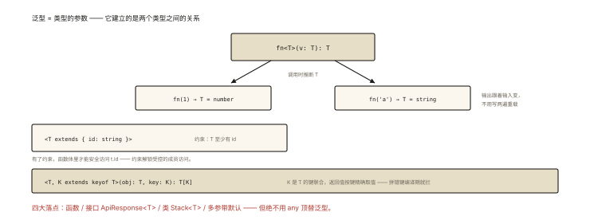

# TypeScript 之泛型与类型约束

## 从「一个 identity 函数暴露的问题」说起

```ts
function identity(value: any) { return value; }   // ✅ 能跑 ❌ 类型丢了
const n = identity(42);        // n: any —— 后面 n.split() 都不报错 💥

function identityNumber(v: number) { return v; }  // 类型保住了 ❌ 只能 number
function identityString(v: string) { return v; }  // ❌ 再抄一遍？

// 泛型：类型也能是「参数」⭐
function identity<T>(value: T): T { return value; }
const n = identity(42);        // n: number ✅（T 被推断为 number）
const s = identity('hi');      // s: string ✅ 一个函数，所有类型，类型不丢
```

⭐⭐ 泛型是「类型的函数参数」——本文从直觉到约束（extends/keyof）到工程实战，把泛型讲透。

## 现象与直觉解释

```ts
// 普通（值世界）:  function add(a: number, b: number): number     值是参数
// 泛型（类型世界）: function identity<T>(v: T): T                 类型也是参数 ⭐
//                                     ▲
//                          调用时由【实参的类型】填充 —— 类型推断

// 直觉：泛型 = 「类型的占位符」，调用那一刻才确定；
//       好处 = 在编译期建立「输入类型 ↔ 输出类型」的关联（上面 T → T）
```

## 深入原理

### 一、类型推断：T 是怎么被「算出来」的 ⭐⭐

```ts
function first<T>(arr: T[]): T { return arr[0]; }

first([1, 2, 3]);        // 从实参 [1,2,3] 推出 T=number → 返回 number
first(['a']);            // T=string
first<number | string>([1, 'a']);  // 显式指定（推断不唯一/被 any 污染时）

// 推断失败的常见现场：实参是 any（第三方未类型化的数据）
first(JSON.parse('["a"]'));   // T=any ❗ —— 泛型救不了 any 进来的数据
```

### 二、约束 extends：「T 不能是任何东西」⭐⭐⭐

无约束的 T 只能当 T 用（不敢碰任何属性）——约束声明「T 至少长什么样」：

```ts
// 场景：取对象属性长度
function getLength<T>(obj: T) {
  return obj.length;    // ❌ T 可能是 number，number 没有 length
}

function getLength<T extends { length: number }>(obj: T) {
  return obj.length;    // ✅ 约束保证了 length 存在
}
getLength('abc');        // ✅ string 有 length
getLength([1, 2]);       // ✅
getLength(123);          // ❌ 编译期拦截
```

**约束的三个常用形态** ⭐：

```ts
<T extends object>                    // 排除原始值
<K extends keyof T>                   // 「T 的某个键」（下一节）
<T extends string | number>           // 联合约束
```

### 三、keyof + 索引访问：类型安全的属性操作（泛型最经典组合）⭐⭐⭐

```ts
// 需求：pick(obj, key) —— obj[key] 但要类型安全
function pick<T, K extends keyof T>(obj: T, key: K): T[K] {
  return obj[key];
}
const user = { name: 'a', age: 1, vip: true };

pick(user, 'name');    // 返回 string（K='name' → T[K]=string）✅
pick(user, 'vip');     // 返回 boolean ✅
pick(user, 'nam');     // ❌ 拼错编译期报错 —— 「魔法字符串」的终结者 ⭐

// keyof T = 「T 的所有键组成的联合类型」: 'name' | 'age' | 'vip'
// T[K]   = 索引访问: 取该键对应的值类型
// 三件套含义: 「拿 T 类型的对象、它的某个真实存在的键 K、返回该键的值类型」
```

### 四、泛型的日常四大件 ⭐⭐

```ts
// ① 泛型接口/类型（容器的类型描述）
interface ApiResponse<T> { code: number; data: T; message: string }
const res: ApiResponse<User[]> = await fetchUsers();

// ② 泛型类
class Stack<T> {
  private items: T[] = [];
  push(v: T) { this.items.push(v); }
  pop(): T | undefined { return this.items.pop(); }
}

// ③ 多泛型参数（建立多个类型的关系）
function swap<A, B>(pair: [A, B]): [B, A] { return [pair[1], pair[0]]; }

// ④ 默认类型参数
interface Paginated<T, Extra = { total: number }> {
  list: T[];
  extra: Extra;
}
```

### 五、泛型 vs 函数重载 vs any：选型 ⭐⭐

```
any:      放弃类型 —— 出现在"泛型"该在的位置 = 代码坏味道 ⭐
重载:     每种类型一个签名 —— 适合「不同类型行为不同」（输入 string 输出 number 等）
泛型:     一个签名走天下 —— 适合「输入输出类型相关联」（T→T、T[]→T）
判据: 输出类型能否用输入类型的【同一个 T】表达？能→泛型；不能但有限几类→重载
```

### 六、工程化实战两则 ⭐⭐

```ts
// ① API 层的泛型请求封装（TS 项目最常见落点）
function http<T>(url: string, init?: RequestInit): Promise<T> { /* fetch + json */ }
const user = await http<User>('/api/user/1');     // user: User ✅

// ② Vue/React 的类型化工具
const state = reactive<{ count: number }>({ count: 0 });
useRoute<{ id: string }>();                       // 泛型化的框架 API
```

## 回看开篇

identity 三版的进化：any（类型丢失）→ 类型重载（穷举地狱）→ 泛型（`T` 建立输入输出的类型关联，调用时推断填充）。**泛型的价值一句话：让「类型」像「值」一样参数化，在编译期表达类型之间的函数关系。**

## 实战延伸

**1. 面试答题骨架**：「泛型是类型的参数——调用时由实参类型推断填充，建立输入输出类型的编译期关联。约束用 extends 声明 T 至少具备的结构，如 extends { length: number } 才能访问 length；keyof 与索引访问 T[K] 组合实现类型安全的属性操作，拼错键名在编译期报错。日常四大件是泛型函数、泛型接口（ApiResponse 这类容器描述）、泛型类与多参数泛型；与 any 和重载的选型判据是输出类型能否用输入的同一个 T 表达——能则泛型、类型间是固定映射则重载、任何情况下都不该用 any 顶替泛型的位置。」

**2. 一道经典手写题**：`pluck<T, K extends keyof T>(objs: T[], key: K): T[K][]`——三行代码考全本篇。

## 图解总结



*图 · T 是占位符，推断发生在调用点*

```
泛型 = 类型的参数:  fn<T>(v: T): T     调用时推断 T
约束:  <T extends 形状>   → T 至少有…（可访问约束成员）
经典组合: <T, K extends keyof T>(obj: T, key: K): T[K]
          ↑ T的键联合 ↑ 按键取值类型 —— 拼错键编译期拦截 ⭐
四大件: 函数 │ 接口 ApiResponse<T> │ 类 Stack<T> │ 多参+默认 <A, B=…>
选型: 输出=输入的T → 泛型 │ 固定映射 → 重载 │ 禁止用 any 顶替泛型
```

## 总结

- 泛型是类型参数，推断发生在调用点，建立类型间编译期关系；
- extends 约束「T 至少长什么样」——解锁受控的成员访问；
- keyof + T[K] 是类型安全属性操作的经典组合（消灭魔法字符串）；
- 四大件：函数/接口/类/多参默认；
- 选型：T 能表达用泛型、固定映射用重载、any 顶替泛型是坏味道。

**面试一句话回答**：泛型把类型本身变成函数的参数——调用时 TypeScript 根据实参类型推断填充泛型变量，从而在编译期建立输入与输出类型之间的关联，例如 identity 返回值的类型随传入参数精确变化。约束通过 extends 声明泛型至少具备的结构，比如 T extends { length: number } 之后才能安全访问 length。最经典的组合是 T 配合 K extends keyof T 与索引访问类型 T[K]，实现 pick、pluck 这类属性操作的完全类型安全——键名拼错在编译期直接报错。日常形态有泛型函数、泛型接口如 ApiResponse、泛型类与带默认值的多泛型参数；与重载的分工是输出类型能用输入的同一个 T 表达就用泛型，固定的类型映射用重载，任何情况下都不该用 any 占据泛型的位置。

## 思考题

1. 手写 `groupBy<T>(arr: T[], key: keyof T): Record<string, T[]>` 的完整签名与实现。
2. `T extends any` 与不写约束有什么区别？`T extends unknown` 呢？（约束语义的边界实验）
3. `function f<T>(x: T): T extends string ? 's' : 'n'` —— 调用 f('a') 与 f(1) 的返回类型？（条件类型预热——ts-003 主菜）
4. 开放设计：给「表格组件」设计泛型 API：`Table<Row>`（columns: Column<Row>[]、data: Row[]、render cell: (row: Row, key: keyof Row)）——写出类型并说明它如何防止列定义与数据脱节。

（思考题解析将同步录入小程序题库，关联本文 id：ts-002）

## 参考文献：

- TypeScript Handbook — Generics / keyof 与 Indexed Access
- 《Effective TypeScript》Item 26~31（泛型设计条目）
- 本课程《ts-001 结构化类型》《ts-003 映射与条件类型》
