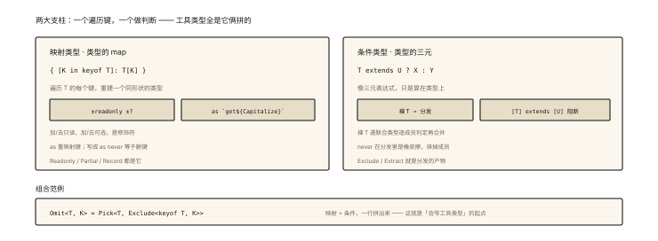

# TypeScript 之映射类型与条件类型

## 从「Partial 的源码只有一行」说起

```ts
// 每天在用的 Partial，本体竟然是：
type Partial<T> = { [K in keyof T]?: T[K] };
// 顺带：Required / Readonly / Pick 都是"一行代码"
type Readonly<T> = { readonly [K in keyof T]: T[K] };
type Pick<T, K extends keyof T> = { [P in K]: T[P] };
```

工具类型不是魔法，是**映射类型（Mapped Types）**与**条件类型（Conditional Types）**的组合拳——TS 类型系统「可编程性」的两大支柱。⭐⭐⭐ 掌握它们，你不仅能读懂工具库源码，还能为自己领域定制类型（type-level programming 的入口）。

## 现象与直觉解释

```
值世界:  遍历数组 → map 出新数组        [1,2].map(x => x * 2)
类型世界: 遍历键 → map 出新类型 ⭐      { [K in keyof T]: ... }   ← 映射类型

值世界:  条件分支 if/else               cond ? a : b
类型世界: 类型层面的三元 ⭐             T extends U ? X : Y      ← 条件类型
```

**一句话：映射类型是「类型的 map」，条件类型是「类型的三元表达式」**——类型从此可计算。

## 深入原理

### 一、映射类型：逐键重建 ⭐⭐⭐

```ts
type User = { id: number; name: string; vip: boolean };

// 基本形态：[K in keyof T] 遍历 T 的每个键
type Clone = { [K in keyof User]: User[K] };
// = { id: number; name: string; vip: boolean }（结构相同的新类型）

// 修饰符的加减（+/− readonly 与 ?）⭐
type AllReadonly = { readonly [K in keyof User]: User[K] };    // 全只读
type AllPartial  = { [K in keyof User]?: User[K] };            // 全可选
type NoOptional  = { [K in keyof Partial<User>]-?: User[K] };  // -? 去掉可选 ⭐

// 遍历「键的子集/联合」——不必是 keyof T
type Flags = { [K in 'a' | 'b']: boolean };    // { a: boolean; b: boolean }
type Pick<T, K extends keyof T> = { [P in K]: T[P] };          // Pick 的本体 ⭐

// as 子句重映射（键的改造 —— 高阶技巧）
type Getters = { [K in keyof User as `get${Capitalize<K>}`]: () => User[K] };
// = { getId: () => number; getName: () => string; getVip: () => boolean }
```

### 二、条件类型：类型的三元与「分发」⭐⭐⭐

```ts
// 基本形态（ts-002 思考题3 的答案揭晓）
type IsString<T> = T extends string ? 'yes' : 'no';
IsString<'a'>;    // 'yes'
IsString<42>;     // 'no'

// ⚔️ 分发条件类型（Distributive）——裸 T 遇到联合会【逐个判定再合并】⭐⭐
type ToArray<T> = T extends any ? T[] : never;
ToArray<string | number>;   // string[] | number[]  ⭐（不是 (string|number)[]！）

// 经典应用 Extract / Exclude（官方工具的本体）：
type Exclude<T, U> = T extends U ? never : T;      // 从联合中剔除
type Extract<T, U> = T extends U ? T : never;      // 抽取匹配的
Exclude<'a' | 'b' | 'c', 'a'>;   // 'b' | 'c'
// never 的角色: 条件类型里的"类型黑洞" —— 联合中分发给 never 的成员直接消失 ⭐

// 阻止分发: 用元组包一层 [T] extends [U]（需要"整体判定"时）
type IsNever<T> = [T] extends [never] ? true : false;   // 经典坑的解 ⭐
```

### 三、组合技：自制三个实战工具类型 ⭐⭐⭐

```ts
// ① DeepPartial：递归可选（表单场景常客）
type DeepPartial<T> = {
  [K in keyof T]?: T[K] extends object ? DeepPartial<T[K]> : T[K];
};

// ② Mutable：去掉全部 readonly（冻结数据的反面）
type Mutable<T> = { -readonly [K in keyof T]: T[K] };

// ③ PickByValueType：按值类型挑键（如挑出全部函数 → 自动 events 表）
type PickByValueType<T, V> = {
  [K in keyof T as T[K] extends V ? K : never]: T[K];   // as + never 删键 ⭐
};
type OnlyFunctions = PickByValueType<UserAPI, (...args: any[]) => any>;
```

**`as ... ? K : never` 删键**与**`? X : never` 删成员**——never 在类型编程里是「橡皮擦」。

### 四、内置工具类型全景（按两大支柱归类）⭐⭐

```
映射系:   Partial<T> / Required<T> / Readonly<T> / Pick<T,K> / Record<K,V> / Omit(映射+Exclude)
条件系:   Exclude<T,U> / Extract<T,U> / NonNullable<T> / ReturnType<F> / Parameters<F>
条件+infer: Awaited<P> / InstanceType<C> / …（ts-004 主角）
```

**Omit 的源码**（两大支柱合体的最佳教材）：

```ts
type Omit<T, K extends keyof any> = Pick<T, Exclude<keyof T, K>>;
// Exclude 先从键的联合里剔除 K → 再用映射的 Pick 按剩余键重建 ⭐
```

### 五、什么时候该写自定义类型编程？⭐

```
值得: 同构变换反复出现（Partial 化/函数化/键过滤）——一行类型顶百处手写
值得: 与泛型库配合（组件 props 的推导、API 层的响应映射）
不值得: 花式炫技（一个 30 行的复杂类型 vs 可读性）——团队可维护性优先
红线: 类型报错不可读时果断退回显式声明 —— 类型编程是【省力工具】不是【目的】
```

## 回看开篇

Partial 一行源码的组成：`[K in keyof T]`（映射遍历）+ `?`（修饰符）+ `T[K]`（索引取值）——**读懂这行，就读懂了半个工具类型库**；再配上条件类型的分发与 never，类型系统从「描述」升级为「计算」。

## 实战延伸

**1. 面试答题骨架**：「映射类型用 [K in keyof T] 遍历键重建类型，支持加减 readonly 与可选修饰符、遍历键的子集、以及 as 子句做键重映射；条件类型是类型层面的三元表达式，裸泛型遇联合类型会分发逐个判定再合并，never 在联合分发中充当删除成员的黑洞，Extract 与 Exclude 即由此实现，阻止分发可用元组包裹。两大支柱组合即可实现 Omit（先 Exclude 键再映射重建）、DeepPartial 递归变换、按值类型筛键等自定义工具——判断标准是同构变换高频出现才值得类型编程，可读性优先于技巧。」

**2. 一道手写题**：`FunctionKeys<T>`（挑出值全为函数的键）——考察 as 重映射 + 条件删键的组合。

## 图解总结



*图 · 一个遍历键，一个做判断，工具类型全是它俩拼的*

```
映射类型（类型的 map）:  { [K in keyof T]: T[K] }
  修饰符: ±readonly ±?  │ 键重映射: as `get${Capitalize<K>}` │ as never=删键
条件类型（类型的三元）:  T extends U ? X : Y
  分发: 裸T×联合 → 逐成员判定合并（Exclude/Extract 的原理）
  never = 联合分发中的橡皮擦 │ [T] extends [U] = 阻止分发
组合范例: Omit = Pick<T, Exclude<keyof T, K>> ⭐
自制: DeepPartial(递归+条件) │ PickByValueType(as删键)
```

## 总结

- 映射类型：遍历键重建；±readonly/±? 修饰；as 重映射与删键；
- 条件类型：类型三元；裸 T 分发；never 删成员；元组包裹阻止分发；
- Exclude/Extract/Pick/Omit 全部由两大支柱构成；
- 自制工具三例：DeepPartial、Mutable、按值筛键；
- 原则：高频同构变换才值得类型编程，可读性是红线。

**面试一句话回答**：映射类型通过 for-in 风格的方括号语法遍历类型的键并重建新类型，支持加减 readonly 与可选修饰符、遍历任意键联合，还能用 as 子句做键的重映射、以 never 删除键；条件类型是类型层面的三元表达式，当裸泛型参数遇到联合类型时会分发——逐个成员判定再合并成联合，Exclude 与 Extract 正是利用分发配合 never 实现成员删除，需要整体判定时用元组包裹阻止分发。两大支柱组合即可还原官方工具——Omit 就等于 Pick 加 Exclude 的组合，也能实现 DeepPartial 递归可选、按值类型筛选键等自定义工具。工程原则是同构变换高频出现才值得写类型编程，始终保持类型可读性优先。

## 思考题

1. 手写 `FunctionKeys<T>` 与 `NonFunctionKeys<T>`（互补的一对）。
2. `ToArray<string | never>` 分发结果是什么？（never 分发得到 never——IsNever 坑的根源）
3. 用 as 重映射实现 `Rename<T, { from: K; to: N }>` 泛型版键改名（限定 from 必须是 keyof T）。
4. 开放讨论：Vue 的 `defineProps<Props>()` 如何用映射类型推导出模板可用字段？找出其中两大支柱的使用点（源码阅读指引）。

（思考题解析将同步录入小程序题库，关联本文 id：ts-003）

## 参考文献：

- TypeScript Handbook — Mapped Types / Conditional Types / Distributive
- 《TypeScript 类型体操通关教程》地基篇
- 本课程《ts-002 泛型与约束》《ts-004 infer 与递归》
