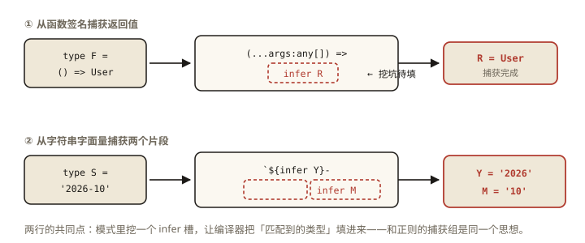
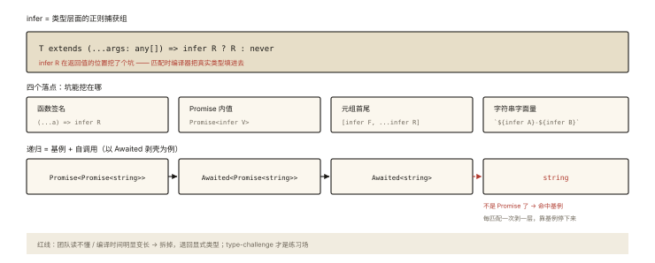

# TypeScript 之 infer 与递归类型

## 从「ReturnType 的源码看不懂？」说起

```ts
type ReturnType<T> = T extends (...args: any[]) => infer R ? R : any;
//                                                            ▲
//                                infer R = 「在这声明一个待推断的类型变量」⭐

// 它干了什么？
type F = () => { id: number };
ReturnType<F>;   // { id: number } —— 从"函数类型"里【抽出】了返回值类型
```

`infer` 是类型系统的**模式匹配捕获**——正则里的「捕获组」。⭐⭐⭐ 加上递归，类型系统就成了一门「可编程语言」：元组翻转、深度 Promise 解包、字符串解析……本篇从直觉到经典案例，讲透 type-level programming 的进阶双侠。

## 现象与直觉解释

```ts
// 值世界的"模式匹配 + 捕获"：正则
/(\d+)-(\d+)/.exec('2026-10')   // 捕获组 1: '2026'，组 2: '10'

// 类型世界的等价物：
type Match<T> = T extends `${infer Year}-${infer Month}` ? [Year, Month] : never;
Match<'2026-10'>;   // ['2026', '10'] —— 从字符串类型里"抽"出片段 ⭐
```

**一句话：`infer X` 在 extends 的模式里挖一个坑，让 TS 替你填上「匹配到的类型」**。



*图 · infer = 类型层面的正则捕获组——函数签名、字符串字面量都能被模式匹配拆解*

## 深入原理

### 一、infer 的三个经典落点 ⭐⭐⭐

```ts
// ① 函数相关（最常用）
type ReturnType<T> = T extends (...args: any[]) => infer R ? R : never;
type Parameters<T> = T extends (...args: infer P) => any ? P : never;
type FirstParam<T> = T extends (first: infer F, ...rest: any[]) => any ? F : never;

// ② Promise 解包（Awaited 的简化版）
type Awaited<T> = T extends Promise<infer V> ? Awaited<V> : T;   // 递归登场 ⭐
Awaited<Promise<Promise<number>>>;   // number —— 层层解包！

// ③ 元组操作（体操高发区）
type Head<T extends any[]> = T extends [infer F, ...any[]] ? F : never;
type Tail<T extends any[]> = T extends [any, ...infer Rest] ? Rest : [];
Head<[1, 2, 3]>;   // 1
Tail<[1, 2, 3]>;   // [2, 3]
```

### 二、递归类型：类型调用自己的两个条件 ⭐⭐⭐

```ts
// 条件1: 基例（能终止的形态）  条件2: 需要时尾随展开（TS 4.5+ 支持尾递归优化）

// 经典1: Flatten（拍平嵌套元组）
type Flatten<T extends any[]> =
  T extends [infer F, ...infer R]
    ? F extends any[] ? [...Flatten<F>, ...Flatten<R>] : [F, ...Flatten<R>]
    : [];
Flatten<[1, [2, [3, 4]], 5]>;   // [1, 2, 3, 4, 5] ✅

// 经典2: Reverse（倒序元组）
type Reverse<T extends any[]> =
  T extends [infer F, ...infer R] ? [...Reverse<R>, F] : [];
Reverse<[1, 2, 3]>;             // [3, 2, 1]

// 经典3: DeepReadonly（递归只读——映射+条件+递归三合一）
type DeepReadonly<T> = {
  readonly [K in keyof T]: T[K] extends object ? DeepReadonly<T[K]> : T[K];
};
```

### 三、字符串类型体操（模板字面量 + infer 的化学反应）⭐⭐

```ts
// 模板字面量类型（TS 4.1+）：字符串类型可以被"拼接"和"匹配"
type Greeting = `hello ${string}`;            // 匹配一切 'hello xxx'

// 实战1: getter 名生成（ts-003 as 重映射的强化版）
type Getters<T> = { [K in keyof T as `get${Capitalize<K>}`]: () => T[K] };

// 实战2: 解析 'a=1&b=2' —— 一条 QueryString 解析成对象类型（究极体操，欣赏即可）
type ParseQS<S extends string> =
  S extends `${infer K}=${infer V}&${infer Rest}`
    ? { [P in K]: V } & ParseQS<Rest>
    : S extends `${infer K}=${infer V}` ? { [P in K]: V } : {};
ParseQS<'page=1&size=10'>;   // { page: '1' } & { size: '10' }
```

### 四、inference 的用武之地与「过度工程」红线 ⭐⭐

```
✅ 日常值得（真实高频）:
   Awaited（await 的类型推导——官方用它）
   ReturnType/Parameters（hooks/高阶函数的签名推导）
   DeepReadonly/DeepPartial（配置与表单场景）

⚠️ 炫技区（面试题出现、生产慎用）:
   ParseQS / 元组四则运算 / 编号系统（type-challenge hard 区）

红线判据:
   类型推导报错时，团队成员能不能看懂？→ 不能 = 拆掉，写显式类型
   「编译时间显著变长」也是退信号（复杂类型计算的实测代价）
```

**type-challenge** 是本篇最好的练习场——easy 到 medium 的 infer/递归题做完，两大侠就算出师。

## 回看开篇

ReturnType 的可读化：`(...args: any[]) => infer R` 是「函数类型的模式」——infer R 在返回值的位置挖坑，TS 匹配时把真实返回类型填进去，条件分支取出。**infer 的本质是「从既有类型结构中提取子结构的类型」**——正则捕获组思维的类型版。

## 实战延伸

**1. 面试答题骨架**：「infer 在条件类型的 extends 模式中声明一个待推断的占位类型变量，编译器匹配时自动填充——相当于类型层面的正则捕获组，用于从函数签名提取返回值与参数（ReturnType 与 Parameters 的本体）、从 Promise 中提取内部值、从元组中提取首尾。配合递归可实现 Awaited 的深度解包、Flatten 拍平、Reverse 倒序与 DeepReadonly 深层变换；模板字面量类型加 infer 还能解析字符串字面量类型。工程边界是可读性与编译成本——团队读不懂或编译变慢时退回显式声明。」

**2. 一道手写题**：`Last<T extends any[]>`（取元组末位）——提示：`T extends [...any[], infer L] ? L : never`。

## 图解总结



*图 · 上半：坑挖在哪；下半：剥壳怎么靠基例停下来*

```
infer = 类型正则的捕获组:
  T extends 模式(含 infer X) ? 用X : ...
  落点: 函数(R/P) │ Promise<V> │ 元组 [F, ...R] │ 字符串 `${infer A}-${infer B}`

递归 = 基例 + 自调用:
  Awaited: Promise<infer V> ? Awaited<V> : T     ← 深解包
  Flatten/Reverse: [infer F, ...infer R] 拆头 + 递归尾
  DeepReadonly: 映射 × 条件 × 递归 三合一

红线: 团队读不懂 / 编译变慢 → 退显式（type-challenge 是练习场）
```

## 总结

- infer 是条件类型模式中的待推断占位——类型版正则捕获组；
- 四大落点：函数签名、Promise 内值、元组首尾、字符串字面量片段；
- 递归条件：基例可终止；Awaited/Flatten/Reverse/DeepReadonly 是四大经典；
- 模板字面量 × infer 可以解析字符串类型（Query String 级体操）；
- 边界：可读性与编译成本优先——type-challenge 练功，生产克制。

**面试一句话回答**：infer 用在条件类型的 extends 模式中声明一个待推断的类型变量，编译器在模式匹配时自动把对应位置的真实类型填入——它相当于类型层面的正则捕获组。经典应用包括从函数类型提取返回值与参数（ReturnType 与 Parameters 的实现本体）、从 Promise 类型提取内部值（Awaited 递归解包）、从元组提取首尾元素，配合模板字面量类型还能解析字符串字面量类型如查询串。递归类型要求有可终止的基例，能实现元组拍平、倒序与 DeepReadonly 这类深层结构变换。工程上以团队可读性与编译成本为红线，复杂推导读不懂或拖慢编译时应当退回显式类型声明。

## 思考题

1. 手写 `Last<T>` 与 `DropLast<T>`（互为一对的元组操作）。
2. `Awaited<Promise<Promise<never>>>` 的结果？（never 在解包链中的传递——好玩的行为）
3. 实现 `UnionToTuple`？为什么它极难（联合类型无序性）——查资料并总结现有 hack 的思路。
4. 开放设计：为「路由表 → 类型安全的 params」设计推导链：`'/user/:id' → { id: string }`（模板字面量 + infer + 递归 trim）。

（思考题解析将同步录入小程序题库，关联本文 id：ts-004）

## 参考文献：

- TypeScript Handbook — Type Inference in Conditional Types / Recursive
- type-challenges 仓库（easy~medium 的 infer/递归题单）
- 本课程《ts-003 映射与条件类型》（infer 的宿主是条件类型）
