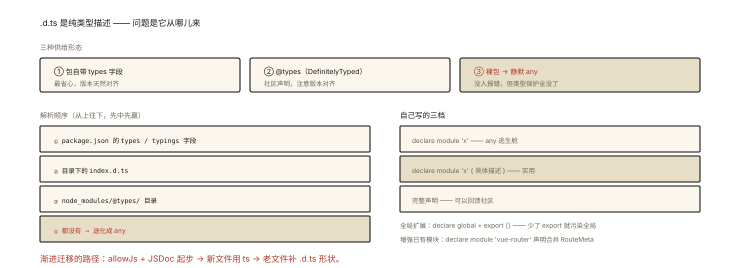

# TypeScript 之声明文件与 @types

## 从「import 一个 npm 包，全是 any」说起

```ts
import { chunk } from 'lodash';
chunk([1, 2, 3], 2);   // chunk: any —— 提示消失、拼错不报、返回值 unknown ❓
// 原因: lodash 的包里没有类型信息 —— TS 只能当作 any
```

补一句 `npm i -D @types/lodash`，世界恢复色彩——**@types 是什么？声明文件（.d.ts）体系是怎么运作的？**⭐⭐ 本篇讲清类型声明的生态机制：谁来提供类型、TS 怎么找、自己怎么写。

## 现象与直觉解释

JS 包是「值的世界」，TS 需要「类型的世界」与之对应——**声明文件（*.d.ts）就是「只有类型、没有实现」的描述文件**：

```ts
// lodash/chunk 的声明（在 @types/lodash 里，约等于这样）:
declare module 'lodash' {
  function chunk<T>(array: List<T> | null | undefined, size?: number): T[][];
  //            ⭐ declare = "实现别处，我只描述形状"
  export = chunk;   // CommonJS 导出的类型描述方式
}
```

**三种包的形态**（谁带类型）：

```
① 自带类型（现代主流）: 包里有 .d.ts + package.json 的 "types" 字段指向它
   （vue、axios 新版、所有 TS 编写的库）
② 社区类型: DefinitelyTyped 仓库（@types/xxx）—— 给没类型的 JS 包补
   （lodash、jest、node…）
③ 裸包: 两者皆无 → import 全 any（本篇要解决的对象）
```

## 深入原理

### 一、TS 的类型解析顺序 ⭐⭐

```ts
import { chunk } from 'lodash';
// TS 找类型的顺序:
// 1. lodash 的 package.json 有 "types"/"typings" 字段? → 指向的 .d.ts
// 2. 包根目录有 index.d.ts? → 用它
// 3. node_modules/@types/lodash 存在? → 用它 ⭐（@types 的魔法就是这个目录约定）
// 4. 都没有 → 隐式 any（noImplicitAny 下报错）
```

**@types 的本质**：DefinitelyTyped 是一个巨型 monorepo，`@types/xxx` 发包的只是 `.d.ts` 文件集合——安装后落在 `node_modules/@types/lodash`，TS 按第 3 步的约定自动拾取。**「@types 版本要与包版本匹配」**（大版本错位可能有 API 出入——@types/lodash@4 对 lodash@4）。

### 二、为一个没有类型的包写声明（三档火力）⭐⭐⭐

```ts
// 情形: import { initSDK } from 'untyped-sdk'（无类型的第三方 SDK）

// 火力1: 逃生舱——模块声明为 any（快速但不安全）
// typings/untyped-sdk.d.ts
declare module 'untyped-sdk';        // 整包 any ⚠️ 仅过渡用

// 火力2: 描述用到的部分（实用主义 ⭐ 推荐）
declare module 'untyped-sdk' {
  export function initSDK(options: { appId: string; debug?: boolean }): void;
  export interface User { id: string; name: string }
  export function getUser(id: string): Promise<User>;
}

// 火力3: 完整声明 + 逐步迁移（开源贡献姿势: 给 DefinitelyTyped 提 PR）
```

### 三、全局环境的声明 ⭐⭐

```ts
// 场景: 页面被宿主注入了全局变量（WebView 的 window.nativeBridge）
// global.d.ts
declare global {
  interface Window {
    nativeBridge: {
      openPage(url: string): void;
      scan(): Promise<{ text: string }>;
    };
  }
}
export {};   // ⚠️ 让本文件成为模块（否则 declare global 不合法——经典坑）

// 扩展现有模块（声明合并）:
declare module 'vue-router' {
  interface RouteMeta { requiresAuth?: boolean }   // 全项目 meta 类型增强 ⭐
}
```

### 四、JS 项目渐进迁移的声明策略 ⭐⭐

```
allowJs + checkJs + JSDoc 的渐进三部曲:
① 老项目先开 allowJs —— TS 能 import js 文件（类型来自 JSDoc 或推断）
② 给核心 js 文件补 JSDoc 注释（/** @param {number} id */）→ 零改造拿到类型
③ 新文件一律 ts，存量逐步迁移（.d.ts 给纯 js 模块补形状）

命名空间与 UMD 声明（读老代码必备）:
declare namespace JQuery { ... }        // 老式全局库的类型描述
declare const $: JQueryStatic;          // UMD 全局 + import 两用
```

### 五、tsconfig 的三件配套 ⭐

```jsonc
{
  "typeRoots": ["./typings", "node_modules/@types"],  // 自定义 @types 查找位置
  "types": ["node", "vite/client"],   // 只引入需要的 @types（不写=全部）
  "paths": { "@/*": ["src/*"] }        // 路径别名（与构建工具的 alias 对齐 ⭐ 双份配置易失同步）
}
```

## 回看开篇

`@types/lodash` 恢复色彩的机制：安装后 TS 在解析 `import 'lodash'` 的第 3 步找到 `@types/lodash` 的声明——**声明文件是「JS 世界的类型影子」**，自带、@types、自写三档供给按需选择。

## 实战延伸

**1. 面试答题骨架**：「声明文件是只有类型没有实现的 .d.ts 描述，TS 解析 import 时按顺序找包内 types 字段、包根 index.d.ts、node_modules/@types 目录，@types 即 DefinitelyTyped 发的纯声明包。无类型的三档处理：整包 any 的 declare module 逃生、按用到的 API 手写模块声明、完整声明回馈社区。全局变量用 declare global 扩展 Window，第三方模块类型用 declare module 声明合并增强如给 vue-router 的 RouteMeta 加字段；JS 项目用 allowJs 加 JSDoc 渐进获得类型。注意 @types 与包的大版本匹配、tsconfig 的 types 与 paths 与构建工具 alias 的同步。」

**2. 一道实战题**：「window.\_hmt（百度统计）在 TS 报错」——用 declare global 补类型；「import.meta.env」——vite/client 类型；「import 一个 svg」——vite 提供的 `declare module '*.svg'`（通配符声明）。

## 图解总结



*图 · 类型从哪来：三种形态，四步解析*

```
类型供给三形态: ①包自带 types 字段 │ ②@types(DefinitelyTyped) │ ③裸包(any)
解析顺序: package.json types → index.d.ts → @types/ 目录 → any

自写三档: declare module 'x'  (any逃生) │
          declare module 'x' { 具体描述 } (实用⭐) │ 完整声明(回馈社区)
全局: declare global { interface Window {…} } + export {} ⚠️
增强: declare module 'vue-router' { interface RouteMeta {…} } (声明合并)
渐进: allowJs + JSDoc → 新文件 ts → .d.ts 补形状
```

## 总结

- .d.ts = 纯类型描述；三种供给形态与四步解析顺序；
- @types 是社区声明的标准发行方式；版本与包对齐；
- 无类型包三档处理，实用档（描述用到的 API）最优；
- declare global 补宿主环境；declare module 声明合并做增强；
- JS 渐进：allowJs + JSDoc；paths/alias 双端同步。

**面试一句话回答**：声明文件 d.ts 是只含类型声明不含实现的描述文件，TypeScript 解析模块类型时按顺序查找包 package.json 的 types 字段、包根目录的 index.d.ts、以及 node_modules 下的 @types 目录，@types 包就是 DefinitelyTyped 仓库发布的纯声明集合。对没有类型的包有三种处理：用 declare module 整包声明为 any 作过渡、手写模块声明描述实际用到的 API、或完整声明后回馈社区。宿主注入的全局变量用 declare global 扩展 Window 接口且文件需 export 空对象保持模块身份，第三方模块可用 declare module 声明合并为其类型增加字段；JavaScript 老项目通过 allowJs 配 JSDoc 注释渐进获得类型，同时注意 @types 与包版本匹配、tsconfig paths 与构建工具 alias 保持同步。

## 思考题

1. `declare module '*.css'` 的通配符声明在工程里解决什么？（样式/资源导入的类型——Vite/Webpack 生态的标配声明）
2. 手写声明的「诚实纪律」：声明与实际实现不符会发生什么？（编译期全对、运行时炸——声明的维护责任）
3. `export =` 与 `export default` 在声明 CJS 包时的差异？（esModuleInterop 的角色）
4. 开放实践：给团队内部的一个老 JS 工具包补一份 30 行的实用型声明文件——列出你的 API 选择（只声明高频接口）与评审要点。

（思考题解析将同步录入小程序题库，关联本文 id：ts-006）

## 参考文献：

- TypeScript Handbook — Declaration Files / Modules 指南
- DefinitelyTyped 仓库 README（@types 的运作机制）
- 本课程《engineering-001 依赖管理》《ts-008 工程实践》
