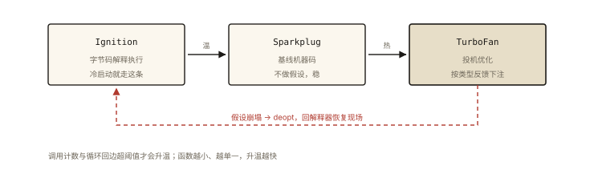

# V8 之 JIT：解释器与优化编译器

## 从「一个函数忽快忽慢的玄学现场」说起

```js
function load(user) { return user.profile.name; }

// 场景 A：百万次同结构调用 —— 飞快（TurboFan 全力优化）
// 场景 B：中途混入 null 与不同结构 —— 卡顿毛刺（反复 deopt）
// 同一个函数，两种命运 —— 谁在决定？
```

《v8-001》讲了流水线地图，本篇深入 **JIT（Just-In-Time 即时编译）的决策机制**：什么代码被优化、按什么假设优化、什么行为会毁掉优化。⭐⭐⭐ 这是「写出引擎友好代码」的理论终点。

## 现象与直觉解释

JIT 的本质权衡：

```
AOT（提前全量编译）：所有代码按最坏情况准备 —— 启动慢、体积大、无处优化
解释执行：所有代码按最慢方式跑 —— 永远不快
JIT：按【实际运行画像】编译 —— 快的前提是"画像稳定"

「画像」= 类型反馈（Feedback）：
  这个加法的参数一直是整数吗？这个属性访问一直是同一形状吗？（v8-002 的 IC）
  这个分支从来没走进过吗？—— 没走过的分支按"死代码"优化
```

**一句话：JIT 优化的是「你代码的实际跑法」，不是「你代码的写法」。**

## 深入原理

### 一、编译器梯队：三级火箭 ⭐⭐⭐

现代 V8 不止两层，而是**三级递进**（越往上越快、优化越激进、升级成本越高）：

```
① Ignition（解释器）：字节码逐条解释 —— 冷代码的家，启动即用
② Sparkplug（基线编译器，2021）：字节码 → 快速机器码（不做激进优化，
   专为「正在升温但还不够热」的代码 —— 优化成本极低）
③ TurboFan（优化编译器）：字节码 + 类型反馈 → 激进投机优化机器码

触发：执行计数（调用次数/循环回边）超阈值逐级升温
      —— 「函数越小，升温越快」（大函数计数慢、deopt 代价大）
```

### 二、投机优化的三张牌 ⭐⭐⭐

TurboFan 拿着类型反馈，打这三张牌：

**牌 ① 类型特化**：

```js
function add(a, b) { return a + b; }
// 反馈：a、b 一直是 Smi（小整数）
// 优化后：直接生成整数加指令（跳过「string? object? BigInt? toPrimitive?」全部分支）
```

**牌 ② 内联（Inlining）**——JIT 最大的性能魔法 ⭐：

```js
function square(x) { return x * x; }
function sumSquares(arr) {
  let s = 0;
  for (const x of arr) s += square(x);    // 调用点被【整个函数体替换】
}
// 优化后等价于：for (const x of arr) s += x * x;
// 消灭了调用开销 + 打开了跨函数的进一步优化空间（循环内联后整体优化）
```

**牌 ③ 死分支消除**：

```js
if (DEBUG) { log(); }   // DEBUG 反馈从未为 true → 分支整体不生成代码
```

### 三、deopt：假设崩塌的现场与代价 ⭐⭐⭐

```js
// 反馈说"参数总是形状 {x,y}" → TurboFan 按 offset 直取生成代码
load(null);         // ❌ 崩塌点1：null 没有 profile
load({ profile: 3 }); // ❌ 崩塌点2：profile 不是对象
// deopt 发生：① 丢弃优化代码 ② 回 Ignition 恢复执行状态 ③ 记录原因
// 若该函数再次变热 → 重新优化（这次的反馈包含新情况，假设更保守）
```

**毛刺的成因**：deopt 的「恢复现场」本身有成本（重建解释器栈帧状态）——热函数反复 deopt/reopt（称为 **deopt 风暴**）会出现周期性卡顿。**场景 B 的毛刺正是 deopt 风暴**。

### 四、优化敏感代码黑名单（写代码时避开的坑）⭐⭐⭐

```
① 参数/属性类型频繁变化（一会儿 number 一会儿 string）→ 类型特化反复作废
② 对象形状漂移（乱加属性/delete —— v8-002）
③ arguments 泄漏到外部 / 修改 arguments —— 部分优化受阻
④ with / eval：编译期信息全黑 → 直接不优化
⑤ try-catch 中的热循环（旧版本问题，现代已大幅改善——别背过时结论 ⭐）
⑥ 超大函数：升温慢 + deopt 全报废 → 拆小函数（天然利于内联）
```

**验证命令**：`node --trace-opt --trace-deopt app.js`——看到自己的函数名频繁出现在 deopt 行 = 找到了毛刺元凶。

### 五、JIT 与「过时性能建议」的甄别 ⭐

```
过时说法1：「for 循环缓存 arr.length 更快」—— 现代 IC 下已无差异
过时说法2：「倒序循环更快」—— 无依据
过时说法3：「try-catch 拖慢一切」—— 现代已不影响外层优化
方法论：任何性能建议都要 ① 分清引擎时代 ② 用基准测试验证（benchmark.js，
       避免 V8 的死代码消除把「没被消费的结果」整个删掉导致假结论 ⭐）
```

## 回看开篇

忽快忽慢的决策者是**类型反馈的稳定性**：场景 A 画像稳定（同结构对象）→ TurboFan 三张牌全打（类型特化+内联+死分支消除）；场景 B 画像被污染 → deopt 风暴 → 周期性回退解释执行。**写代码的姿势决定了引擎拿到的是「干净的画像」还是「花掉的画像」。**

## 实战延伸

**1. 面试答题骨架**：「现代 V8 是三级编译梯队——Ignition 解释字节码负责冷启动，Sparkplug 快速生成基线机器码承接升温代码，TurboFan 依据类型反馈做投机优化。投机三张牌：类型特化按反馈的真实类型生成指令、内联把小函数调用点展开消灭开销并打开跨函数优化、死分支按从未执行反馈直接消除。假设崩塌即 deopt——回退解释器保正确，反复 deopt 形成风暴产生毛刺。优化敏感代码包括类型漂移、对象形状不稳定、eval/with、超大函数；验证用 trace-opt/trace-deopt，任何性能结论都应基准测试并防死代码消除污染。」

**2. 一个亲手实验**：写两个版本的循环（类型稳定 vs 每次换类型），`--trace-deopt` 对比 deopt 次数与耗时差异——五分钟看到 JIT 的脾气。

## 图解总结



*图 · 升一次级要多验一次假设，假设塌了就得退回来*

```
梯队: Ignition(字节码解释) ─温─▶ Sparkplug(基线机器码) ─热─▶ TurboFan(投机优化)
触发: 调用计数/循环回边超阈值 —— 函数越小升温越快

TurboFan 三张牌（输入=类型反馈+IC）:
  类型特化: 只生成实际类型的指令 │ 内联: 函数体替换调用点 ⭐ │ 死分支: 没跑过的删掉

deopt: 假设崩塌 ─▶ 回 Ignition 恢复现场 ─▶ 可再优化(更保守)
      反复 deopt = 毛刺元凶
黑名单: 类型漂移 │ 形状漂移 │ eval/with │ 超大函数 │ (try-catch已平反)
验证: --trace-opt/--trace-deopt │ benchmark.js(防死代码消除)
```

## 总结

- 三级梯队：Ignition（冷）→ Sparkplug（温）→ TurboFan（热）；
- 投机三张牌：类型特化、内联、死分支消除——依据全是类型反馈；
- deopt 保正确但有恢复成本；deopt 风暴 = 性能毛刺；
- 黑名单：类型/形状漂移、eval/with、超大函数；小函数利于内联与升温；
- 性能建议要验引擎时代 + 基准测试防死代码消除。

**面试一句话回答**：现代 V8 采用三级编译梯队——Ignition 解释器负责冷启动的字节码执行，Sparkplug 基线编译器为升温中的代码快速生成机器码，TurboFan 优化编译器在函数成为热点后基于收集的类型反馈做投机编译。投机优化的三张牌是类型特化（按反馈的真实类型生成专用指令）、函数内联（把小函数调用点整体展开，消除调用开销并打开跨函数优化）与死分支消除（按从未执行的反馈直接不生成代码）。一旦运行时与假设不符立即触发反优化，回退解释器执行并可能重新优化，反复反优化会形成性能毛刺。优化敏感代码包括参数类型漂移、对象形状不稳定、eval 与 with 以及超大函数；验证手段是 trace 优化与反优化日志，任何性能结论都需基准测试佐证并防备死代码消除带来的假结果。

## 思考题

1. 内联为什么能带来「超线性」收益？（消灭调用开销之外：跨函数常量传播/逃逸分析/循环整体优化）
2. 设计一个「deopt 风暴」的最小复现：同一函数交替接收两种形状的对象——用 --trace-deopt 观察日志节奏。
3. 「把热循环提取成独立小函数」的双重收益是什么？（升温快 + 内联主体后循环整体优化）
4. 开放讨论：JIT 与 AOT（Go/Rust）在「启动速度/峰值速度/内存占用」三维的取舍——为什么云函数/FaaS 场景偏爱 AOT 或快照技术？

（思考题解析将同步录入小程序题库，关联本文 id：v8-003）

## 参考文献：

- V8 官方博客 — Sparkplug / TurboFan 系列
- 《JavaScript 引擎性能优化》系列（类型反馈与 deopt 机制）
- 本课程《v8-001 流水线》《v8-002 隐藏类与 IC》（反馈数据的来源）
