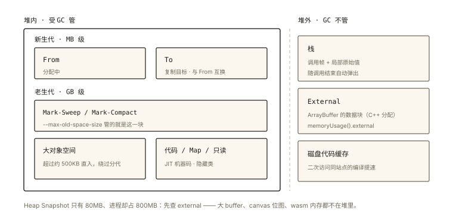

# V8 之堆内存结构

## 从「限制内存就能改变 GC 行为」说起

```bash
node --max-old-space-size=512 app.js   # 老生代上限 512MB
# 「老生代」是什么？为什么单独限它？
```

《v8-005》讲过 GC 算法（Scavenger/Mark-Sweep）；本篇往下钻一层——**堆的物理分区**：各类对象住在哪个区、各区怎么配合。⭐⭐ 它是内存调优（--max-old-space-size、快照分析）与 GC 篇的承上启下。

## 现象与直觉解释

V8 的堆不是一块大空地，而是**按「对象寿命与形态」分区管理**的城区规划：

```
V8 堆
├── 新生代（Young Generation）── 短命对象的"产科病房"
│   ├── From 空间（分配中）
│   └── To 空间（复制目标，角色互换）
├── 老生代（Old Space）── 活过青春期的"居民区"（又分指针区/数据区）
├── 大对象空间（Large Object Space）── 超大户的"独栋别墅"
├── 代码空间（Code Space）── JIT 生成的机器码
└── 其他（Map 空间=隐藏类、只读空间等）
```

**为什么要分区**——弱分代假说（《v8-005》）的直接推论：**不同寿命的对象用不同算法管理**（短命的批量收割便宜、长命的精打细算）。

## 深入原理

### 一、新生代：小而快 ⭐⭐

```
容量：MB 级（几~几十MB，按需伸缩）
算法：Scavenger 半空间复制（《v8-005》详解）
分配：新对象永远在 From 空间的"指针碰撞区"线性分配 —— 分配本身 O(1) 极快
晋升：熬过两轮回收 / To 空间占用超 25% → 搬入老生代
```

**线性分配的精妙**：新生代分配只是「指针后移 + 判断余量」——这是 JS 高频创建临时对象（字符串拼接、数组 map、闭包）依然高效的原因。

### 二、老生代：大而稳 ⭐⭐

```
容量：GB 级（--max-old-space-size 控制的就是它）
算法：Mark-Sweep + Mark-Compact（标记清除/整理，《v8-005》）
居民：全局对象、长生命周期闭包、缓存、模块单例…
特点：回收频率低、单次成本高 —— 增量/并发标记缓解停顿（v8-006）
```

**内存调优的落点**：`--max-old-space-size` 限制的是老生代——Node 服务 OOM 时调大它是第一反应；浏览器则看整体堆（DevTools Memory 面板）。

### 三、大对象空间：绕过分代 ⭐⭐

```
阈值：约 500KB 以上的对象（大 ArrayBuffer/长字符串/大数组）
规则：直接进大对象空间，【不经过新生代】
原因：① 半空间复制对大对象太浪费（复制成本高）
     ② 独立页管理，回收可整体处理
推论：new Array(1e6) 这类"一次性大分配"不会抖新生代的 throughput
```

### 四、代码空间与 Map 空间 ⭐

```
代码空间：TurboFan/Sparkplug 的机器码住这（v8-003 的产物）
         —— 代码缓存（code cache）也归这里管理（热函数的编译结果复用）
Map 空间：隐藏类（v8-002）本尊住这 —— 每个"形状"一个 Map 对象
只读空间：引擎内置的不可变对象（如内置原型上的方法）
```

### 五、堆之外的邻居（容易混淆的三块）⭐⭐

```
栈（Stack）：函数调用帧 + 原始值局部变量 —— 不归堆 GC 管（随调用结束自动弹）
堆外内存（External）：ArrayBuffer 的实际数据块（C++ 层分配）
  —— process.memoryUsage() 的 external 字段 ⭐
  —— 「JS Heap 不大但进程内存暴涨」的第一嫌疑（大 buffer、canvas、wasm 内存）
代码缓存区：磁盘上的编译缓存（二次访问同一站点的解析编译提速）
```

**一道诊断题**：「Heap Snapshot 只有 80MB，进程却占了 800MB」——查 external：大文件读成 ArrayBuffer、图像位图、WASM 内存——堆外才是大头（DevTools Memory 的 External 计数 / Node 的 memoryUsage().external）。

### 六、用 DevTools 看分区 ⭐

```
Memory 面板 → Heap snapshot 的 Statistics 视图：
  Objects（老+新）、Strings、Arrays、System objects、External…
Performance Monitor 的 JS Heap 只是总量 —— 分区要靠 snapshot 细看
```

## 回看开篇

`--max-old-space-size` 限的是**老生代**——长生命周期对象的城区。OOM 本质是「老生代里可达的东西太多」（缓存无界/全局堆积/泄漏，performance-008 的案发现场）；分区结构决定了调参只对「该区」生效——堆外与代码区另算。

## 实战延伸

**1. 面试答题骨架**：「V8 堆按对象寿命与形态分区——新生代采用半空间复制的 Scavenger，容量小、线性分配极快，对象熬过两轮或 To 超四分之一即晋升；老生代用标记清除加整理，容量大、由 max-old-space-size 控制，全局与缓存类对象常驻；超过约 500KB 的大对象直接进大对象空间绕过分代；代码空间存 JIT 机器码、Map 空间存隐藏类。此外还有堆外的 external 内存——ArrayBuffer 的数据在 C++ 层分配，JS 堆不大而进程内存暴涨时首先排查 external。」

**2. 一道快手题**：`new Array(1e6)` 与 循环 1e6 次 `new Point()` 各进哪个区？（前者大对象空间，后者新生代——Scavenger 一轮收割大部分）

## 图解总结



*图 · 左边一个框、右边三块散件：进程内存不等于堆内存，差额大多在 External 里*

```
V8 堆                                  堆外
├ 新生代(MB级): From|To ──Scavenger──  ├ 栈: 调用帧/局部原始值(不归GC)
│   线性分配O(1) │ 熬2轮晋升⬇           ├ External: ArrayBuffer数据(C++分配)
├ 老生代(GB级): Mark-Sweep/Compact       │   memoryUsage().external ⭐
│   --max-old-space-size 管这里          └ 磁盘代码缓存
├ 大对象空间: >500KB 直入(绕过分代)
├ 代码空间: JIT机器码 │ Map空间: 隐藏类 │ 只读空间
诊断: "Heap不大进程大" → 先查 external
```

## 总结

- 分区规划：新生代（小快 Scavenger）、老生代（大稳 Mark 系）、大对象（>500KB 直入）；
- 新生代线性分配 O(1)；晋升条件熬两轮或 To>25%；
- 老生代由 max-old-space-size 控制是 OOM 调参对象；
- 代码/Map/只读空间各有其主；external 堆外是「进程大堆不大」的第一嫌疑；
- 分区结构是 GC 算法选择的物理基础（v8-005 的算法住在这些区里）。

**面试一句话回答**：V8 堆按对象寿命与形态分区管理——新生代容量小，采用半空间复制的 Scavenger 算法，分配只需指针后移极快，对象熬过两轮回收或目标空间占用超四分之一就晋升老生代；老生代容量大，用标记清除加标记整理管理全局对象与缓存等长生命周期数据，max-old-space-size 限制的就是它；超过约五百 KB 的大对象直接分配进大对象空间绕过分代，避免复制浪费；另有存放 JIT 机器码的代码空间与存放隐藏类的 Map 空间。栈与 ArrayBuffer 数据所在的堆外内存不属于堆——进程内存远大于 JS 堆时优先排查 external 计数。

## 思考题

1. 「把热数据的缓存从 Map 迁到 Array 池化复用」在分区视角的收益是什么？（减少晋升与老生代碎片——对象复用不产生新垃圾）
2. 为什么新生代要设计得小？（存活率低时复制算法成本∝存活量；半空间利用率 50%——大空间浪费且单轮复制变慢）
3. `process.memoryUsage()` 的 rss / heapTotal / heapUsed / external 四个数字分别对应本文哪些区？画出对应关系。
4. 开放讨论：流式处理（stream）大文件的内存收益，从「大对象空间 + external」的角度分析背压机制为什么必须存在。

（思考题解析将同步录入小程序题库，关联本文 id：v8-004）

## 参考文献：

- V8 官方文档 — Memory terminology（分区名词表）
- 《深入浅出 Node.js》第 5 章（分代结构经典中文论述）
- 本课程《v8-005 内存与 GC》《performance-008 内存排查》（分区之上的算法与实战）
