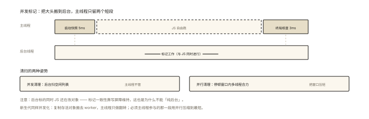
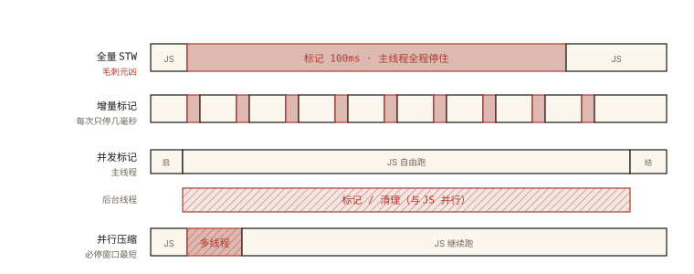

# V8 之 Orinoco：增量、并发与并行 GC

## 从「每 30 秒卡 100ms」的规律性毛刺说起

```
Profiler 观察某实时应用：每隔约 30 秒出现一次 ~100ms 的主线程停顿
时间轴上呈完美的周期性 —— 这是老生代 Mark-Sweep 的全量标记在"整段"执行
```

《v8-005》结尾说过「停顿优化三板斧」；本篇把它讲透——**Orinoco 项目**：V8 把 GC 停顿从「百毫秒整段」拆到「毫秒碎片」的工程艺术。⭐⭐ 这是 GC 话题的深水区顶配考点。

## 现象与直觉解释

先明确问题：GC 工作时 JS 主线程通常得停（STW, Stop-The-World）。全堆标记可能上百毫秒——对 16.7ms 一帧的页面是灾难。Orinoco 的思路一句话：

> **把 GC 的活拆碎（增量）、搬走（并发）、搭手（并行）——尽一切可能缩短主线程停顿。**

三个词的精确区分（面试易混点）⭐⭐：

```
增量（Incremental）：活还是主线程干，但拆成小步穿插在 JS 执行的间隙
并发（Concurrent）：大部分活搬到【后台线程】，与 JS 同时跑
并行（Parallel）：必须停的那一小段，多线程【合力一起干】
```

## 深入原理

### 一、增量标记与写屏障 ⭐⭐⭐

把标记拆成小步交替执行：

```
无增量：  [JS...50ms] [==标记100ms==] [JS...]           ← 100ms 停顿
增量：    [JS 5ms][标 5ms][JS 5ms][标 5ms]...            ← 停顿 ≤5ms/次
```

**致命问题：标记期间 JS 在改引用**——「黑对象（已标完）新增指向白对象（未标）」的引用建立后，白对象会被漏标成垃圾误回收 ⭐：

```
增量期间 JS 执行：blackObj.field = whiteObj   ← 危险引用！
黑已扫完不会再扫 → whiteObj 没人标记 → 被当垃圾 → 误回收存活对象 💥
```

**写屏障（Write Barrier）的解法**：编译器在「对象字段赋值」处插入一小段检查代码——检测到「黑→白」赋值时，把白对象改标为灰（重新入队待扫）：

```
store 黑.field = 白 之前：
  if (黑是黑色 && 白是白色) { 把白标灰（加入待处理队列） }  ← 屏障代码
```

**代价**：所有对象写入多一小段开销——「增量换停顿、屏障保正确」的权衡。三色标记（白灰黑，v8-005）正是为「可暂停恢复」设计的抽象。

### 二、并发标记与清理：把活搬走 ⭐⭐⭐



*图 · 主线程只剩两小段，中间那一大段才是 JS 真正的时间*

```
并发标记：标记的大头在后台线程做，主线程只参与极短的起止段
  主线程:  [启动快照 5ms] ......... JS 自由跑 ......... [终局核查 3ms]
  后台:        ════════ 标记工作 ════════
  ⚠️ 后台标的同时 JS 还在改对象 → 同样依赖写屏障维护标记一致性

并发清理（Concurrent Sweeping）：清扫空闲列表的工作后台执行
并行清理（Parallel Sweeping）：主线程与辅助线程在停顿窗口内合力扫
```

### 三、并发 Scavenger（新生代也要卷）⭐

新生代回收本来很快，但大堆时代单次 Scavenge 也可能到 10ms+——V8 把「复制存活对象」也搬到后台（利用空闲时的 worker 线程），主线程只做必要的翻转。

### 四、「并行」的主战场： evacuation 的最后一段 ⭐

有些步骤必须主线程参与（对象地址变更涉及 JS 可见的引用更新）——这一小段用**多线程并行**压缩到最短。

### 五、Orinoco 的成果观感 ⭐

```
优化前：老生代回收停顿 ~100ms 级
优化后：主线程停顿被压到 <5ms 级（多数场景无感知）
收益方式：增量拆碎 + 并发搬走 + 并行压短 —— 三管齐下
代价：写屏障的常数开销、并发协调复杂度、总吞吐略降（为低延迟让路）
```

**一句话总结设计哲学**：**用「总体多干一点活」换「每次少停一点」**——延迟优先于吞吐（交互应用的正确取舍）。

## 回看开篇

周期性 100ms 毛刺 = 老生代全量标记的整段 STW。Orinoco 三管齐下后：标记拆成毫秒级小步（增量+写屏障）、大头搬后台（并发）、必停段多线程压缩（并行）——毛刺化为不可感知的微停顿。

## 实战延伸

**1. 面试答题骨架**：「Orinoco 是 V8 的低延迟 GC 工程——增量标记把标记拆成小步穿插执行，代价是必须在对象写入处插入写屏障：检测黑对象新增指向白对象的赋值并把白对象回标为灰，防止漏标误回收；并发标记与清理把大部分工作放到后台线程与 JS 并行，主线程只参与启动与终局的极短窗口；必须停顿的最后一段（如引用更新、翻转）用多线程并行压缩。三管齐下把老生代停顿从百毫秒压到毫秒级，本质是用总吞吐换低延迟。」

**2. 一个概念辨析题**（必考）：并发 vs 并行——**并发=后台与主线程同时跑（协作调度）；并行=同一停顿窗口多线程合力**——一个是「时间上的错开」，一个是「空间上的人海」。

## 图解总结



*图 · 同一段标记工作（深色）放在哪、由谁做，决定了毛刺：全量 STW 独占主线程；增量拆碎穿插；并发把大头搬到后台（斜纹带）；并行只在必停段加人*

```
全量STW: [JS][==========标记100ms==========][JS]        ← 毛刺元凶
增量:    [JS5][标5][JS5][标5]…（写屏障守卫黑→白）      ← 停顿拆碎
并发:    主线程 [启5ms]…自由跑…[结3ms]
         后台   ═══标记/清理═══                        ← 大头搬走
并行:    必停段: [主线程+辅助线程合力 ▓▓▓]              ← 窗口压缩

写屏障: store 黑.f=白 时 if(黑黑&&白白) 白→灰  ← 一致性保镖
取舍: 写屏障常数开销 + 吞吐微降 ⇄ 停顿 <5ms —— 延迟优先
```

## 总结

- Orinoco 三技术：增量（拆碎主线程穿插）、并发（后台并行干）、并行（停顿窗口人海）；
- 写屏障是增量/并发标记的正确性根基：黑→白赋值触发回标灰；
- 并发 vs 并行的语义区分是必考概念题；
- 成果：老生代停顿从 ~100ms 到 <5ms；代价是屏障开销与吞吐微降；
- 设计哲学：延迟优先于吞吐。

**面试一句话回答**：Orinoco 是 V8 降低垃圾回收停顿的工程方案，包含三种技术——增量标记把标记阶段拆成多个小步穿插在 JavaScript 执行之间，每次只停几毫秒，但需要在对象字段赋值处插入写屏障，当检测到已扫描完的黑色对象新建指向未标记的白色对象的引用时，把白色对象重新标灰以避免漏标导致误回收；并发标记与并发清理把大部分回收工作搬到后台线程与主线程同时进行，主线程只在开始与结束参与极短的窗口；而必须暂停的最后阶段如引用更新则由多个线程并行完成以压缩停顿时长。三者结合把老生代回收停顿从上百毫秒压到几毫秒以内，代价是写屏障的常数开销与总吞吐的小幅下降——这是交互场景下延迟优先于吞吐的取舍。

## 思考题

1. 为什么写屏障只检查「黑→白」？（白→白、灰→X 都还有机会被扫到——推演三色的不变式）
2. 增量标记的「步长」怎么定才合理？（太碎：切换开销大；太长：停顿回升——V8 的动态调整）
3. 主线程改了对象图，后台标记怎么知道？（写屏障队列在主线程侧维护，后台消费——一致性协议）
4. 开放讨论：实时性要求极端的场景（音频合成 128ms 缓冲）还能怎么进一步躲 GC？（对象池预分配、避免运行时分配、Worker 隔离——工程侧手段）

（思考题解析将同步录入小程序题库，关联本文 id：v8-006）

## 参考文献：

- V8 官方博客 — Trash talk: the Orinoco garbage collector（本篇一手资料）
- V8 官方博客 — Concurrent marking in V8（写屏障细节）
- 本课程《v8-005 内存与 GC》（算法基座）、《v8-004 堆结构》（分区前提）
