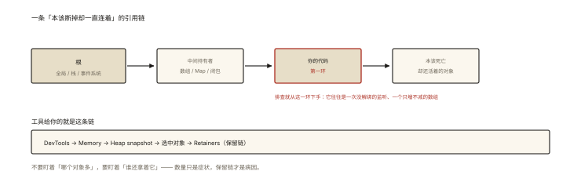
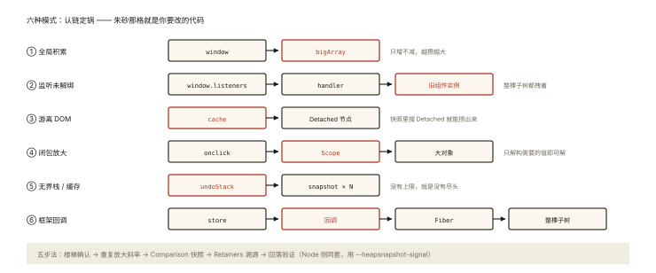

# V8 之常见内存泄漏模式与排查

## 从三个真实案例开头

```
案例A：可视化大屏挂 3 天必崩 —— 内存 2GB
案例B：IM 长连接应用每天涨 50MB —— 一周重启一次
案例C：编辑器撤回 100 次后卡顿 —— 撤销栈越堆越高
```

三个案例三种模式，但排查路径同一条。⭐ 本篇站在《performance-008》（工具操作）与《v8-005》（GC 理论）的肩膀上，聚焦**模式库与 Retainers 溯源思维**——「看到什么样的链，就知道哪里写的锅」。

## 现象与直觉解释

所有泄漏的统一模型（一句话）：



*图 · 泄漏不是「对象多」，是「链没断」*

```
泄漏 = 一条「本该断掉却一直连着」的引用链：
  根(全局/栈/事件系统) ──…──▶ 本该死亡的对象

排查 = 找到那条链上【属于你的代码】的第一环
工具给你的就是这条链：Retainers（保留链）
```

## 深入原理：六大模式 + 各自的 Retainers 长相 ⭐⭐⭐

### 模式① 全局积累（最常见）

```js
// 代码味道
window.reportData = [];            // 或函数内忘了 let 的裸赋值
setInterval(() => reportData.push(collect()), 60000);
// Retainers 长相: window → reportData → Array(持续增长) → …
// 特征: Snapshot 对比里一个数组 Delta 巨大且全是字符串/对象
```

### 模式② 事件与定时器未清理

```js
// 代码味道（SPA 路由切换没销毁）
mounted: () => window.addEventListener('resize', this.onResize)
// Retainers: window(listeners) → handler → 闭包 → 整个旧组件实例
// 特征: 组件对象在路由切换后仍存活（React Fiber/Vue 实例出现在 Retainers）
```

### 模式③ 游离 DOM 树

```js
// 代码味道
const list = this.$refs.list;
container.innerHTML = '';         // DOM 从文档移除
this.cache.push(list);            // 但 JS 还攥着整棵子树的引用
// Retainers: cache(Array) → HTMLUListElement(Detached) → li×1000
// 特征: Snapshot 搜 "Detached" 直接命中 ⭐
```

### 模式④ 闭包捕获放大

```js
// 代码味道：小闭包牵大对象
function bindBtn(btn) {
  const hugeDataset = loadAll();          // 100MB
  btn.onclick = () => console.log(hugeDataset.length);   // 只用了 length！
  // btn 活多久 hugeDataset 活多久
}
// Retainers: btn → onclick(闭包) → Scope(hugeDataset) → 100MB 数据
// 修复: const len = hugeDataset.length; btn.onclick = () => log(len);
```

### 模式⑤ 无界缓存/历史栈（案例C）

```js
undoStack.push(snapshot);          // 每次编辑全量快照，无上限
// Retainers: undoStack → snapshot×N(每张几MB)
// 修复方向: 上限 LRU（handwritten-012）/ 增量快照（diff 而非全量）/ 结构共享
```

### 模式⑥ 框架特供：数据与视图的双向勾连

```jsx
// React: 全局 store 里挂着「带组件闭包的回调」
store.callbacks.push(() => this.setState(...));   // 组件销毁没人摘
// Retainers: store → callbacks → 闭包 → Fiber/props → 整棵子树
// 框架泄漏的特征: Retainers 里出现框架内部对象（FiberNode/实例/observer）
//   —— 别怕框架名词，沿链找第一个你的变量名
```

## 排查方法论（五步法）⭐⭐⭐

```
Step1 确认: Performance Monitor 楼梯曲线（区分膨胀 vs 泄漏）
Step2 制造斜率: 重复单一可疑操作 N 次 → 泄漏增量 ≈ 单次泄漏×N（可归因）
Step3 对比快照: 操作前后 Snapshot Comparison（Delta 排序）
Step4 溯源: 点开只增对象的 Retainers —— 沿链自上而下找【你写的第一环】
Step5 定罪验证: 修复该行 → 重复操作曲线回落 → 实锤闭环
```

**Step2 的巧妙之处**：让泄漏「线性放大」，从缓慢漂移变成清晰斜率——归因不再靠猜。

### Node 侧排查（服务端同款思想）⭐

```bash
# 堆快照的三种姿势：
node --heapsnapshot-signal=SIGUSR2 app.js   # kill -USR2 <pid> 拍快照
# 或代码: v8.writeHeapSnapshot()
# 或 inspector: node --inspect + chrome://inspect
# 分析: 同样 Comparison + Retainers（工具链与浏览器一致）
```

## 回看三个开篇案例

```
A 可视化大屏: 模式③+①（图表重建时旧 DOM/数据被全局仪表盘字典勾住）
B IM 应用: 模式②+⑤（消息事件监听未摘 + 消息缓存无界）
C 编辑器: 模式⑤（全量快照无上限——改增量 diff 后稳定）
```

三个案例、三种主模式、一条排查流水线——**模式库 + Retainers 溯源 = 内存问题的完整方法论**。

## 实战延伸

**1. 面试答题骨架**：「内存泄漏的统一模型是从根到本该死亡对象的残留引用链，排查的核心是 Retainers 溯源——沿保留链找到属于业务代码的第一环。六大模式：全局积累、事件定时器未清理、游离 DOM（快照搜 Detached）、闭包捕获放大（只解构需要的值可解）、无界缓存与撤销栈（LRU 或增量快照）、框架回调挂全局。方法五步：曲线确认、重复操作放大斜率、对比快照、溯源 Retainers、修复后回落验证；Node 侧用 heapsnapshot-signal 或 writeHeapSnapshot 拍快照，同一套分析思路。」

**2. 一道综合题**：「给一个泄漏的第三方组件写防御层」——不动源码的前提下：包装器记录实例数与监听数、卸载时强制解绑与置空、暴露 dispose——把模式②/③的锅挡在门外。

## 图解总结



*图 · 六种模式各有一条典型保留链：认链定锅，比背定义快得多*

```
泄漏模型: 根 ─…─▶ [本该死亡的对象]     排查=找链上你的第一环
六模式 Retainers 长相:
 ①全局: window→数组(涨)      ②监听: window(listeners)→handler→旧组件
 ③游离DOM: cache→Detached节点⭐ ④闭包: onclick→Scope→大数据
 ⑤无界栈: undoStack→snapshot×N  ⑥框架: store→回调→Fiber→子树
五步法: 楼梯确认 → 重复放大斜率 → Comparison快照 → Retainers溯源 → 回落验证
Node: --heapsnapshot-signal / v8.writeHeapSnapshot（同套分析）
```

## 总结

- 统一模型：根到死对象的残留链；Retainers 溯源找业务第一环；
- 六大模式各有典型链长相——认链定锅；
- 五步法关键在「重复操作放大斜率」与「修复回落闭环」；
- Node 与浏览器共用一套快照分析思路；
- 防御层可在不动第三方源码时挡住常见模式。

**面试一句话回答**：内存泄漏的统一模型是从 GC 根到本该回收对象之间残留的引用链，排查核心是用堆快照的 Retainers 保留链溯源，找到链上属于业务代码的第一个引用点。常见模式六种——全局变量持续积累、事件监听与定时器未在卸载时清理、从文档移除仍被引用的游离 DOM、小闭包捕获大对象、无上限的缓存与撤销栈、以及框架回调被全局状态持有导致整棵组件树无法回收。排查五步法：先用 Performance Monitor 确认楼梯型增长，再重复单一操作把泄漏放大成清晰斜率，前后堆快照用 Comparison 视图找只增不减的对象，沿 Retainers 定位源头代码，修复后重复操作验证内存回落；Node 端可用 heapsnapshot-signal 或 writeHeapSnapshot 拍快照，分析方法与浏览器完全一致。

## 思考题

1. Retainers 里全是 V8/框架内部对象，找不到自己的变量——下一步怎么办？（快照里搜索自己模块的字符串/构造函数名；用 WeakRef 调试钩子标记自己的对象）
2. 设计「泄漏值守」CI：无头浏览器循环关键路径 + heap 阈值断言——如何避免误报（GC 时机不确定 → 强制 gc 或取多次中位数）？
3. 模式④的「解构基本值」为什么能救内存？从闭包环境保留粒度（v8 保留被引用的变量而非整个环境——引擎优化边界）解释。
4. 开放讨论：微前端下「子应用卸载后的泄漏审计」——Qiankun 的沙箱为什么也难完全兜住模式①②？（全局副作用逃逸沙箱的通道盘点）

（思考题解析将同步录入小程序题库，关联本文 id：v8-007）

## 参考文献：

- Chrome DevTools — Memory debugging 官方教程
- V8 官方博客 — 堆快照与 Retainers 的实现
- 本课程《performance-008 排查实战》《v8-005 可达性与 GC》《js-deep-005 闭包》
