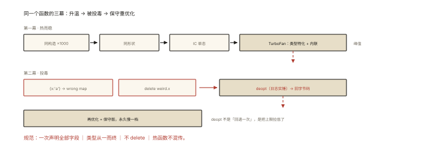

# V8 之从一段代码看优化与反优化

## 一场完整的实验（本篇是一次「侦探复盘」）

> 系列收官篇：把 v8-001/002/003 的理论装进一段代码，用引擎日志**亲眼看**优化的升起与崩塌。

```js
// experiment.js
class Vector {
  constructor(x, y) { this.x = x; this.y = y; }
  length() { return Math.sqrt(this.x ** 2 + this.y ** 2); }
}

function distance(a, b) {
  const dx = a.x - b.x, dy = a.y - b.y;
  return Math.sqrt(dx * dx + dy * dy);
}

// 第一幕：热身（稳定的形状 + 稳定的类型）
const pts = Array.from({ length: 1000 }, (_, i) => new Vector(i, i * 2));
let sink = 0;
for (let round = 0; round < 5000; round++) {
  for (const p of pts) sink += p.length();
}
console.log('第一幕完成', sink);

// 第二幕：投毒（破坏假设的调用）
distance(new Vector(1, 2), { x: 'a', y: 'b' });   // ① 形状+类型突变
const weird = new Vector(1, 2);
delete weird.x;                                    // ② 形状摧毁
for (let round = 0; round < 5000; round++) {
  for (const p of pts) sink += p.length();
}
console.log('第二幕完成', sink);
```

运行：`node --trace-opt --trace-deopt --trace-ic experiment.js`

## 第一幕：优化的升起 ⭐⭐

```
日志（节选）：
[marking … for optimization to MAGLEV, reason: hot and stable]
[completed optimizing … length]
[completed optimizing … distance]

引擎此时的三个判断（对照 v8-003）：
① Vector 全部实例同构造路径 → 共享隐藏类（v8-002）→ p.x 走 IC 单态
② length 的 this 反馈始终「形状C2 且字段是 Smi」→ 类型特化 + 内联 sqrt
③ 循环计数超阈值 → 升温：Ignition → (Maglev) → TurboFan
```

**亲手可见的加速**：优化生效前后，同样的循环耗时可以差 5~10 倍（加 `console.time` 印证）。

## 第二幕：反优化的崩塌 ⭐⭐⭐

```
日志（节选）：
[bailout (kind: deopt-soft, reason: wrong map) … distance]
   ↑ {x:'a',y:'b'} 的形状与 Vector 实例不同 —— "wrong map" = 形状不匹配 ⭐
[bailout (kind: deopt-eager, reason: field type mismatch) … length]
   ↑ delete weird.x 之后 x 字段类型/存在性反馈崩塌
[marking … for reoptimization, reason: …]
   ↑ 再次升温 —— 但这次的反馈「见过多种形状」→ 更保守的优化（较慢的版本）
```

**三种典型 deopt 理由速查**（日志里就这几个词）⭐：

| 日志理由 | 人话 | 对应坏写法 |
|---|---|---|
| wrong map | 对象形状变了 | 动态加/删属性、异构对象混传 |
| field type mismatch | 字段类型变了 | x 一会儿 number 一会儿 string |
| not a heap number / inspect type | 值类型突变 | 参数收到 undefined/null/对象 |
| deopt-soft / deopt-eager | 软反优化（可换优化版）/ 立即回退 | —— |

## 复盘：这段代码教会的四件事 ⭐⭐⭐

```
① 「热而稳」才会被优化：循环次数（热度）× 反馈一致性（稳定性）缺一不可；
② deopt 的代价不只是"回退一次"：还有「重优化成更保守版本」的永久性变慢；
   —— 第二幕后半段的 length 比 第一幕 慢，就是保守版的代价 ⭐
③ 日志是最好的老师：trace-opt/trace-deopt/trace-ic 三个开关，
   把 v8-001~003 的所有理论变成肉眼可见的事件流；
④ 「写引擎友好代码」的可操作清单落成：
   - 构造函数一次性声明全部字段（含可能为空的，初始化 null）
   - 字段类型从一而终（数字就一直是数字）
   - 不 delete（置 null/undefined）
   - 热函数不混传异构对象（TS 的结构约束在工程上就是干这个的）
```

## 延伸实验菜单（自己动手十分钟）⭐

```bash
--trace-ic            # 看内联缓存四态变化（monomorphic→polymorphic 的瞬间）
--trace-gc            # 配合 v8-005/006：看新生代/老生代的节奏与停顿
--allow-natives-syntax # %HaveSameMap / %OptimizeFunctionOnNextCall 精确控制
--print-opt-code      # 查看生成的机器码（硬核）
```

## 回看整个系列

```
v8-001 流水线:  源码→AST→字节码→（热）机器码          ← 本实验的主干
v8-002 隐藏类/IC: 形状共享让 p.x 单态直取              ← 第一幕快的原因
v8-003 JIT:      类型特化+内联+死分支                   ← 优化生效的三张牌
本篇:            wrong map / field type mismatch 崩塌   ← 第二幕慢的原因
v8-004~007:      内存分区、GC、泄漏                     ← 另一条战线
```

一个实验串起全系列——**引擎不是黑盒，它一直在日志里跟你说话**。

## 图解总结



*图 · 三幕演完，函数就永久慢了一档*

```
第一幕(热而稳):
  同构造×1000 → 同形状 → IC 单态 → 升温 → TurboFan(类型特化+内联) ⚡
第二幕(投毒):
  {x:'a'} → wrong map ─┐
  delete weird.x ──────┴─▶ deopt(日志实锤) → 回字节码
                          → 再优化 = 保守版（永久变慢一档）📉
工具: --trace-opt/--trace-deopt/--trace-ic → 理论全部可见化
规范: 一次声明全部字段 │ 类型从一而终 │ 不delete │ 热函数不混传
```

## 总结

- 实验复现了「升起—崩塌—保守重优化」的完整 JIT 生命周期；
- wrong map / field type mismatch 是形状与类型破坏的日志签名；
- deopt 的长期代价：重优化为保守版本（永久慢一档）；
- 三开关（opt/deopt/ic）把引擎理论全部可见化——这是最有效的学习方法；
- 引擎友好四规范：全字段声明、类型从一而终、不 delete、不混传。

**面试一句话回答**：用 trace-opt 与 trace-deopt 观察一段热点代码可以看到完整的 JIT 生命周期——稳定形状与类型下函数因 hot and stable 被标记并优化，日志显示 completed optimizing；一旦传入形状不同的对象或用 delete 改变对象结构，日志立刻出现 wrong map 或 field type mismatch 的 bailout，函数反优化回字节码执行，随后虽会重新优化，但因反馈里已包含多种形状，新版本明显更保守、比最初更慢。这揭示了两条工程结论：反优化不止回退一次的代价，还会导致长期降级；要写引擎友好的代码——构造函数一次性声明全部字段并保持类型从一而终、不使用 delete、避免热函数接收异构对象——并用 trace 系列开关把引擎行为可见化地验证。

## 思考题

1. 在第一幕与第二幕分别加 `console.time`，量化「保守版」与「首优化版」的差距——多次运行取中位数，报告你的数据。
2. 把 `{x:'a'}` 换成 `new Vector('a','b')`（同构造器不同值类型）——deopt 理由会变吗？（field type mismatch 而非 wrong map——两种破坏的边界）
3. `%OptimizeFunctionOnNextCall(fn)` 强制优化后再投毒——观察「立即 deopt」与「自然升温 deopt」的日志差异。
4. 开放实验：把 Vector 字段从「x、y」扩到 50 个字段（只用 2 个）——隐藏类与 IC 的行为变化？给「按需建模」一个引擎侧论据。

（思考题解析将同步录入小程序题库，关联本文 id：v8-008）

## 参考文献：

- V8 官方 — Flag 列表（--trace-* 系列）
- V8 官方博客 — Deoptimization 系列
- 本课程《v8-001/002/003》——本实验的理论底座
